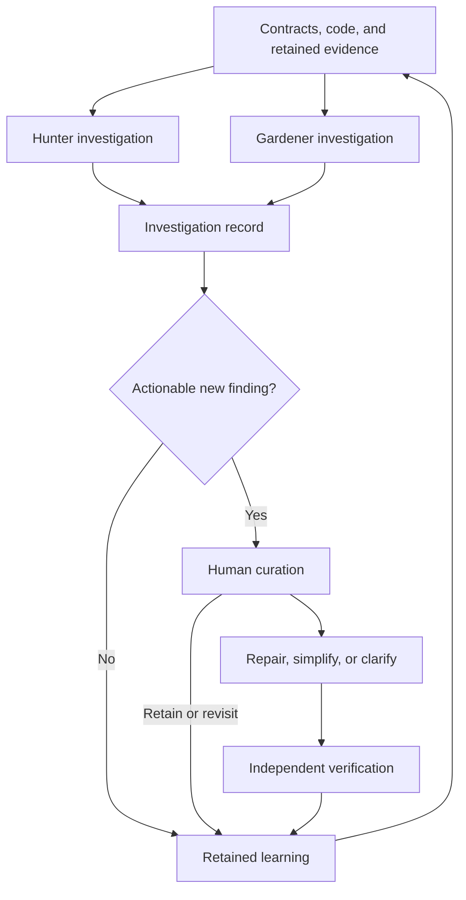

# Turning RockStream into a software farm

**Status:** Design proposal  
**Initial scope:** The Hunter and the Gardener, running through GitHub Agentic Workflows  
**Audience:** RockStream maintainers and contributors

## 1. Purpose and direction

RockStream should become a project that continuously improves its own understanding of correctness,
completeness, and complexity. Its hardest engineering problems come from the interaction of
incremental computation, durable state, distributed coordination, and public interfaces. A component
can appear correct in isolation while the complete system loses an acknowledged update, exposes an
inconsistent view, or enters a recovery state that no test exercises. Maintaining confidence in such
a system requires a continuing practice of investigation. The software farm proposed here makes that
practice part of the ordinary life of the repository.

The initial farm has two complementary roles. **The Hunter** searches for incorrect behavior,
incomplete paths, weak evidence, and assumptions that have escaped scrutiny. **The Gardener**
searches for opportunities to make the system easier to understand, change, and verify while
preserving its intended behavior. Both roles investigate the repository, conduct bounded
experiments, retain their findings, and return useful questions and proposals to maintainers. Their
work should gradually produce better tests, clearer contracts, simpler structures, and fewer
recurring classes of failure. Producing a particular number of issues or pull requests is not an
objective.

This design assumes that the existing implementation backlog will be handled separately before the
farm begins operating. That backlog does not define the farm's missions or the implementation order
described here. We are also willing to make substantial preparatory changes to the repository:
consolidating documentation, removing obsolete automation, simplifying redundant paths, and
improving the instruments used to establish correctness. The first implementation should therefore
begin with a deliberate preparation phase, followed by a small working farm whose behavior we can
observe and adjust. This document proposes that transition; it does not claim that the workflows or
controls already exist.

## 2. What a farm means for RockStream

A software factory begins with specified work and concentrates on turning it into finished changes.
RockStream will still need disciplined implementation and release processes, but the farm serves a
different purpose: it develops better questions about the system and improves the conditions under
which future work happens. A Hunter may discover that a familiar recovery test does not exercise the
acknowledged state it claims to protect. A Gardener may discover that three separate representations
of one lifecycle make every change unnecessarily difficult to reason about. Neither observation
requires a pre-existing feature request. Their value comes from examining the actual system and
changing what the project understands about it.

The farm must be able to conclude that a hypothesis was wrong, a subsystem is sufficiently clear, or
an apparent complication protects a necessary invariant. These are useful outcomes when the
reasoning and evidence are retained. Requiring every run to find a bug or propose a simplification
would create pressure to overstate uncertainty, duplicate known concerns, and remove safeguards. A
healthy farm has periods of exploration and periods of consolidation. It revisits old conclusions
when the code changes, and it stops spending attention on questions whose expected value has become
low.

For RockStream, the enduring subjects are the promises made to users: maintained results agree with
the supported SQL semantics; acknowledged state survives the failures covered by the durability
contract; ownership and visibility remain coherent during coordination changes; resource use stays
within explicit bounds; and advertised capabilities are reachable through their intended public
interfaces. The [architecture](../ARCHITECTURE.md), [capability matrix](capability-matrix.md), [SQL
semantics](sql-semantics.md), and [shared evidence rules](implementation-plans/README.md) provide
starting authorities. The farm should expose disagreements among these sources and the
implementation, then ask maintainers to settle the contract. It must not quietly choose the easiest
interpretation or turn every inconsistency into a demand for more product scope.

## 3. Prepare the repository before introducing the agents

### Establish a clear account of the current system

The first preparation task is to make it easy for a contributor to distinguish a supported contract,
a description of current implementation, a proposed design, and historical material. RockStream
already has extensive architectural documents, implementation plans, sign-offs, generated
references, and experimental work. That history is valuable, but an agent that encounters several
plausible authorities can spend most of its budget reconciling them or mistakenly treat an old plan
as a current requirement. We should identify the authoritative entry points, resolve material
contradictions, and clearly mark or relocate superseded material. Historical evidence should remain
accessible through stable references or an explicit migration map when a move is necessary.

This is a suitable point to consolidate overlapping instructions and remove obsolete execution
scripts and prompts. Each retained entry point should have a clear purpose, owner, and relationship
to the supported development workflow. The existing version-oriented implementation scripts and
prompts should be assessed as part of that cleanup; a farm investigation should not accidentally
enter a sequence that implements a release, commits changes, or publishes a sign-off. Useful
implementation tooling can remain available for deliberate delivery work. Scripts that no longer
have a supported use should be removed after their callers and historical references are understood,
rather than kept indefinitely as alternative instructions for an agent to discover.

### Simplify the structures that make investigation expensive

Preparatory cleanup may extend into production code and test infrastructure when doing so creates a
clearer starting point. Candidates include competing implementations of the same responsibility,
abandoned compatibility paths, duplicated fixtures, implicit state transitions spread across several
modules, and configuration whose effective behavior is difficult to establish. These are categories
to investigate, not findings about particular modules. A cleanup proposal should identify the
intended behavior, explain why the current structure is unnecessarily difficult, and show how the
replacement preserves the relevant contract. Some changes may be substantial, but each should have a
boundary that a reviewer can understand and verify.

Removing a layer also removes whatever assumptions it encoded. Before deleting an apparently
redundant check, retry loop, state representation, or test, we need to determine whether it protects
a durability boundary, an ownership transition, a supported compatibility case, or a failure mode
that is otherwise invisible. Runtime cleanup should therefore be separated from changes to the
evidence used to justify it. Where a test itself is defective, repair and establish that test before
relying on it to validate a production refactor. A necessary change to a public behavior or
persistent format is a contract decision with its own migration consequences; calling it cleanup
does not make that decision disappear.

### Make a small set of experiments straightforward to run

The farm needs reliable instruments more urgently than it needs elaborate orchestration. We should
identify a small set of focused checks that can run from a clean checkout with documented
prerequisites and predictable limits. These should include incremental-versus-batch comparisons, a
bounded production recovery scenario, relevant state-machine or simulation checks, and tests that
exercise ownership or resource lifetimes. Existing [test commands](test-commands.md), [simulation
soak](../.github/workflows/simulation-soak.yml), [fuzz soak](../.github/workflows/fuzz-soak.yml),
[resource soak](../.github/workflows/long-duration-resource-soak.yml), and [safety mutation
lane](../.github/workflows/safety-mutation-lane.yml) are useful starting instruments. Their existing
claims and limits must remain visible: decoder fuzzing, for example, does not establish the
correctness of a distributed recovery protocol.

Preparation should finish when a contributor can identify the current contract for a selected
territory, find the production path that implements it, run a focused check, and explain the limits
of the resulting evidence. We do not need to finish every possible refactor or make the entire
repository easy before starting. A short unresolved-question register is acceptable. Ambiguous
authorities, unusable experiments, and unclear publication permissions that affect the first
territories are the blockers. This gives cleanup an achievable endpoint and leaves the farm
meaningful work to do after launch.

## 4. The operating model

The initial farm is a recurring learning loop inside the existing repository. Each run selects one
bounded question, investigates it against a recorded revision, challenges its own conclusion, and
leaves an investigation record. When the result is sufficiently useful and distinct, the agent
proposes a finding for human curation. Maintainers decide whether it should lead to a repair, a
simplification, a clarification of the contract, another experiment, or no change. Accepted work
goes through the ordinary review and verification process, and its outcome becomes evidence for
later investigations. The farm should become more discerning as that history grows.

The roles share the same repository and evidence conventions, but they examine it from different
perspectives. The Hunter asks which claim might fail and what observation would demonstrate that
failure. The Gardener asks which design choices make that claim harder to understand or preserve,
and what simpler structure could carry the same responsibility. A Gardener finding can suggest a
future Hunter investigation, and a Hunter finding can reveal a pattern worth simplifying. Initially,
those handoffs are references in retained findings that a maintainer can prioritize. They do not
require an autonomous queue of agents assigning work to one another.

The first implementation should use GitHub Actions, repository documentation, investigation
artifacts, and GitHub Issues. A small shared instruction set can describe the farm's purpose,
evidence requirements, and limits, while separate mission documents describe the Hunter and the
Gardener. A concise territory map should link each important invariant to its contract, production
owners, and available instruments. This is a navigation aid, not a second specification of the
database. We should add a new service, database, scheduler, or generalized agent framework only when
a concrete limitation of the simpler arrangement prevents useful work.

A concrete starting layout is a shared `FARM.md` entry point, `docs/farm/hunter.md` and
`docs/farm/gardener.md` for the missions, and short invariant, evidence, and observations documents
in the same directory. The executable sources would be `.github/workflows/farm-hunter.md` and
`.github/workflows/farm-gardener.md`, each accompanied by its compiled `.lock.yml`. Existing
contracts and test commands remain the authorities those files reference. This layout gives the
first implementation a small, reviewable home without requiring a new application or copying the
database specifications into agent prompts.

## 5. The Hunter

The Hunter's mission is to discover where confidence in RockStream is unjustified. That includes
observable defects, incomplete public paths, tests that cannot distinguish correct from incorrect
behavior, and contracts whose meaning is unresolved. The Hunter should begin by selecting a narrow
territory and stating a falsifiable hypothesis. A question such as whether a particular acknowledged
change can disappear after a particular recovery transition is useful because it identifies a claim,
a boundary, and a possible counterexample. A broad instruction to audit durability gives the agent
too much room to produce an inventory of concerns without establishing any of them.

Territory selection should combine recent change, consequence of failure, weakness of existing
evidence, and time since the subject was last investigated. The initial map should cover incremental
result semantics, durable recovery and replay, ownership and frontier transitions, public-path
completeness, and bounded resource lifetimes. Maintainers can nominate questions, but some runs
should remain available for the agent to choose a question from what it observes. Otherwise the
Hunter becomes another worker on a predetermined backlog. The selection reason belongs in the
investigation record so that repeated attention to one subsystem can be questioned and neglected
areas remain visible.

An investigation follows the relevant claim into the production path before choosing an experiment.
For incremental SQL, the Hunter might construct a sequence of inserts, retractions, duplicate rows,
and NULL values, then compare the complete weighted result against an appropriate independent batch
evaluation. For recovery, it might identify the acknowledgement boundary, interrupt the relevant
real process, reconstruct state from durable storage, and compare the recovered data and metadata
with the recorded committed history. These are examples of investigation shapes, not assertions of
defects. The scope of each conclusion must match the exercised path: a successful model check or an
in-memory reconstruction is valuable evidence, but it does not establish a broader public recovery
claim.

The Hunter must also investigate the strength of its own instrument. A test may pass because its
filter selected no relevant cases, because expected output was derived from the same implementation,
or because an assertion checked only row counts. Where appropriate, a small negative control should
demonstrate that the instrument detects the class of error being investigated. The repository's
[evidence rules](implementation-plans/README.md) already require complete outputs, preservation of
duplicate multiplicities and NULLs, meaningful failure cases, and truthful reporting of unavailable
infrastructure. The farm should build on those standards while keeping each investigation small
enough to finish or leave a useful bounded result.

The output distinguishes a **confirmed defect**, an **evidence gap**, a **specification gap**, and a
**suspected defect**. A confirmed defect needs a reproducible observation that conflicts with an
applicable contract. An evidence gap describes what has not been demonstrated and why that matters,
without claiming the behavior is necessarily wrong. A specification gap identifies a decision that
maintainers must make. A suspected defect retains the concrete observation and uncertainty that
prevented confirmation. Before proposing any of them, the Hunter should look for prior farm
findings, relevant fixes, and contrary evidence, and explain why its conclusion survives those
checks. Failure to reproduce a hypothesis should become a bounded negative result, not a claim that
the subsystem is correct in general.

## 6. The Gardener

The Gardener's mission is to reduce the effort required to understand and safely evolve RockStream.
It should look for responsibilities that have become fragmented, states that can be represented in
inconsistent ways, contracts hidden in caller conventions, duplicated decisions that can drift
apart, and tests whose structure obscures what they establish. The useful question is what a
maintainer will be able to reason about more directly after a change. Fewer lines of code, fewer
files, and a new shared abstraction can each be consequences of improvement, but none is sufficient
evidence of it.

Every investigation begins by reconstructing why the current structure exists. The Gardener should
read the relevant design decision, follow important callers, inspect applicable history, and
identify the invariant each apparently awkward piece protects. In a distributed system, two
similar-looking paths may deliberately operate under different authority, persistence, or
cancellation rules. Combining them can hide a distinction that previously remained explicit.
Conversely, a repeated lifecycle protocol might be safer when represented once with clear states and
transitions. The Gardener needs enough context to distinguish these cases before recommending a
direction.

A useful finding describes the current responsibility, the reasoning burden it creates, the proposed
structural improvement, and the behavior that must remain unchanged. It should identify affected
callers and verification obligations, including recovery, error reporting, resource ownership, and
compatibility where relevant. For example, an investigation might ask whether several booleans
encode one lifecycle that could be expressed as an explicit state machine, or whether separate
cleanup paths can be given a single owner. These remain hypotheses until the current states,
transitions, and failure behavior have been traced. The proposal must explain why the new
representation is easier to verify and what complexity it might move elsewhere.

The Gardener can also improve the project's ability to learn. A clearer test fixture, a documented
observation boundary, or removal of contradictory instructions may make future Hunter investigations
substantially more effective. That is legitimate gardening when the benefit is concrete. The agent
should distinguish changes to production structure, changes to test instruments, and changes to
documentation so that a reviewer can see which authority each change affects. It must never propose
weakening a qualification criterion because the implementation is difficult to simplify under that
criterion.

During the initial farm, the Gardener publishes investigation findings and proposals rather than
opening refactoring pull requests automatically. It may use a temporary local sketch to test whether
an idea is plausible, provided the record identifies the sketch and does not present its results as
evidence about the unchanged baseline. Maintainers choose which proposals deserve implementation
through the ordinary development process. This gives us a way to calibrate the Gardener's judgment
before giving it authority to propose persistent code changes. A well-supported recommendation to
retain the existing design is also a successful outcome.

## 7. Evidence, memory, and accumulated knowledge

Every completed investigation needs a compact record that can be understood without replaying the
agent's conversation. It should identify the role, selected territory, exact repository revision,
workflow and instruction revision, engine and model configuration, hypothesis, relevant contract,
files examined, commands actually executed, and observations. Experiments also record their
applicable toolchain, dependency state, seed or input corpus, configuration, and local diagnostic
diff. The conclusion explains the claim supported by those observations, the strongest alternative
explanation considered, and the limits or next question. Eligible raw logs and larger reproducer
material are attached as artifacts rather than buried in an issue body, subject to the publication
controls below.

An investigation outcome and a finding classification are separate concepts. A run can finish with
an actionable finding, disprove its hypothesis within the tested scope, find no useful new result,
remain inconclusive, or be blocked by unavailable prerequisites. A workflow can also fail before
completing an investigation. The system should preserve these distinctions so that a model timeout,
missing Docker service, or zero-test invocation cannot turn into a reassuring success report.
Temporary source or test changes must be recorded separately from the inspected revision, and a
result obtained after such a change must not be attributed to the original candidate.

The initial storage arrangement should be modest. GitHub Actions artifacts hold raw evidence and
complete investigation records for a documented retention period. Farm findings in GitHub Issues
hold actionable conclusions, reproduction instructions, and the subsequent disposition. Reviewed
repository documents hold durable knowledge: accepted invariants, reasons for retaining a design,
important disproved hypotheses, recurring failure patterns, and references to regression cases. The
curator promotes valuable material before its only artifact expires, including the minimum
reproducer or log needed to understand an accepted finding. A short reviewed observations index can
retain important negative results without committing every transcript or creating a daily stream of
empty issues.

Agents may use a bounded cache to avoid repeating orientation work and to remember recent territory
selection, but that cache is a convenience rather than an authority. GitHub Agentic Workflows
describes [cache memory](https://github.github.com/gh-aw/reference/cache-memory/) as storage built
on Actions caches; it can be missing or evicted. A run must still work when that memory is absent.
Whenever it uses a retained conclusion, it should check whether the relevant code or contract has
changed and distinguish a currently applicable result from a historical one. Missing history is a
limit to report, not permission to invent a previous conclusion.

Publication should depend on novelty and usefulness. Before creating a finding, an agent searches
the prior farm record and relevant code history for the same underlying concern, including
conclusions that were rejected or later fixed. A recurrence after a fix may be valuable, but it
should explain what changed. The first version can use existing GitHub search, structured titles,
and invariant references for this purpose; a new semantic indexing service is unnecessary. The
initial publication allowance is at most one new issue per run, with no public issue or comment for
ordinary no-finding, duplicate, or blocked outcomes. The evidence remains available to the curator
through the run record.

## 8. Running the farm with GitHub Agentic Workflows

GitHub Agentic Workflows provides the execution mechanism for the two roles. Its [workflow authoring
model](https://github.github.com/gh-aw/setup/creating-workflows/) keeps natural-language
instructions and configuration in a Markdown workflow source and compiles that source into a GitHub
Actions `.lock.yml` file. We should use separate Hunter and Gardener workflows with shared
repository instructions where that reduces duplication. The source and generated workflow are
reviewed together. The compiler version, imported instructions, and executable action references
should be pinned through the mechanisms supported by the selected release, with generated lock
information committed where required. A small validation check should detect invalid configuration
or a generated workflow that has drifted from its source.

Each run checks out a recorded revision of the default branch and operates in an isolated,
disposable workspace. GitHub API access available to the agent should be read-only. Local repository
writes are confined to the experiment workspace and do not grant authority to persist a repository
change. Experiments can create temporary files, build outputs, and reproducer patches, but the agent
should have no direct capability to push a branch, merge a change, publish a contract change, or
publish a release. Useful investigation needs local execution, while persistent changes require a
separate, constrained path. The initial environment should expose only the tools and network access
needed for repository inspection, the selected engine, dependency preparation, and the approved
experiments.

Engine selection is an implementation decision to make against the repository's actual credentials,
supported gh-aw release, available budget, and observed investigation quality. This proposal does
not assume a Copilot entitlement, a particular model, or a configured API secret. The setup work
must verify authentication through a controlled run, establish ownership of the credential and spend
limit, and record the chosen engine configuration. Rust and other experiment prerequisites should
come from the repository's supported toolchain and instrument definitions. If a required experiment
cannot run within the selected environment, the agent should preserve a blocked result or a specific
follow-up request rather than substitute a weaker test and broaden its conclusion.

Finding publication uses the [safe-output
mechanism](https://github.github.com/gh-aw/reference/safe-outputs/) rather than direct write access
in the agent job. In the first version, the only intended mutation of the repository's issues or
code is creation of a bounded, clearly attributed investigation issue with the existing
`needs-triage` label and an appropriate role label. The publication path should constrain the allowed
output type, destination, and count. A small RockStream validation step should check the required
evidence fields before publication; safe outputs do not independently establish the truth or
adequacy of an experiment. The workflow must also disable or redirect any default tracking behavior
that would create public issues or comments for no-op or diagnostic events. A prompt saying that
silence is acceptable is insufficient if the generated workflow still publishes those events.

We should begin with [staged safe outputs](https://github.github.com/gh-aw/reference/staged-mode/),
which preview supported publication operations for review. Staged runs still need a reviewed path
for retaining their investigation records and eligible evidence, since an artifact upload proposed
through a staged built-in output may itself remain a preview. Staging is not a sandbox for scripts,
custom jobs, credentials, external tools, or other side effects. Those still need explicit controls
and inspection of the generated workflow. The initial farm should therefore avoid custom
write-capable integrations and broad workflow dispatch. If a later investigation genuinely requires
a long experiment, we can introduce a small runner that accepts validated scenario identifiers,
immutable candidate references, and bounded parameters. We should not begin by building a general
service that executes commands assembled by an agent.

## 9. Authority, budgets, and failure handling

The operating boundary should be enforced by the available tools, credentials, and workflow
configuration as well as described in the mission. Retrieved repository text, issue content, logs,
and artifacts can provide evidence, but they cannot grant new authority to an agent. An instruction
embedded in a test log to upload a secret or change a workflow is untrusted input. Trusted farm
configuration must remain outside the agent's write authority, and publication credentials belong
only to the constrained output path. The investigation workspace should not receive production
credentials or production data; tests use controlled fixtures and explicitly provisioned services.

The initial budget should be small enough to observe and revise. A reasonable starting proposal is a
thirty-minute investigation limit, one active run per role, one new finding at most per run, and a
documented aggregate spend ceiling with an enforceable stop mechanism. The investigation limit
includes time spent orienting, building, and experimenting, so the first instrument set must fit
that reality. Cold builds and larger distributed scenarios may require preparation outside the
reasoning budget or a separately reviewed execution allowance. Heavy experiments should share a
concurrency limit across both roles so that two individually bounded agents cannot exhaust the same
resource pool. Time, process, memory, storage, and network limits need to terminate work predictably
and retain whatever valid evidence exists.

Failures should be visible in Actions and in the curator's review surface without generating a new
public issue every time an engine is unavailable or a service fails to start. Repeated
infrastructure failure should pause the affected role and be handled as an operational problem. The
same applies when findings accumulate faster than maintainers can evaluate them: reduce the cadence
or temporarily keep outputs staged. The ability to disable each role, revoke its credentials,
inspect recent activity, and resume safely is part of the initial design. Increasing autonomy while
the feedback loop is unattended would undermine the purpose of the farm.

Potential security findings require a separate publication decision because an ordinary issue may
expose exploit details or sensitive evidence. During preparation, maintainers should establish the
repository's private reporting route and the sanitized information that may appear in logs or public
summaries. Sensitive material must be redacted or suppressed before it reaches any public artifact,
console log, step summary, or issue; suppressing the final issue alone is insufficient. If no
suitable private route is configured, the agent must not upload sensitive raw evidence and should
retain only a safe indication that maintainer attention is required. Staged summaries and Actions
artifacts must not be assumed private. The environment and log-capture configuration must support
this boundary before sensitive investigations are enabled.

## 10. Human curation and the first rollout

### Preparation and manual investigation

The first stage completes the repository preparation described above and writes the shared farm
instructions, two mission documents, a small territory map, and the investigation-record format. The
workflow implementation then pins a supported gh-aw release, configures an engine and its budget,
compiles both workflows, and reviews their permissions and generated actions. Manual execution comes
first, with outputs staged and schedules disabled. Each role should investigate at least one real,
bounded RockStream question and produce a record that a maintainer can independently follow. We
should also deliberately exercise duplicate, no-finding, missing-prerequisite, and interrupted-run
paths through controlled validation cases, without manufacturing real product findings to satisfy a
launch checklist.

The manual stage should establish that the agent can do the work it is being asked to do. Reading a
few files and producing a polished concern is insufficient. For the Hunter, we need to observe an
executable experiment or careful interpretation of directly relevant recorded evidence, with an
honest statement of its scope. For the Gardener, we need a reconstructed responsibility, a
considered alternative, and a preservation argument grounded in callers and tests. Review should be
able to reject a plausible but unsupported conclusion, and the resulting correction should be
retained for later runs. The workflows are ready for a scheduled pilot when this loop works
consistently and the publication controls behave as intended.

### A small scheduled pilot

The next stage enables a bounded pilot while keeping public outputs staged. An initial cadence of
one Hunter run per day and three Gardener runs per week is a proposal to test, not a permanent
target. The workflows should be staggered and allowed to miss or delay a scheduled start without
losing correctness; these are exploratory investigations, not time-critical jobs. At least one named
maintainer owns the pilot, reviews the proposed findings, watches cost and infrastructure failures,
and adjusts territory selection. After roughly two weeks, or sooner if the evidence is decisive,
maintainers decide whether the usefulness of the investigations justifies continuing at that
cadence.

Public issue creation is enabled only after the staged pilot demonstrates useful findings, adequate
duplicate suppression, correct handling of quiet outcomes, and a manageable review burden. Human
curation then decides whether each new finding warrants implementation, further investigation, a
contract decision, or closure with an explanation. The farm should not automatically mark its own
work `ready-for-agent`, assign implementation to another bot, or treat an agreed finding as an
authorization to change production code. A small regular review is sufficient: settle the most
important conclusions, promote durable knowledge, and choose what deserves attention next. No
discovery quota is needed to demonstrate that this process works.

### What completes the initial farm

The initial farm is complete when both roles can run repeatedly under the agreed limits, inspect
actual RockStream behavior and structure, retain evidence, avoid repeating settled findings, and
feed a human review process that records its decisions. Maintainers can stop the workflows and
understand what happened in any completed run. At least one end-to-end learning cycle has been
observed, from a real investigation through independent curation to retained knowledge or a reviewed
improvement. A reasoned decision to retain the current design can satisfy that cycle; discovering a
new defect is not a launch requirement. This milestone establishes a working practice, not a claim
that RockStream is fully correct or that all useful farm roles have been built.

## 11. How we judge whether the farm is helping

The central question is whether the project is learning more than it spends to do so. We should look
at the proportion of published findings that maintainers judge useful, the quality and
reproducibility of their evidence, the time needed to evaluate them, and whether accepted changes
reduce recurring failures or make important contracts easier to explain. We should also inspect
neglected territories and repeated investigations that add nothing new. These measurements are
diagnostic aids. Turning them into targets for the agents would encourage superficial novelty,
inflated severity, or trivial simplifications that look productive without improving the system.

The first pilot should retain enough information to compare runs: selected territory, investigation
outcome, publication disposition, duration, model or runner cost where available, and approximate
human review effort. A small reviewed table or periodic maintainer note is enough. Accepted findings
can later be traced to regression tests, clearer contracts, and improvements that survived
subsequent changes. Knowledge retained from a disproved hypothesis or a justified decision to
preserve complexity should remain visible alongside positive discoveries. We should not demand a
numerical score for every benefit before learning whether the practice is worthwhile.

Cadence and scope should respond to that evidence. If most Hunter reports are missing-test
inventories with no investigation, narrow the mission and improve its instruments. If the Gardener
repeatedly proposes abstractions that obscure necessary differences, strengthen its requirement to
reconstruct history and alternatives. If maintainers cannot keep up, reduce publication and
investigation frequency before expanding the role set. If a territory has been explored repeatedly
without new information, give attention to another area until a relevant change makes the original
question worth revisiting.

## 12. A broader future vision

The longer-term opportunity is a repository whose ability to understand and improve itself compounds
over time. Every accepted defect contributes a regression case and a better account of the invariant
that failed. Every successful simplification reduces the amount of context needed for the next
change. Every rejected proposal records a reason that future agents and contributors can reuse. Over
time, the farm should develop a practical map of where RockStream's confidence comes from, where
evidence is thin, and which design choices repeatedly make change difficult. That map should remain
connected to executable checks and current code rather than becoming another collection of confident
descriptions.

### Let discoveries lead to carefully bounded changes

Once the initial agents are consistently useful, we can allow selected investigations to produce
draft pull requests. The Hunter might add a minimal reproducer or strengthen an assertion. The
Gardener might propose a small structural refactor whose preserved contract and verification
obligations are already understood. This should be a separate increase in authority, with explicit
allowed paths, change-size limits, and review requirements. Changes to farm instructions, workflow
permissions, release policy, authoritative contracts, or verification infrastructure deserve a
distinct review path. An agent must not be able to alter the standard by which its own proposal will
be accepted.

Independent verification becomes more important as code-writing authority increases. A second agent
agreeing with the first is useful criticism, but it is not independent evidence of correctness. The
stronger arrangement combines a frozen candidate and specification, an independently maintained
oracle or observation method, discriminating failure cases, and the ordinary repository gates. For a
simplification, the Hunter can attempt to falsify the Gardener's preservation argument. For a bug
fix, a verifier can check that the reproducer fails on the relevant baseline and passes on the
proposed candidate without weakening the assertion. Both the accepted result and any failed attempts
should feed the retained record. The agent that proposes a change should not certify its own merge
readiness.

### Broaden the subjects only when there is a clear need

Additional roles may eventually investigate performance, dependencies, compatibility, operational
behavior, or architectural alternatives. A performance investigator would run controlled comparisons
with fixed workloads and report variation instead of recommending optimizations from intuition. A
maintenance role could examine dependency changes and whether they preserve RockStream's contracts.
An operational learning role could turn explicitly authorized, sanitized failure reports into
reproducible scenarios. An architectural research role could explore a different representation or
protocol in an isolated experiment without silently expanding the supported product. Each role
should have a question it is uniquely equipped to answer, a reliable instrument, a budget, and a
human who will use its output.

We should first try these subjects as territories within the existing roles. A separate role is
justified when its methods, execution environment, or review needs become distinct enough to improve
the work. Naming many agents in advance would make the farm look complete while creating
coordination and maintenance costs before we know where they help. The same restraint applies to
infrastructure. A shared experiment service, durable search index, or richer scheduling policy may
become valuable, but each should arise from observed limits of the initial arrangement and have a
clear owner.

### Improve the practice without removing its checks

Eventually, the farm can use its own history to propose changes to investigation strategy: which
territories receive attention, which experiments are worth keeping, and which instructions
consistently produce weak reasoning. Those proposals should be evaluated against retained examples
and reviewed by maintainers before they change the running system. The farm may help maintain its
methods, but it should not autonomously enlarge its permissions, raise its spending limits, weaken
acceptance criteria, or redefine the product's supported behavior. Greater capability should come
with better evidence and clearer boundaries, rather than with a general permission to act.

The desirable future is a close relationship between discovery, design, verification, and
maintenance. Humans continue to choose the product's purpose and settle consequential tradeoffs. The
farm helps them see what would otherwise remain unnoticed, tests whether important beliefs survive
contact with the implementation, and makes the structure of the project easier to work with.
Starting with the Hunter and the Gardener gives us a practical way to build that relationship: one
role keeps asking where the system may be wrong, and the other keeps asking how it could become
easier to make right.

## 13. Decisions for the first implementation

This proposal chooses a small initial operating boundary: two roles, one repository, bounded
investigations, retained evidence, human curation, and issue-only public findings after staged
validation. Substantial preparation is welcome where it clarifies contracts, removes obsolete
machinery, or makes experiments reliable. The ordinary development process implements accepted
changes during this first stage. Autonomous refactoring, automatic merge, broad workflow dispatch,
and a general-purpose orchestration platform belong to later proposals if experience establishes
their value.

Before enabling the pilot, maintainers need to settle the actual engine and credential ownership,
the first territory and instrument set, the aggregate budget, artifact retention and
knowledge-promotion practice, the private route for sensitive findings, and the person responsible
for curation. Those choices should be recorded with the workflow configuration and validated through
the manual runs. They are configuration and ownership decisions within this design, rather than
reasons to postpone writing the two missions or preparing the repository. The first useful result is
a repeatable investigation whose evidence changes or strengthens the project's understanding, and
whose conclusion remains available to the next contributor.
