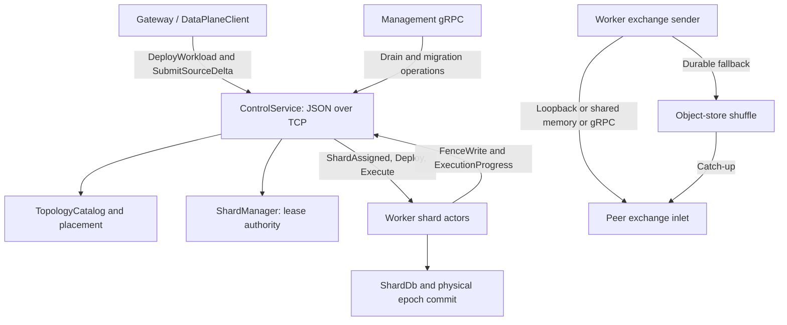

# Cluster authority, shard placement, and exchange

The key separation is **authority versus transport**, not simply “control carries metadata, workers carry rows.” `TopologyCatalog` owns the worker registry and `ShardManager` owns write leases. Workers execute and persist shard state. However, the implemented distributed workload API routes source rows through the control service as JSON execution messages; direct Arrow shuffle is a separate worker-to-worker mechanism.

*Authority and control-mediated execution are distinct from the direct shuffle payload path.*

## Three interfaces that must not be conflated

| Interface | Contract and role |
|---|---|
| Worker/control protocol | Newline-delimited `WorkerMessage` and `ControlMessage` JSON on TCP, optionally using internal TLS in the worker/control service setup. Registration, heartbeat, leases, fence checks, deployment, execution, and progress share this protocol. |
| Direct shuffle | `ShuffleService::shuffle_stream` carries Arrow IPC payload frames and returns credit acknowledgments; locality can substitute loopback, shared memory, or object-store delivery. |
| Management gRPC | `ManagementService` exposes operational actions backed by operation records and drain/migration/backup runtimes. It is not the JSON execution connection or the shuffle stream. |

`DataPlaneClient` is a short-lived client to the **control address**: `deploy`, `submit_delta`, and `read_workload` open TCP requests and decode JSON replies. Its name is not evidence of a direct gateway-to-worker RPC. It even strips `http://`/`https://` prefixes before opening ordinary `TcpStream`; do not infer TLS from those prefixes. See [security boundaries](../operations/security-boundaries.md) for deployment implications.

Sources: [control protocol](../../crates/rockstream-control/src/service.rs), [public client](../../crates/rockstream-runtime/src/data_plane.rs), [shuffle server](../../crates/rockstream-runtime/src/exchange/service.rs), [management service](../../crates/rockstream-control/src/management.rs).

## Registration, placement, and deployment

1. A worker registers its identity, address, capacity, location, capabilities, and compatibility ranges. The catalog inserts or updates the worker and increments its version. Heartbeats sample memory headroom roughly every 500 ms. `TopologyChanged` replaces the worker client's topology snapshot rather than merging individual entries.
2. Placement prefers capacity headroom and uses worker ID for deterministic ties. `choose_with_preference` can prefer the same availability zone when headroom differs by at most 0.01; `assign_n` instead sorts by descending headroom and then ascending ID. Healthy/active eligibility and compatibility checks matter independently of capacity: explicit shard requests are withheld for draining/decommissioned workers or an incompatible protocol/storage-format floor.
3. `deploy_workload` selects all healthy workers through `assign_n`, requires live control senders, and creates one descriptor per selected worker. It force-acquires leases, attaches a stable workload/shard storage identity, and sends `ShardAssigned` followed by `Deploy`. This is a concrete deployment path, not a general optimizer that dynamically chooses an arbitrary shard count.
4. On `Deploy`, the worker checks descriptor version, owner identity, and current lease token, opens storage, reconstructs schemas and the serialized plan, compiles the pipeline/sink, restores operator state, and reports `DeploymentReady`. Deployment readiness and execution status are tracked by the control service.

Sources: [catalog](../../crates/rockstream-control/src/topology.rs), [placement](../../crates/rockstream-control/src/placement.rs), [deployment routing](../../crates/rockstream-control/src/service.rs#L2043-L2188), [worker setup](../../crates/rockstream-runtime/src/client.rs#L1294-L1510).

## Source delta to durable worker progress

A `SourceDeltaRequest` must name a registered routing column for its source. Control extracts that TSV column, computes `fnv1a_64(key) % 4096`, and rendezvous-hashes the virtual bucket over the deployment's shard IDs. Missing routing metadata or columns are errors, not permission to scatter arbitrarily. Rows are grouped by shard into `RuntimeExchangeMessage` values containing workload, shard, epoch, sink operator, request ID, source, and lease token, then sent as `ControlMessage::Execute`.

Control rejects duplicate **in-flight** request IDs and waits for one progress response per routed group. An empty delta is acknowledged immediately. For nonempty requests, progress must match the descriptor's lease token and operator; control updates worker counters/frontiers and sends `SourceDeltaCommitted` once its expected response count is reached. This counting protocol is not a persistent request journal or a deduplicating set of shard acknowledgments.

Worker actors serialize frames for a shard. `execute_frame` checks deployment version, shard/operator identity, exact descriptor lease, epoch lower bound, and worker ownership, then requests `FenceWrite` validation from control. It compacts input, executes the compiled pipeline or join, checks the fence again before persistence, appends sink output and operator state to a `WriteBatch`, and commits through `PhysicalCommitGroup` before sending `ExecutionProgress`. The zero-net-input branch sends empty progress without running the pipeline or committing a new batch. Do not equate that special case with a durable epoch write.

See [Postgres requests](../workflows/postgres-requests.md) for the gateway-facing workflow and [progress and checkpoints](../concepts/progress-and-checkpoints.md) for progress beyond one request.

Sources: [routing and waiters](../../crates/rockstream-control/src/service.rs#L2113-L2298), [progress handling](../../crates/rockstream-control/src/service.rs#L3065-L3120), [execution](../../crates/rockstream-runtime/src/client.rs#L211-L390).

## Lease ownership and stale work

`ShardManager` keeps one active owner record per shard. Ordinary acquisition refuses another owner, while reacquisition by the same worker mints a new token; force acquisition evicts an owner. Tokens combine a control-leader epoch in the high 32 bits with a bounded monotonic counter in the low bits. `transfer_if_owner` changes ownership only if the complete expected lease is still current.

There are several different rejection boundaries:

- The actor registry requires **exact** token equality before accepting a JSON execution frame. Replacing an actor aborts the previous task; revocation removes and aborts it.
- Worker execution checks descriptor identity and asks control to validate the write fence before computation and again before persistence.
- The standalone `execute_durable_request` helper rejects a token **less than** the supplied active lease (`RS-3004`) and an epoch below the stored committed frontier (`RS-3011`). It does not itself fetch control authority.
- The shuffle receiver uses the committed frontier to suppress already-reflected epochs. Do not assume ordinary `ShuffleFrame` delivery performs the same ownership checks as `execute_frame`.

`fence.rs` also provides `assert_valid_writer`, a control-leader-epoch assertion, and `SelfFenceGuard`, whose default isolation deadline is 30 seconds. The guard requires its caller to tick reachability and enforce termination; its existence alone does not establish that the worker client's reconnect loop enforces that deadline.

Sources: [lease authority](../../crates/rockstream-control/src/shard.rs), [actor lifecycle](../../crates/rockstream-runtime/src/shard_actor.rs#L79-L204), [fence utilities](../../crates/rockstream-runtime/src/fence.rs), [durable request checks](../../crates/rockstream-runtime/src/exchange/persistence.rs#L125-L198).

## Exchange classification and fallback

`classify_exchange` resolves both a logical `ExchangePath` and a physical `ExchangeTransport`:

| Classification | Transport policy |
|---|---|
| `Elided` | In-process, no compression. |
| `Loopback` | In-process path, LZ4 policy; `LoopbackRouter` provides bounded local delivery. |
| Explicit `Durable` | Durable object, Zstd policy. |
| `Direct`, same host and both advertise `same_host_arrow_shm_v1` | Shared-memory fast path. |
| Other eligible `Direct` | gRPC fast path. |
| Forced durable, unreachable receiver, batch at/above direct threshold, epoch bytes above spill threshold, or cross-AZ | Durable object rather than direct delivery. |

Unknown location metadata is a fallback condition, not proof of same-host locality. Compression framing also respects peer codec capability so legacy peers can receive raw IPC. In the multiplexer, classification currently passes payload length as both batch bytes and epoch-exchange bytes and assumes receiver reachability; failed connectivity then drives fallback. Do not interpret this call site as a cumulative epoch-volume meter.

The multiplexer pools streams per peer, attempts shared memory first when selected, falls back to gRPC if that fails, and finally uploads a coalesced object at `shuffle/{exchange_id}/{epoch}/{src_worker}/{target_worker}` when fast delivery fails or durable transport was selected. A missing object store makes fallback fail (`RS-3012`). The footer indexes source shard, target shard, and sequence; `catch_up_durable` lets a receiver read persisted frames later.

Sources: [classifier](../../crates/rockstream-runtime/src/exchange/classifier.rs), [multiplexer](../../crates/rockstream-runtime/src/exchange/multiplexer.rs), [loopback](../../crates/rockstream-runtime/src/exchange/loopback.rs), [durable format](../../crates/rockstream-runtime/src/exchange/durable.rs).

## Replay identity, retention, and acknowledgment meaning

The durable request helper's identity is `(workload_id, shard_id, operator_id, epoch, request_id)`. It hashes the payload with BLAKE3: an identical identity and digest returns the cached outcome without invoking the operation; a different digest is `RS-3008`. After invoking a fresh operation, it writes the outcome and committed frontier together. **That batch does not automatically include arbitrary writes or external effects performed inside the operation closure.** Nor is this helper automatically the implementation of JSON `execute_frame`.

Successful direct gRPC, shared-memory, and loopback fast paths elide the local shuffle WAL: they do not retain a payload copy in `shuffle_outbox/` or `shuffle_inbox/`. Recovery instead depends on committed/checkpointed progress, source replay, and explicit durable fallback. The gRPC receiver suppresses frames with `epoch <= committed_frontier` when a shard database is available; this is frontier-based suppression, not a durable per-sequence inbox for uncommitted epochs.

Inbox/outbox persistence helpers remain available. Their keys distinguish exchange, peer shard, epoch, and sequence. `ExchangeRegistry::advance_cluster_frontier` triggers scan-and-delete GC through that epoch on active shard databases. This GC is for local inbox/outbox keys; it is not evidence of an object-store shuffle retention policy or request-identity GC.

A `ShuffleAck` returns row credit, not a durable sink-commit promise. The current server can warn on an unregistered target, dropped inlet, or failed decoding and still generate the frame acknowledgment. Likewise, `exchange_stream` currently constructs success acknowledgments without dispatching durable execution. Use `ExecutionProgress` after the physical commit for the implemented JSON execution completion boundary, not these transport acknowledgments.

Sources: [request identity and GC](../../crates/rockstream-runtime/src/exchange/persistence.rs), [fast-path WAL elision](../../crates/rockstream-runtime/src/exchange/multiplexer.rs#L286-L510), [receiver and ACK behavior](../../crates/rockstream-runtime/src/exchange/service.rs#L361-L501). See also [storage and replay](../concepts/storage-and-replay.md).

## Bounded work, overload, and cancellation

Two independent budgets protect different paths:

- **Shard actors:** 32 queued messages, 4 MiB encoded queued bytes, and byte/estimated-compute credits. Enqueue is nonblocking and returns unknown-shard, stale-lease, full, or closed errors. In the worker control read loop, enqueue refusal is currently logged, not converted into an explicit failure response to the source waiter. A full mailbox can therefore prevent request completion; it is not an automatic retry guarantee.
- **Shuffle flow control:** per-channel row credit and batch count plus aggregate byte and pending-request limits. Defaults are 64 in-flight batches per channel, 64 MiB aggregate bytes, 16 MiB per batch, and 256 pending requests. Worker `max_rows_per_quantum` sets the row budget. Oversized frames fail with `RS-3006` or `RS-3024`; saturation can either fail immediately through `try_acquire_batch_permit` or wait through the async acquisition path, whose waiter population is also bounded.

A flow permit returns resources on drop until handed off to a frame identity; ACK handling then releases tracked resources. This protects cancellation before handoff. Exchange teardown releases state and wakes waiters. Receiver channels and outgoing gRPC stream queues are bounded; ACK readers and shuffle receiver work support cancellation/task tracking, and multiplexer shutdown cancels tasks with a bounded wait. Do not confuse capacity backpressure with durable spill: the classifier/connectivity path selects object storage, whereas credit saturation normally waits or rejects rather than silently moving queued actor work to disk.

Sources: [actors](../../crates/rockstream-runtime/src/shard_actor.rs), [enqueue caller](../../crates/rockstream-runtime/src/client.rs#L1512-L1519), [credits](../../crates/rockstream-runtime/src/exchange/flow_control.rs), [stream lifecycle](../../crates/rockstream-runtime/src/exchange/multiplexer.rs).

## Drain, migration, reassignment, and HA boundary

Worker disconnect releases leases and invokes scheduler reassignment to surviving workers. Planned drain is more explicit: the worker revokes actors, removes deployments, flushes/closes databases, then sends `DrainAck` only on success. The control drain queue requires a healthy recipient advertising the same nonempty shared-shard-store identity, mints/persists the recipient lease, sends revocation/assignment, and waits for a matching successful recipient acknowledgment. Unconfirmed transfers are retried; zero donor leases alone is not completion.

The migration coordinator is a separate durable state machine for snapshot/copy, dual-writing, catch-up, old-owner fencing, cutover, verification/rollback, and eventual GC eligibility. Copy buffers are bounded. Cutover readiness requires a sufficient committed frontier and convergence of required observers on the target bucket-map version. These coordinator mechanisms should not be treated as proof that every deployment path automatically redistributes live workload descriptors and source routing.

Control HA is **election plus explicit persistence**, not a fully replicated execution log:

- `raft.rs` implements randomized-timeout voting and heartbeats. Term and vote are persisted as JSON; role is ephemeral. Corrupt or unreadable Raft authority state fails startup.
- `ShardPersistentStore` stores a whole lease-table snapshot at `control/shard_manager/state.json`. Supported service paths write through it, and leadership takeover lazily reloads it once per leader epoch before guarded requests. There is no cross-process replication of every in-memory acquire/release call.
- Persistence semantics differ: lease snapshot save panics on failure, but its load currently falls back to an empty snapshot on read/decode errors. Do not assume the stricter Raft-state loader applies to all control stores.
- `DataPlaneState` holds deployment descriptors and source waiters in memory. In particular, `deploy_workload` directly force-acquires leases; it does not itself run the `RequestShard` leader gate or snapshot-save sequence. An optional Raft handle and shared store do not automatically make every service branch durable or leader-gated.

The formal model and paired assertions clarify intended invariants, but do not prove deployment wiring, storage failure semantics, or end-to-end restart recovery. Validate the exact configured path. See [deployment and configuration](../operations/deployment-and-configuration.md) and [diagnostics and recovery](../operations/diagnostics-and-recovery.md).

Sources: [drain and control state](../../crates/rockstream-control/src/service.rs), [scheduler](../../crates/rockstream-control/src/scheduler.rs), [worker drain](../../crates/rockstream-runtime/src/client.rs#L1338-L1393), [migration](../../crates/rockstream-control/src/migration.rs), [election](../../crates/rockstream-control/src/raft.rs), [snapshot semantics](../../crates/rockstream-control/src/shard.rs#L377-L422).

## What the focused tests actually establish

[distributed_dataplane_process_tests.rs](../../crates/rockstream-cli/tests/distributed_dataplane_process_tests.rs) uses an in-process `InMemory` object store, directly invokes `execute_durable_request`, and simulates restart by changing an active-lease integer from 10 to 11. Its second test advances a client-pool generation and checks permit rejection. These are useful stale-lease/frontier/generation assertions, **not a multi-process control restart proof**, regardless of the file header or test names.

The [exchange service tests](../../crates/rockstream-runtime/src/exchange/service.rs) additionally exercise real local gRPC delivery, exact rows, row-credit blocking, shared-memory fallback, frontier replay suppression, and fast-path WAL absence. Keep these mechanism-level tests distinct from whole-cluster recovery evidence. The older [distributed architecture guide](../../docs/distributed-architecture.md) is useful context, but its two-path shuffle summary and bootstrap narrative should not override the current classifier and caller behavior documented here.
