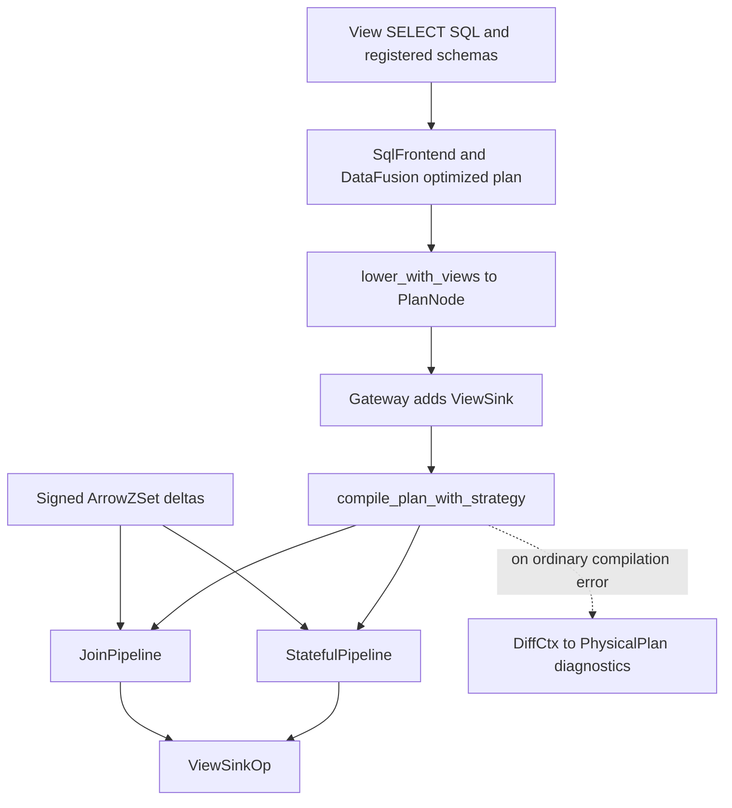

# SQL compilation and incremental execution

RockStream has **two distinct consumers of `PlanNode`**: `DiffCtx` produces a descriptive physical graph, while `rockstream_ops::compile_plan` constructs executable pipelines directly. Do not treat differentiation as a mandatory intermediate step on the gateway's compiled-view path.

This page explains the contracts contributors must preserve. For public feature coverage, consult the generated [SQL support reference](../../docs/reference/sql-support.md), [function reference](../../docs/reference/functions.md), and [SQL type matrix](../../docs/reference/sql-type-matrix.md), rather than inferring support from an enum variant or operator module. See also [system overview](system-overview.md) and [Postgres requests](../workflows/postgres-requests.md).

## Planning and executable compilation

`SqlFrontend` registers Arrow schemas as empty DataFusion tables for name and type resolution. `sql_to_plan_node` requests an **optimized** DataFusion logical plan and calls `lower_with_views`. This is important: the historical module introduction says optimization is disabled, but the current constructor and method do not do that. Lowering resolves column expressions against input schemas into zero-based indices and constructs RockStream's logical `PlanNode` tree.

The gateway's `try_compile_view` wraps that tree in `ViewSink`, using a full-row primary key, and calls `compile_plan_with_strategy` with real source schemas and the configured join strategy. Compilation requires a `ViewSink` root. Its result owns a `ViewSinkOp` and either a single-input `StatefulPipeline` or a two-input `JoinPipeline` plus the left/right source names needed for delta routing.

*The gateway's compiled-view path constructs executable operators directly; differentiation is used in an error path, not between planning and execution.*

On ordinary compilation failure, `try_compile_view` attempts `DiffCtx::differentiate` and still returns an error. Successful differentiation does **not** supply a substitute executable pipeline. Explicit factorized-strategy failures bypass that diagnostic attempt. Follow the surrounding view workflow for admission and fallback policy; a compiler rejection by itself is not evidence that every request path will execute an alternative engine.

`DiffCtx` walks the logical tree, assigns operator IDs, and emits a `PhysicalPlan` of `OpNode`s in topological order with input edges and merge-safety metadata. Linear filter/project/map rules preserve the delta structure; stateful rules describe the need for maintained state. This graph is useful for architectural reasoning, but is not the `CompiledView` object used above. [Sources: frontend](../../crates/rockstream-sql/src/frontend.rs), [lowering](../../crates/rockstream-sql/src/lower.rs), [gateway compiler entry](../../crates/rockstream-gateway/src/server.rs), [differentiation](../../crates/rockstream-diff/src/lib.rs).

### Four different meanings of “supported”

Keep these boundaries separate when adding a feature:

1. **Representation:** `PlanNode` can express a shape, including shapes not accepted by direct compilation.
2. **Implementation:** an operator may accept an internal schema or expose a low-level API without SQL lowering reaching it.
3. **Public reachability:** DataFusion planning, lowering, schema checks, and gateway admission must all reach the executable implementation.
4. **Capability tier:** correctness for bounded in-memory execution does not establish beyond-RAM, durability, or production qualification.

`rockstream-sql/src/compile.rs` is a separate operator-support and memory-budget validator, not the direct executable compiler. Its `validate_operator_support` checks estimated cardinality against a supplied memory budget and can reject large-state shapes before allocation. Do not infer that a successful validation guarantees `rockstream_ops::compile_plan` accepts that shape, or assume every caller automatically invokes this validator.

## Weighted deltas are the operator boundary

An `ArrowZSet` pairs a user-schema Arrow `RecordBatch` with one signed `i64` weight per row. Positive weights add multiplicity, negative weights retract it, and zero is a no-op. Weights are separate from data during computation; `_weight` is the serialization/I/O convention. Row/weight alignment is mandatory: `try_new` returns an error on mismatch, while `new` panics on mismatch.

A logical update is generally a retraction of the old row plus insertion of the new row, not an overwrite message. For example, changing a group sum from 10 to 15 requires `(old_result, -1)` and `(new_result, +1)` downstream. Tests should apply all emitted deltas to a multiset before comparing the result with batch evaluation; comparing only the latest positive rows misses stale results and lost retractions.

Filter, project, and map are linear stages: they can apply their transformation to incoming deltas without maintaining a relation arrangement. Aggregation and joins need state to interpret a delta relative to earlier input. The executable `Stage` enum makes that ownership explicit: stateless stages have nothing to restore or persist, whereas aggregate, distinct, window, key-packer, and other stateful stages carry state and identity. [Z-set boundary](../../crates/rockstream-ops/src/zset.rs), [stage contracts](../../crates/rockstream-ops/src/live_exec.rs).

## Representative stateful path: aggregation

The core `AggregateOp` accumulator maintains a group key's sum and count and emits an aggregate result with `Float64` average. Its current delta path validates alignment, converts supported input representations, skips null key/value rows and zero weights, and consolidates an epoch's contributions by key before constructing state transitions. In particular, do not copy the old “per input row” description as a claim that each row causes an independent persisted write.

For a contribution `(k, v, w)`, the accumulator contribution is `(v * w, w)`. A visible old group is retracted and a visible new group inserted when the result changes; removing the last member removes the result. The delta-native API also exposes state mutations and epoch metrics, allowing callers/tests to distinguish changed keys from unchanged state.

The executable compiler builds SQL aggregate shapes around this small kernel:

- `SUM`, `COUNT`, and `AVG` select the relevant result from the accumulator.
- `MIN`/`MAX` use the separate retraction-safe `MinMaxOp`, because deleting the current extremum requires access to remaining values.
- Distinct aggregation inserts a deduplication stage where needed.
- Multiple aggregates use independent lanes with a shared prefix; their results are combined through left outer joins. `AVG` carries integer sum/count through intermediate joins and finalizes to floating point afterward.
- Composite and text keys can use persisted surrogate-key packers. Packers shared across lanes or matching join keys must preserve the same mapping.

These are compiler adaptations, not proof that the kernel natively accepts every SQL type or aggregate. The current compiler supports more than its historical header's “one Int64 key and one aggregate” summary, including multiple aggregates and session-window stages, but still checks concrete shapes and types and returns `UnsupportedPlanNode` for unsupported cases. [Aggregate implementation](../../crates/rockstream-ops/src/aggregate.rs), [aggregate compilation](../../crates/rockstream-ops/src/compile.rs).

## Joins: classic deltas versus factorized aggregates

The classic inner join maintains weighted left and right arrangements. Both sides must be considered within an epoch:

`Δ(L ⋈ R) = ΔL ⋈ R₀ + L₀ ⋈ ΔR + ΔL ⋈ ΔR`

`JoinOp` stages both sides, then `commit_epoch` accounts for the cross-delta term and applies the updates. Omitting that term loses matches when both inputs change together. Arrangement entries track net row multiplicity; identity includes the operator ID, join-key bytes, and full row bytes through `stable_row_id`, making equal replayed input address the same entry. Zero net weight removes an entry.

`JoinPipeline` runs each side's preprocessing, executes one join epoch, then runs post-join stages. The compiler packs supported text columns for classic joins and shares packers across matching key columns; an internal integer join schema therefore does not imply SQL text joins are universally unreachable. Outer joins use a dedicated implementation rather than pretending inner-join delta algebra alone handles unmatched rows.

`execution.join_strategy` selects `classic`, `auto`, or `factorized` behavior. Factorization is an alternative for eligible inner-join aggregate shapes, not a universal join executor: the compiler requires a single group column and a non-distinct `SUM`/`COUNT`/`AVG` satisfying its expression and side-shape checks. Multiple aggregate lanes disable this candidate. `auto` uses the delta-amplification governor's estimate; forced factorization rejects ineligible shapes rather than silently choosing classic.

`FactorizedJoinAggregateOp` retains bounded factor payloads and exposes aggregate deltas, avoiding flattened join intermediates for this shape. Its default payload limits are 100,000 rows and 64 MiB. Strategy, probes, flattened intermediates, output deltas, state writes, and factor payload sizes are recorded by the join pipeline, so performance changes should be evaluated as work as well as output equality. [Classic join](../../crates/rockstream-ops/src/join.rs), [strategy selection](../../crates/rockstream-ops/src/compile.rs), [factorized execution](../../crates/rockstream-ops/src/factorized.rs).

## State identity, persistence, and recovery

Processing is not persistence. `StatefulPipeline::process` synchronously threads a delta through stages with an epoch counter. `persist` writes state asynchronously; `append_state` instead appends to a caller-owned `WriteBatch`. The latter contract requires `ack_persisted_state` **only after the enclosing batch commits**. `restore` loads state into already-constructed stages. A successful `process` alone is not a durable checkpoint.

IDs are part of the storage contract. The sink ID is retained in the catalog and reused during gateway recovery, so output does not move to a disconnected storage prefix. Internal IDs allocated during compilation are derived from view name plus allocation sequence through `with_view_id_scope`, independent of other views' compilation order. Reordering stateful stages or inserting an extra ID allocation can therefore change persisted addresses: treat compiler layout changes and surrogate tables as recovery-sensitive changes, not merely local refactoring. See [storage and replay](../concepts/storage-and-replay.md) and [views and schema](../workflows/views-and-schema.md).

## Arithmetic and merge-law admission

[ADR 0004](../../docs/adr/0004-merge-law-arithmetic.md) separates mathematical laws from executable domains. `WeightAdd/v1` and `SumCount/v1` use checked `i64` arithmetic. Per-row multiplication and inverses must also be representable; overflow is non-retryable, never wrapping or saturating. Negative weights and signed staging sum/count pairs are valid provisional deltas, while a materialized group requires positive count. In particular, negating `i64::MIN` is not representable.

An associative mathematical operation does not license arbitrary regrouping of checked fixed-width operations. Partial pushdown or regrouping needs executable operand admission proving an absolute-sum budget no greater than `i64::MAX`. Without concrete admission, a composable descriptor alone cannot enable the optimization; skew splitting falls back to a single spill shard. Preserve exact-width decoding and tagged-merge operand validation as well as the arithmetic kernels. Integer accumulator evidence does not automatically prove SQL null handling, decimal conversion, floating-point finalization, or query-visible progress.

## Safe changes and focused tests

Start at the caller and test the complete boundary you change, not only a new enum arm:

- **Planning:** check optimized SQL lowering and column-index/schema alignment, then direct compilation. Explicit rejection is safer than a coercion that silently changes results.
- **Aggregate deltas:** [delta-native aggregate tests](../../crates/rockstream-ops/tests/delta_native_aggregate_tests.rs) exercise dirty-key mutations, full retraction/deletion, consolidation, and bounded staging. The helper name or a matrix comment is not proof of a genuinely different Arrow type—inspect constructed arrays.
- **Join semantics:** [delta-native join tests](../../crates/rockstream-ops/tests/delta_native_join_tests.rs) and [compiled nullable outer joins](../../crates/rockstream-ops/tests/compiled_nullable_outer_join_tests.rs) cover complementary boundaries.
- **Strategy changes:** [factorized aggregate oracle tests](../../crates/rockstream-ops/tests/factorized_join_aggregate_oracle_tests.rs) compare incremental/batch behavior, classic/factorized work at fanout, and update/delete/retraction outputs. Pair them with [classic fallback shape test](../../crates/rockstream-ops/tests/factorized_plan_rejection_tests.rs).
- **Recovery:** exercise compilation twice with stable IDs, restored key packers, and durable sink identity, not only an uninterrupted in-memory run. The compiler's text-group recovery test is a useful representative.

For distributed movement rather than local operator semantics, see [cluster and exchange](cluster-and-exchange.md). For qualification scope and broader test gates, see [correctness and qualification](../testing/correctness-and-qualification.md); the [operator guide](../../docs/ivm-operators.md) provides further background, but current match arms and focused tests take precedence over historical scope notes.
