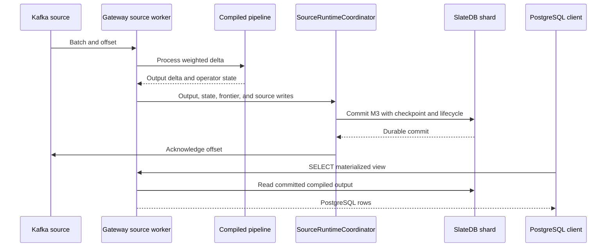

# System ownership and execution boundaries

RockStream maintains a documented SQL subset as durable incremental views. The useful architectural unit is an **ownership domain**, not a crate layer: the gateway composes SQL compilation, connectors, execution, and storage; workers compile and restore deployed plans; control coordinates ownership and progress. Cargo dependencies are not a strict ladder.

The workspace contains seventeen crates under `crates/`, plus `fuzz`. The operator-facing binary is `rockstream` from `rockstream-cli`; `rockstream-docgen` generates references. This page describes current startup and call paths, not every facility proposed in the design documents. [ARCHITECTURE.md](../../ARCHITECTURE.md) gives broader context; [capabilities.toml](../../capabilities.toml) is the support contract.

## Responsibility and state ownership

| Domain | Workspace owners | Boundary and owned state |
| --- | --- | --- |
| Shared contracts | `rockstream-types`, `rockstream-verified` | Epochs, weighted Arrow batches, identities, schemas, leases, frontiers, and selected verified arithmetic, encoding, routing, and persistence kernels. Kernel verification is not whole-database verification. |
| Compilation | `rockstream-sql`, `rockstream-plan`, `rockstream-diff` | DataFusion-based SQL analysis and lowering, logical `PlanNode`, physical `OpNode`, and differentiation rules. The gateway's live view path lowers SQL and calls the operator compiler. |
| Execution | `rockstream-ops`, `rockstream-runtime` | Stateful operators and compiled pipelines, shard actors, worker deployment lifecycle, exchange, fencing, and epoch commits. Worker-local pipeline state is restored from durable shard state. |
| Persistence | `rockstream-storage` | SlateDB-backed `ShardDb`, arrangements, durable frontier keys, checkpoints, and readers. A process holding a pipeline is not by itself the durable authority. |
| Coordination | `rockstream-control`, `rockstream-management-proto` | Worker topology, shard leases and placement, frontier aggregation, checkpoint/migration coordination, and versioned management requests. Control metadata is distinct from operator arrangements. |
| External boundaries and composition | `rockstream-gateway`, `rockstream-connectors`, `rockstream-cli` | PostgreSQL client sessions and SQL dispatch, Kafka/PostgreSQL CDC ingestion, Kafka sink delivery, configuration, node startup, and shutdown. Source checkpoints belong with committed processing state, not merely with a poll loop. |
| Validation and reference tooling | `rockstream-oracle`, `rockstream-sim`, `rockstream-test-support`, `rockstream-docgen`, `fuzz` | Batch comparison, seeded faults, service harnesses, generated references, and fuzzing rather than additional production service tiers. |

Compilation is a reusable boundary: `try_compile_view` creates a `ViewSink` around `sql_to_plan_node` and calls `compile_plan_with_strategy`. A distributed worker receives serialized `PlanNode` data, compiles it against its shard, and restores its pipeline before reporting readiness. Changing a SQL feature therefore requires checking frontend reachability, compilation, state persistence, and serving—not just adding an operator. See [Incremental SQL engine](incremental-sql-engine.md).

## How the binary composes execution

### Embedded node: `--role all`

`run_start` starts an embedded `ControlService` on loopback, connects a real worker client, and requests the shard-0 lease through the normal control path. The worker opens `<storage>/shards/0/`; the gateway receives that same shard through `start_gateway_with_shard`. It must not create an independent `gateway-shard/` database. This is shared ownership plumbing within one process, not an alternate database implementation that bypasses leases.

### Separate gateway, control, and workers

- **`gateway`:** without an embedded worker, startup opens `<storage>/gateway-shard/` and builds a `GatewayServer`. Supplying `--control` also attaches `DataPlaneClient` for distributed workload deployment and source-delta requests. Do not infer that this removes all gateway-local storage.
- **`control`:** starts topology, shard management, and frontier aggregation. Startup attaches persistent shard, topology, and migration stores. Optional Raft configuration gates leadership-sensitive operations; it is not automatically enabled by selecting the role.
- **`worker`:** requires a control address, registers, receives leases and deployment descriptors, and owns execution and persistence for its assigned shards. Deployment is refused if the descriptor version, worker identity, or lease token does not match current ownership. Before persistence, execution checks the lease fence again.
- **`frontier`:** the current startup branch constructs an in-process aggregator and emits startup audit/metrics. It should not be interpreted as a fully wired remote aggregation service merely because the role name is accepted.

The role comment beside `KNOWN_ROLES` still says non-`all` roles run the embedded node. That is stale relative to the distinct branches in `run_start`; use those branches when reasoning about process placement.

### Protocols are separate boundaries

The application interface is PostgreSQL wire protocol, normally bound to `127.0.0.1:5432` by gateway startup. Worker/control traffic uses newline-delimited JSON `WorkerMessage`/`ControlMessage` frames over TCP. The current `DataPlaneClient` also sends deployment, delta, and workload-read requests to control using that framing; it is not evidence that every live data operation bypasses control. Management has a separate tonic/gRPC service with `rockstream-management-proto` version checks. For exchange details, see [Cluster and exchange](cluster-and-exchange.md).

## One change through committed visibility

Consider a Kafka-backed materialized view that has already been compiled. The following is the local gateway-owned source path, specifically `commit_bound_source_ops`, rather than a claim that every distributed path shares the same coordinator.

*Local source-backed execution commits output, operator state, progress, and source recovery position together before acknowledging upstream.*

1. Under the shard commit lock, the gateway allocates an epoch and converts source operations into an `ArrowZSet`. Inserts have positive weights, deletes negative weights, and updates retract the old row and add the new row.
2. The compiled pipeline computes the output delta. The gateway assembles one `WriteBatch` containing source mutations, materialized output, pipeline state, and the frontier key.
3. `SourceRuntimeCoordinator::commit_backfill_epoch` validates the active source-owner lease and lifecycle/epoch consistency. It adds the committed source checkpoint, snapshot/delta fence cursor, lifecycle, and progress state to the M3 commit.
4. Only after the durable commit does it acknowledge the upstream offset. An acknowledgement failure blocks the source with `RS-4016`: the local commit already exists, so recovery must resume from the checkpoint and retry acknowledgement rather than treating the input as uncommitted.
5. The local view read path rejects unpublished backfills and reads compiled output directly from `ShardDb` when available, avoiding the lag of a separately polling `ShardReader`.

Distributed execution uses a different composition: workers append output and pipeline state to `PhysicalCommitGroup`, await the commit, and then report `ExecutionProgress`. Control validates the reported lease/operator identity and sends `SourceDeltaCommitted` after the expected reports arrive. This acknowledgement boundary must not be replaced with “frame received.”

**Read-path caveat:** query-time scatter and distributed materialized-view reads are not interchangeable. The query-time topology provider reopens every configured reader and rejects missing topology or unequal durable frontiers; CLI `--query-time-shard-dir` supplies additional local-filesystem shard roots. Separately, the distributed view branch calls `read_workload` and merges its snapshot, while the current control handler constructs shard entries with empty `deltas`. Thus the broad contract promise of globally committed results is not, by itself, proof that this particular distributed materialized-view read path returns persisted worker output. Validate the selected serving path before relying on it. See [Progress and checkpoints](../concepts/progress-and-checkpoints.md) and [PostgreSQL requests](../workflows/postgres-requests.md).

## Durability and operational boundaries

Keep three kinds of state distinct:

- **Shard data:** SlateDB arrangements, output, operator state, and committed frontiers. `ShardDb::commit_epoch` writes the frontier and flushes before returning its report; durable checkpoints include durably flushed state.
- **Shared control metadata:** `--control-shared-storage` allows another elected control process to recover lease metadata. Without shared storage, private control directories do not provide cross-process lease continuity.
- **Replica-local consensus state:** Raft term/vote state stays under that node's private `<storage>/raft`, even when shared control storage is configured. Sharing those keys between replicas risks overwriting independent votes.

Commit buffering is bounded, not an unbounded durability queue: `PhysicalCommitGroup` limits retained epochs, pending bytes, and waiters, and acknowledges complete epochs only after durable flush. The legacy `GroupCommit` coalescer is a write-only fragment API, not an equivalent completion boundary.

For deployment flags, credentials, authentication, and shutdown procedures, use [Deployment and configuration](../operations/deployment-and-configuration.md); for a minimal embedded setup, use [Quickstart](../quickstart.md).

## Shipped scope versus proposals and leftover surface

The [capability matrix](../../docs/capability-matrix.md) is generated from `capabilities.toml`: Core is release-gated, Maintain remains supported, and Experimental has no continuity guarantee. Kafka and PostgreSQL CDC sources are Core; Kafka sink is Experimental, despite implemented bounded delivery. Exact integer/decimal aggregation and integer equi-joins are Core; floating aggregation and floating joins are not equivalent support commitments. Rust operators alone do not establish SQL reachability.

[ROCKSTREAM_PROJECT_FOCUS.md](../../ROCKSTREAM_PROJECT_FOCUS.md) is explicitly a strategic proposal with a later connector-reduction amendment. Its older references to object-store and other connector paths must not be read as the current supported integration list.

- **Internal object storage is retained.** SlateDB state, checkpoints, spill, and recovery are not external object-store connectors. Removing the S3 source and object-store/lakehouse sinks did not remove the storage architecture.
- **PostgreSQL client protocol is not PostgreSQL CDC.** The former serves applications; the latter snapshots and streams changes from an external PostgreSQL source. Removing optional connectors does not remove pgwire.
- **Leftover parsing/listeners do not imply support.** Source syntax text still mentions S3/HTTP, and an optional webhook listener still binds, but the removed-connector path returns `RS-4017`; the webhook responder explicitly reports removal. Likewise, a legacy rejection message says Kafka row export is unsupported, whereas the current contract records bounded sink delivery as implemented but Experimental. Prefer the contract tier and actual dispatch over that old diagnostic wording.

Connector contracts and extension boundaries are covered in [Source ingestion](../integrations/source-ingestion.md).

## Tests that protect these boundaries

Useful focused checks include:

- `unified_data_plane_tests::role_all_creates_exactly_one_shard_directory`: launches the binary, waits for gateway readiness, checks the shard-0 manifest and absence of `gateway-shard/`, then sends SIGTERM.
- The Core semantic ledger in `capabilities.toml`: ties incremental behavior, backfill, recovery, bounded state, and failure behavior to named proofs rather than merely listing operators.
- `distributed_dataplane_process_tests`: despite its filename and introductory wording, the inspected tests simulate lease changes using an in-memory store and exercise pool-generation fencing. They are useful narrow checks, not evidence of a real control-process restart during live traffic.

These distinctions matter when changing startup, source acknowledgement order, or serving: preserve the actual ownership and durability boundary, and add a proof at the same boundary rather than relying on a similarly named helper test.
