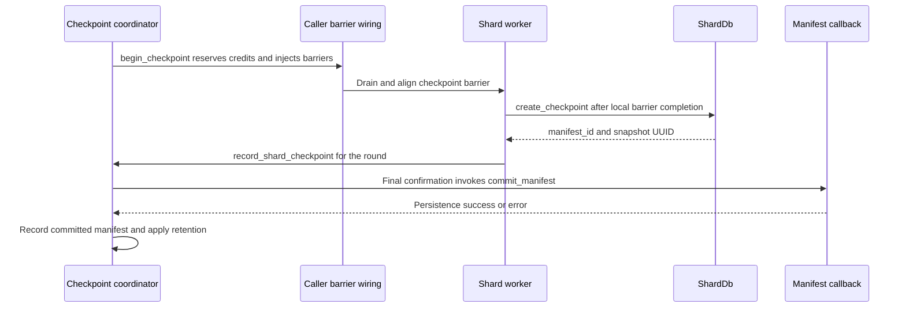

# Epochs, frontiers, and checkpoint authority

Progress is not one counter. A source owns its durable input position, a worker makes local state durable, a frontier aggregator derives completeness for a configured membership, and a checkpoint coordinator collects handles for a recoverable cluster snapshot. None of these authorities can be substituted for another merely because their values are `u64`.

## The different meanings of progress

| Value | Meaning and authority |
|---|---|
| `Epoch` | Logical ordering number (`u64`), not wall-clock time. Allocation is local to the relevant protocol: source epochs follow the recovered source registry, while direct shard writes have a checked atomic allocator. Allocation alone is not a durable commit. |
| Event time and watermark | Application-time milliseconds, separate from processing-time milliseconds and logical epochs. `SourceProgress` pairs a source epoch with an optional event-time watermark; it does not convert milliseconds into epochs. |
| Source offset | Connector-specific `OffsetToken` persisted with a source checkpoint. Snapshot cursors and live offsets are distinct; an epoch is not a Kafka offset or PostgreSQL position. |
| Shard durable progress | The frontier key in `ShardDb`. `commit_epoch` writes and flushes it before returning a report. Other production writers also update this key, so its boundary convention must be checked at the writer. |
| Cluster progress | A minimum over admitted shard progress, with membership determining whose progress counts. Local aggregation, durable publication, and a control-plane notification are different steps. |
| `CheckpointId` | A checkpoint-round sequence, not a data epoch. Zero means no checkpoint; rounds start at one and reject overflow. A manifest maps shards to SlateDB checkpoint handles. |
| `FreshnessToken` | A vector of per-source progress plus a diagnostic hash, not a cluster checkpoint or a proof of current membership. |

The type aliases are in [shared timestamp types](../../crates/rockstream-types/src/lib.rs#L105-L118). See [source ingestion](../integrations/source-ingestion.md) for connector positions and [storage and replay](storage-and-replay.md) for persistence details.

### Boundaries: do not silently reinterpret a frontier

[ADR 0005](../../docs/adr/0005-frontier-membership.md) defines membership frontier **F as covering every epoch `e < F`**, not `e <= F`. `MembershipFrontierReport.epoch` is explicitly an exclusive next epoch. The scalar `ShardFrontierReport` documentation also says “next epoch,” but production compatibility fields are not uniformly exclusive:

- `ShardDb::commit_epoch(shard, epoch)` stores and returns exactly `epoch`; it does **not** add one. A caller must supply the correct boundary.
- The worker execution path commits `frame.epoch` through `PhysicalCommitGroup`. That group persists the largest committed epoch itself as the shard frontier key, and `ExecutionProgress` reports the same frame epoch after durable commit. This is a last-committed-epoch convention, not an automatic conversion to an exclusive next epoch.
- `ClusterFrontier::has_committed_through(x)` tests `F >= x`, but its documented promise is **all epochs strictly before x**. The method name must not be read as an inclusive promise about epoch x.
- The control service sends the aggregated value unchanged in `ClusterFrontierAdvanced` (the scalar branch substitutes zero for `None`). The worker passes the received epoch unchanged to `gc_exchange_storage`, which deletes inbox/outbox entries with `epoch <= up_to_epoch`.

Thus the notification-to-GC path has an **inclusive deletion boundary**, whereas the membership protocol specifies an **exclusive completeness boundary**. An exclusive F does not by itself justify deleting epoch F. This is a concrete integration discrepancy, not a reason to redefine ADR 0005. Any change joining these paths must establish the producer convention and explicitly reconcile the boundary before reclamation. [Worker commit caller](../../crates/rockstream-runtime/src/client.rs#L343-L389), [physical persistence](../../crates/rockstream-ops/src/group_commit/physical.rs#L464-L505), and [exchange GC](../../crates/rockstream-runtime/src/exchange/persistence.rs#L328-L369) show the actual behavior.

## Source checkpoint authority

`SourceRuntimeCoordinator` is the source's checkpoint/ack authority, separate from `CheckpointCoordinator`'s cluster snapshots:

1. Recover the highest **committed** source checkpoint, ignoring prepared records, before allowing an owner to become active.
2. Issue an owner lease; replacing that owner fences older leases. Commit requires the active lease and the next admissible source epoch; exhaustion is an error rather than wraparound.
3. Prepare the source checkpoint, append its committed form and progress state to the input `WriteBatch`, and durably commit that M3 batch.
4. Update the in-memory source registry and exact committed offset, then call the connector's `commit_offset`.

Upstream acknowledgement is therefore after durable input and checkpoint state, not after epoch allocation or merely preparing a record. An acknowledgement failure can leave durable local progress ahead of upstream acknowledgement; it blocks the coordinator with a recovery diagnostic instead of undoing the durable input. The named in-flight limit is `SOURCE_RUNTIME_MAX_IN_FLIGHT_EPOCHS = 64`. See the [source runtime implementation](../../crates/rockstream-connectors/src/source_runtime.rs#L116-L143) and its [commit ordering](../../crates/rockstream-connectors/src/source_runtime.rs#L239-L309).

## Membership defines cluster completeness

### Configured members are not the reporting set

`FrontierAggregator::with_membership` starts with a scope string, `FrontierGeneration`, and active shard-to-`ShardIncarnation` map. Initially each active member has unknown progress. The meet cannot be computed until every active member has a value; an empty active set means `None`, not vacuous completeness.

`ingest_membership_report` validates envelope version, scope, generation, active shard, and incarnation. Per-member progress only advances. The public control service separately checks that the reporting connection belongs to the current shard owner, that the envelope's lease token matches, and that the shard manager still recognizes it as a valid writer. **The aggregator method alone is not a lease validator.**

These identities solve different problems:

- **Generation** identifies a membership configuration for a scope.
- **Incarnation** distinguishes assignments/restarts of a shard, so an old assignment cannot report for its successor.
- **Shard lease token** fences the reporter's write authority.
- **Publisher lease token** fences the aggregator allowed to write durable cluster publication.

Activation and replacement require a supplied durable bootstrap epoch at least as high as the current publication. Each activation, retirement, or guarded replacement increments the generation with overflow rejection. Retirement removes the member from the meet; retiring the last member clears publication. Replacement performs removal and admission together rather than opening a publication gap. The caller remains responsible for the truth of the bootstrap durability assertion; this API checks its numeric bound, not the underlying snapshot.

The compatibility constructor `FrontierAggregator::new()` instead learns its registry from scalar reports. It cannot establish authoritative membership, and configured aggregators reject those reports. In particular, retaining publication 10 while admitting a new scalar shard at 5 does not establish completeness for the expanded set—the motivating failure in ADR 0005. See [membership transitions and admission](../../crates/rockstream-control/src/frontier.rs#L276-L445).

### Local aggregation versus durable publication

Ingestion can update `cluster_frontier()` in memory. Durable publisher election is an optional, explicit wiring through `FrontierLeaseStore`, not an implied property of every aggregator.

`acquire_lease` competes using the current fence token. The lease store serializes the check and update, writes a strictly larger token and holder to SlateDB, and flushes before returning it. A stale acquisition returns an error; the aggregator treats the lost election as a normal follower outcome. On handoff it reads the synchronously persisted publication. Membership publications use scope-and-generation-specific keys so a restarted publisher does not import another configuration's value.

`try_publish` requires publisher status and a computable meet. A preflight token mismatch demotes it without publishing. The store then asserts that the token is still current, rejects retreating values, writes, and flushes before marking the publication synchronized. A race after the preflight check can reach the hard stale-publisher assertion (`RS-8002`); the flush-before-handoff assertion is `RS-8003`. These are runtime invariant failures, not ordinary backpressure.

Do not equate this optional durable path with the service reply path: the scalar service handler ingests locally, gates its reply on Raft leadership, and reads `cluster_frontier()`; it does not call `try_publish` there. See [publication mechanics](../../crates/rockstream-control/src/frontier.rs#L584-L643) and [service handling](../../crates/rockstream-control/src/service.rs#L3599-L3683).

## Cluster checkpoint contract

A checkpoint is an explicit collection of recoverable shard snapshots, not merely a frontier notification.

*The coordinator's callback contract for aligned snapshots; barrier transport and worker alignment are caller responsibilities, not implemented by the coordinator itself.*

`begin_checkpoint` reserves one alignment credit per registered shard, using a pool separate from data-exchange credits, and invokes the injection callback. The barrier contract is to drain in-flight source batches, propagate downstream, and snapshot only after local operators complete the barrier. `ShardDb::create_checkpoint` uses SlateDB `CheckpointScope::Durable`; the returned manifest ID plus snapshot UUID identifies the exact snapshot rather than mutable latest state.

The coordinator accepts confirmations only for its active round and known shards. When all pending shards have confirmed, it builds `ClusterCheckpoint`, clears the in-progress round, drops its lock, and invokes `commit_manifest`. Only callback success adds the manifest to the committed set and records completion. **Callback failure is not an in-place retryable pending round**: the round has already been removed. Persistence and retry policy belong to the caller.

The changelog variant stages a round-matched `EpochStateDelta` contribution and snapshots all contributions under the lock that observes the final confirmation. It asserts one contribution per manifest shard. `CheckpointManifestStore` supports persisting those contributions before confirmation and writes manifests at `control/checkpoints/{id}` with create-only semantics: identical existing content is accepted, conflicting content is rejected. Use `load_manifest_exact` when recovery must distinguish absence from storage/corruption errors; the convenience `load_manifest` suppresses errors.

The live `ControlMessage::CreateShardCheckpoint` handler is a **different, constrained backup entrypoint**: it checks worker identity and the exact active shard lease, rejects a shard with an active workload, creates the snapshot, and returns `ShardCheckpointAck`. Its existence is not evidence of live, flowing multi-input barrier alignment. See [worker backup handling](../../crates/rockstream-runtime/src/client.rs#L1749-L1799), [coordinator finalization](../../crates/rockstream-control/src/checkpoint.rs#L429-L542), and [manifest persistence](../../crates/rockstream-control/src/checkpoint_store.rs#L122-L218).

## Bounds, failures, and validation

- **Alignment:** defaults are 64 credits and a 60-second timeout. Partial credit acquisition is rolled back. Starting another round returns `AlignmentTimeout` even if the existing round has not yet expired; on an expired round, `begin_checkpoint` drains its held credits and clears it. This method is not a background timeout watchdog. `RS-3601` means credit exhaustion, `RS-3602` alignment timeout, and `RS-3604` checkpoint-ID exhaustion. `credits_used()` exposes fill level for `checkpoint_alignment_buffer_credits_used`; `alignment_snapshot` exposes pending/barrier-received/confirmed diagnostics.
- **Retention:** default horizon is 3, but the actual cutoff retains IDs `id >= latest - horizon`. With contiguous rounds that is the latest **plus three older checkpoints**, not exactly three total. The coordinator prunes its in-memory map; object-store manifest and changelog GC are separate explicit methods, deleting IDs strictly below the same cutoff with point deletion. Do not infer that map pruning alone releases every underlying SlateDB snapshot.
- **Frontier registry:** scalar registration has `MAX_REGISTERED_SHARDS = 100_000` and returns `RS-8001` on overflow. Membership authority/bootstrap qualification remains an external responsibility; neither a scalar report nor a diagnostic token supplies it.

### What the evidence does—and does not—establish

| Layer | Focused evidence and scope |
|---|---|
| Runtime assertions | `ShardDb` checks non-decreasing frontier values; the physical group checks monotonic durable completion. Frontier-store assertions check publisher fencing and synchronized handoff reads. They do not prove that every producer uses the same inclusive/exclusive convention. |
| Formal models | [M1](../../formal/m1_epoch_commit.fizz) models bounded two-shard atomic commits, crash/replay, duplicate no-ops, and physical group progress. [M2](../../formal/m2_frontier_agg.fizz) models two shards, two-source vectors, atomic lease/store actions, and generation/incarnation membership changes. Atomic model actions and fair progress actions are model assumptions, not a measurement of network or object-store behavior. |
| Component and integration tests | Frontier unit tests cover bootstrap rejection, stale generation/incarnation, empty membership, scalar rejection, and generation-scoped persistence. [Lease durability tests](../../crates/rockstream-control/tests/frontier_lease_tests.rs) reopen LocalFileSystem-backed stores and include Docker-gated MinIO tests for restart/flush behavior. Service tests exercise V2 connection/lease admission. Coordinator tests exercise callback collection, contribution races, credits, timeout, and retention. These tests are not an end-to-end proof of active-workload barrier alignment or of the notification-to-GC boundary. |

This page describes inspected implementation and test coverage, not a claim that those tests were executed here. Operational follow-up belongs in [diagnostics and recovery](../operations/diagnostics-and-recovery.md); transport and exchange behavior is covered by [cluster and exchange](../architecture/cluster-and-exchange.md).

## Freshness is a separate algebra

`FreshnessToken.source_progress` tracks sources independently. Meet intersects source keys and takes the lower source progress; join unions keys and takes the higher progress. Epoch comparison comes first; only equal epochs combine optional watermarks by minimum/maximum. `watermark_ms()` returns the minimum of present watermarks, ignoring absent values—it does not establish that every source has an event-time bound.

Both token operations XOR `cluster_frontier_hash`. Consequently merging a token with itself zeroes that hash: the full token is **not idempotent** and is deliberately described as `ProgressMerge`, not a mathematical lattice. Use the source progress fields for progress reasoning and the hash for diagnostics, not membership authority, deduplication, or checkpoint identity. See [freshness merge semantics](../../crates/rockstream-types/src/frontier.rs#L24-L149). Delivery-specific guarantees remain separate in [Kafka view delivery](../integrations/kafka-view-delivery.md) and [PostgreSQL requests](../workflows/postgres-requests.md).
