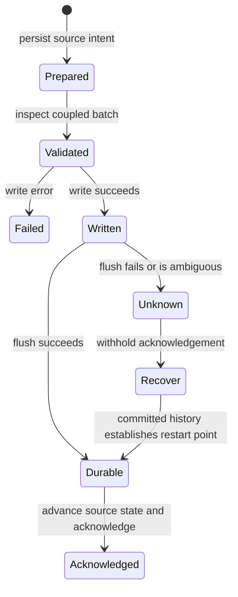

# Durable state, replay, and compaction

RockStream separates **admitting an epoch**, **making its mutations durable**, and **publishing or acknowledging progress**. A logically admissible epoch is not by itself a durable commit. The critical source boundary couples operator state, materialized-view output, a committed source checkpoint, and the shard frontier in one storage batch, then checks storage outcomes before acknowledging the source.

[ADR 0006](../../docs/adr/0006-persistence-replay-compaction.md) defines three responsibility layers: pure verified decisions, runtime adapters that supply truthful batch and I/O facts, and SlateDB/object-store contracts. The proofs are conditional on those inputs and contracts; they do not verify SlateDB internals, every adapter, cross-process fencing, Tokio scheduling, or distributed liveness.

## Ownership and durable identity

`ShardDb` is a per-shard wrapper owning a SlateDB `Db`, its path, and an `Arc<dyn ObjectStore>`. SlateDB implements the database write, WAL, manifest, checkpoint, and read machinery; RockStream supplies typed key conventions, batch construction, format checks, and application-level progress rules. Atomicity is a SlateDB batch contract—not a claim that an arbitrary collection of object-store puts forms a transaction.

The main logical keyspaces are:

| Prefix | Meaning |
| --- | --- |
| `0x01` / `OpState` | Operator arrangements and state |
| `0x02` / `OpIndex` | Secondary indexes and cached extrema |
| `0x03` / `ViewOutput` | Materialized-view output |
| `0x04` / `ShuffleInbox` | Persisted incoming exchange data |
| `0x05` / `ShuffleOutbox` | Persisted outgoing exchange data |
| `0x06` / `ShardMeta` | Frontiers, epoch metadata, and offsets |

The generic shard key layout is `[prefix:1][operator_id:8][suffix...]`; specialized arrangements add their own discriminators and identities. Catalog keys instead include a namespace immediately after the type byte. Source checkpoint keys use connector catalog identity plus a prepared/committed suffix and circular slot. Do not equate a display name, an operator-local key, a consumer `ViewId`, and a shared physical `ArrangementId`.

Shared arrangements derive `ArrangementId` from the canonical `ArrangementSpec`. Their V3 trace manifest stores that spec, the ID, a base frontier, and segment descriptors. Deserialization rejects malformed JSON, a non-V3 manifest, or an ID that disagrees with the spec hash. The arrangement catalog registers consumer views against this physical identity; reuse checks tenant and security-policy identity.

### Local and remote storage

The runtime object-store builder defaults to `LocalFileSystem` rooted at the local storage path. Setting `ROCKSTREAM_OBJECT_STORE_ENDPOINT` selects an S3-compatible store, including MinIO, and requires `ROCKSTREAM_OBJECT_STORE_BUCKET`, `ROCKSTREAM_OBJECT_STORE_ACCESS_KEY`, and `ROCKSTREAM_OBJECT_STORE_SECRET_KEY`; region defaults to `us-east-1`. Remote access uses ETag-matched conditional puts and a `PrefixStore` scoped to the supplied remote prefix. These are alternative backing stores for the same shard database abstraction, not two independently authoritative copies. A configured SlateDB disk cache is a separate local cache, not a replacement for durable backing storage.

## The coupled source commit boundary

`SourceCheckpointStore::commit_m3` inspects the actual `WriteBatch`, rather than trusting booleans supplied by its caller:

1. `CoupledBatchDescriptor::inspect` recognizes operator-state and view-output mutations by their typed prefixes (and supported textual conventions), committed source checkpoint keys, and frontier keys.
2. For a production M3 commit, `validate_for` requires all four categories. It decodes the source checkpoint, requires version 1 and committed state, checks key/value connector identity against this store, and requires the source epoch to equal the canonical frontier epoch. Malformed or conflicting identities fail before storage I/O. The builder can additionally require coupling metadata, such as a backfill cursor/lifecycle mutation.
3. `write_batch` converts all operations into one SlateDB `WriteBatch` and calls `Db::write` once. The current implementation then awaits the returned write handle's `await_durable()`.
4. Only after a successful write does `commit_m3` call `ShardDb::flush`. It supplies the observed write and flush success values, together with inspected component presence, to `coupled_commit_is_durable`.
5. The source runtime advances its in-memory source registry and committed offset only after M3 succeeds, then calls upstream `commit_offset`. M3 failure blocks the runtime without upstream acknowledgement. If upstream acknowledgement fails after M3, it also blocks and directs recovery of the checkpoint before retrying acknowledgement.

Component inspection establishes presence and selected source/frontier identities; it is not a proof that every operator value or output row is semantically correct.

*Source commit lifecycle: successful storage admission is distinct from the acknowledgement boundary, and an unknown outcome requires recovery.*

The verified `commit_outcome` classifies a failed write as `COMMIT_FAILED`, successful write plus successful flush as `COMMIT_COMMITTED`, and successful write plus unsuccessful flush as `COMMIT_UNKNOWN`. An unknown result must not be treated as rollback: durable history may already contain the commit. In particular, because `write_batch` already awaits durability, a later explicit flush failure does **not** establish that the batch was lost. Recover the stored source checkpoint and coupled state before retrying; blindly replaying an unacknowledged input risks double application.

Prepared checkpoints are separately written and flushed for the ordinary prepared-source path. `append_committed` adds the committed checkpoint and deletes its prepared slot in the caller's M3 batch. Replayable-source input can append a committed record directly: the PostgreSQL path relies on the unacknowledged logical slot as its replay log instead of a separate prepared write. `commit_raw_batch` writes and flushes without coupled-component validation and is intended for isolated administrative metadata, not as a substitute for the state/output/frontier boundary.

### Compare neighboring persistence paths by implementation

Names and comments alone are not durability evidence:

| Path | Actual storage boundary | Important limit |
| --- | --- | --- |
| Source `commit_m3` | One `write_batch` with `await_durable()`, followed by explicit `flush()` | Requires inspected state, output, source marker, and matching frontier identity |
| Exchange `execute_durable_request` | One `write_batch` with `await_durable()` for request identity and frontier | No explicit `flush()` at this call site, despite its flush comment; arbitrary `op()` runs beforehand and its effects are not automatically in this batch |
| Exchange identity/frontier and inbox/outbox helpers | Individual `ShardDb::put` calls, which await durability | Separate calls are not an atomic coupled transaction |
| Shard `commit_epoch` | Durable `put` of frontier, then explicit `flush()` | Reports progress only after both return successfully |

Exchange request identity includes workload, shard, operator, epoch, and request ID. The request helper rejects stale lease tokens and epochs below the committed frontier before checking its cached outcome. A matching payload digest reuses the outcome without running `op`; the same identity with a different digest is rejected. Thus replay is scoped and payload-sensitive, but an older request can be rejected by the frontier check before reaching the replay cache.

## Recovery: scan completion is necessary, not sufficient

The pure readiness contract requires **scan complete, metadata valid, fence matching, and all state restored**. The runtime `RecoveryDriver` adds a declared phase sequence—opening storage, recovering catalog, epoch, and operators, validating state, then ready—and tracks unique recovered shards. Its `is_ready` checks a loaded checkpoint, Ready phase, and recovered count equal to checkpoint shard count, plus attached lifecycle readiness. The adapter currently uses Ready phase for both the kernel's scan-complete and fence-match arguments: these are not independently measured validations inside `is_ready`. Callers must actually perform the required validation before transitioning phases.

For checkpoint-based shard opening, `recover_shard` verifies that the per-shard checkpoint belongs to the loaded cluster checkpoint and compares the supplied expected/current lease tokens **before I/O**. It opens the exact SlateDB checkpoint UUID when `snapshot_id` exists; without one it falls back to the latest reader. This token comparison is not itself a distributed lease-acquisition CAS. Recovery has a configurable per-shard budget, default 120 seconds; this method checks elapsed time after reader opening rather than imposing a timeout on that I/O.

### Bounded scans and their current limits

`recover_shard_paged` repeatedly calls `scan_prefix_page`, propagates storage errors, checks cancellation between pages, and counts a shard only after the true final page. Continuation is the last logical key, with an exclusive resume comparison. `ShardDb` publishes sizing constants of 1,024 restore rows and 32 MiB recovery buffer bytes, but this API accepts caller-provided limits; those constants are not automatically enforced by `scan_prefix_page`.

Two details matter when changing or operating this path:

- The byte limit stops additional rows only once the page is nonempty, so one oversized row can exceed the requested budget. A zero page size can produce a non-final empty page without a continuation token; callers must provide positive page sizes rather than assume automatic validation.
- Each page opens a new prefix iterator and skips keys through the token. This bounds the returned page, not total scan work or a single pinned multi-page snapshot. Restore needs a stable dataset; pagination alone is not snapshot isolation.

The paged recovery helper's `corrupt_` and `version_unsupported_` checks are sentinel checks on keys/values used to exercise failure handling. They are **not general detection of real backend corruption**, checksum validation, or a decoder for every operator state format. Real failures also come from SlateDB I/O, malformed format markers, incompatible supported-format ranges, and typed record/manifest decoding. Likewise, `wal.rs` utilities scan/get through the ordinary database read path; seeing a key there is not independent proof of crash durability or inspection of raw WAL records.

### Source history and replay eligibility

Source checkpoint history uses 128 circular slots per prepared/committed category, so normal point-written history is bounded rather than an ever-growing log. `highest_committed` scans the committed prefix, decodes records, and chooses the highest eligible source epoch. Version and connector mismatches cannot advance recovery; prepared records are not restart acknowledgement points, and matching duplicates are no-ops. Malformed JSON returns an error rather than being silently accepted. The bounded history assumption comes from controlled slot writes—the underlying `scan_prefix` materializes its entire matching result.

The verified replay kernel applies only committed records with matching identity and scope. It returns no-op for valid committed duplicates, rejects failed or mismatched records, and preserves a distinct unknown outcome. Epoch admission separately rejects duplicates, invalid authority, and non-increasing epochs; it supports consecutive source ordering versus strictly increasing globally allocated epochs and uses checked arithmetic to reject wraparound.

## Readers, replay horizons, and safe compaction

A durable checkpoint is an explicit handle, not just a frontier number. `create_checkpoint` uses `CheckpointScope::Durable` and returns both the manifest ID and snapshot UUID. `ShardReader::open_with_snapshot_id` uses `DbReaderMode::Checkpoint`; ordinary `open` follows the latest manifest. Reader format compatibility is also an entrypoint-specific contract: the default and snapshot reader paths accept V1–V2, while the shard writer builder defaults to V1–V3. Do not assume a writable V3 shard is readable by every default reader path.

There are three distinct meanings of compaction:

1. **In-flight epoch consolidation.** `EpochCompactor` combines signed row deltas in memory and omits net-zero updates. Its default micro-batch window is 100 ms with default bounds of 100–300 ms. This reduces work before persistence; it is not permission to delete replay history.
2. **Trace consolidation.** A shared arrangement stores a compacted base plus immutable sorted delta batches and per-view consumer frontiers. It compacts only through the slowest live consumer, or the latest batch when there are no consumers. Whole batches through that frontier are folded into the base; reads earlier than the base fail with `EpochPruned`.
3. **Deferred arrangement reclamation.** Removing the last registered consumer marks the catalog entry for reclamation, not immediate deletion. Eligibility requires zero consumers, the reclamation mark, no retained snapshot, no in-flight delta, and a compaction frontier covering both reader and replay horizons. The current catalog method passes one caller-supplied `safe_horizon` for both horizons; that caller must conservatively account for both. It removes catalog entries and returns IDs, rather than itself deleting physical object files.

Consumer registration is idempotent in the catalog, and removing an unknown consumer from an existing arrangement is a no-op. Snapshot and in-flight-delta flags must remain accurate until their users finish. Advancing a trace's consumer frontier and declaring a catalog horizon safe are separate responsibilities; neither the proof predicate nor zero reference count discovers hidden readers automatically.

## Qualification and safe changes

Tests complement, rather than extend, the verified boundary. Source epoch tests exercise missing components and mismatched identities before M3; connector LFS and MinIO durability suites exercise restart behavior on concrete stores. The gateway recovery crash-injection suite covers ordinary writes, view maintenance, checkpoints, DDL, backup, and restore boundaries. Its ordinary-write scenario explicitly flushes committed data, aborts a background server task, then opens a fresh server over local storage: this is useful restart evidence, not by itself a separate-process power-loss or SIGKILL qualification.

When changing this subsystem, preserve the one-batch identity boundary, recheck the **actual** storage calls and write-handle durability awaits, test ambiguous flush and failed acknowledgement separately, and verify recovery reaches the final page before opening readiness. Treat reader retention, source replay slots, trace consumers, snapshot pins, and physical object cleanup as coupled lifecycle responsibilities, not independent garbage-collection optimizations.

See also [Progress and checkpoints](progress-and-checkpoints.md), [Source ingestion](../integrations/source-ingestion.md), [Cluster and exchange](../architecture/cluster-and-exchange.md), [Incremental SQL engine](../architecture/incremental-sql-engine.md), [Diagnostics and recovery](../operations/diagnostics-and-recovery.md), and [Correctness and qualification](../testing/correctness-and-qualification.md).
