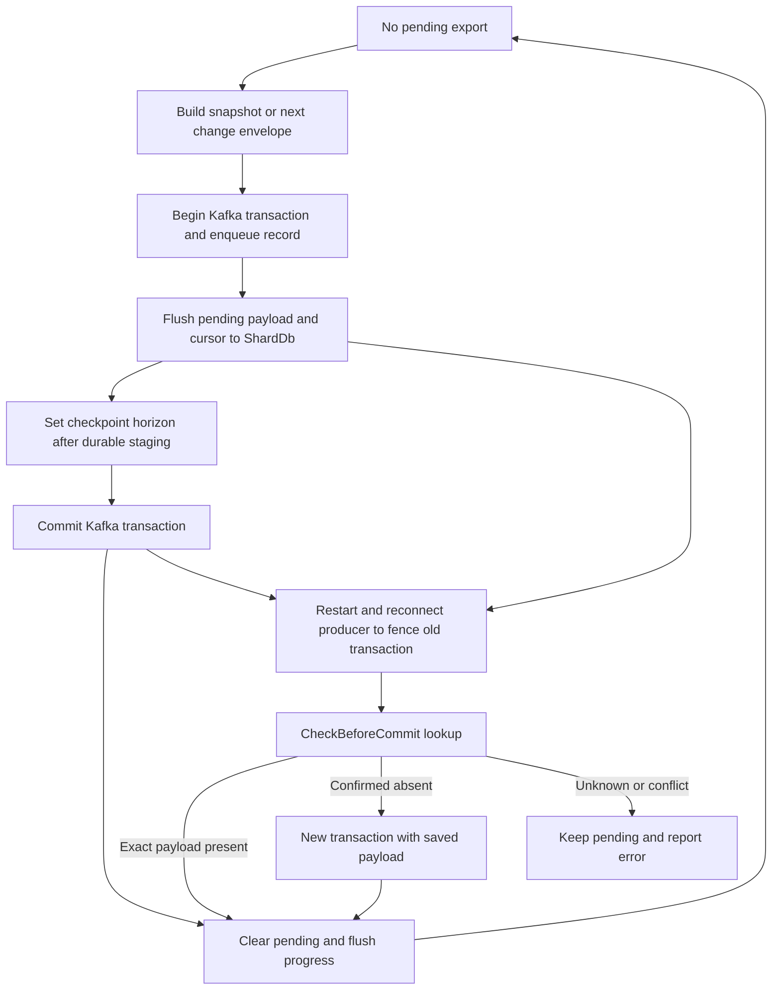

# Experimental Kafka view delivery and recovery

The retained Kafka sink is **Experimental**, with **Connector runtime** reachability—not a fully qualified Core SQL sink. It can export real typed view rows through `rockstream_ops::kafka_sink::KafkaViewSink`. Do not confuse that path with `SinkConnector::pre_commit(epoch, row_count)`, which still publishes only epoch/count markers.

## Attachment and ownership

The public `kafka_sink` module exposes `KafkaViewSink::new(connected_sink, db, view_operator_id, column_count)`. Connect with `KafkaSink::connect(connector_id, bootstrap, topic)`, attach the view's `ShardDb`, then call `deliver_next().await` until it returns `false`. That means the initial snapshot is complete and no further logged rows are available **now**, not that future changes cannot arrive. `stage_next()` is the separate staging entrypoint; it refuses another stage while durable pending work exists. SQL `CREATE SINK` does not configure this adapter.

Use one exporter owner, a dedicated topic and connector ID, an append-only, monotonically committed `ViewSinkOp` log, and a fixed schema. Preserve that log until delivery succeeds. Recreating a view or changing its schema requires a new connector ID. Stored progress rejects a changed view ID, column count, or topic; it does not compare a complete schema fingerprint.

**Stale diagnostic warning:** the CLI's removed cold-tier configuration error still says `Kafka sink row export is currently unsupported; see docs/connector-migration.md.` Its regression assertion preserves the same text. That is stale guidance, not the current capability boundary: the runtime adapter and consumer tests support bounded row export, while SQL wiring and Core qualification remain absent.

See [connector documentation](../../docs/connectors.md#kafka-sink) and the [capability declaration](../../capabilities.toml).

## What a consumer receives

The first transaction materializes all currently retained view output into one `snapshot` envelope, recording the last included view epoch. Negative materialized multiplicities fail staging. Even an empty initial view emits a snapshot with `rows: []` and `view_epoch: null`, so snapshot completion is explicit.

Subsequent transactions select rows strictly after the saved view cursor, exporting the next nonempty logged epoch at a time as `changes`. Snapshot delivery therefore precedes live changes. There is no heartbeat envelope for empty epochs.

The v1 JSON envelope has:

- `version: 1`, `connector_id`, and `view` (operator ID).
- `epoch`: the sink transaction sequence, starting at zero; this is distinct from `view_epoch`, the last included view epoch.
- `kind`: `snapshot` or `changes`.
- `rows`: entries with `values` in column order and a signed integer `weight`.

Values use explicit tags: `"Null"`, `{"Int64":1}`, `{"Utf8":"a"}`, `{"Boolean":true}`, and `{"Float64":"3ff0000000000000"}`. Float values carry 16 hexadecimal IEEE-754 bit digits, preserving NaNs and signed zero. Whole rows identify Z-set entries: an update retracts the old row with a negative weight and inserts the replacement with a positive weight in the same epoch envelope. Sum weights for identical rows to reconstruct the relation; this is not a primary-key upsert protocol.

Each envelope is **one Kafka record in one transaction**, keyed by the decimal sink epoch on **partition zero**. A `read_committed` consumer observes an atomic snapshot boundary before subsequent change envelopes. This does not make arbitrary downstream side effects exactly-once: consumers still need their own offset/state discipline.

## Staging, checkpoint coupling, and commit

*The view adapter durably stages before external commit; recovery resolves the saved transaction before advancing to another envelope.*

`pre_commit_payload` validates the envelope's connector and epoch and returns `SinkState::PreCommitted`, containing the row count and an opaque handle with **exact payload bytes, topic, connector ID, and epoch**. Staging begins a Kafka transaction and enqueues its record; this is not yet consumer-visible committed delivery.

`KafkaViewSink` saves progress under `\x06kafka-view/{connector_id}` in a `WriteBatch`, then flushes `ShardDb`. This progress includes target identity, snapshot completion, view cursor, next transaction sequence, and pending `SinkState`. The cursor has advanced inside that durable pending record, but cannot be used to skip unresolved work. After broker commit, the adapter clears pending and flushes again.

The generic 2PC contract requires the returned sink state to be persisted with the shard epoch's batch, followed by a successful cluster checkpoint before external commit. `KafkaSink::commit` asserts `cluster_committed >= epoch` and rejects already-delivered epochs via an assertion. **Do not retry `commit` blindly; use recovery.** The checkpoint coordinator separately collects shard confirmations and commits a cluster manifest.

The important integration limit is that `KafkaViewSink::deliver_next` does **not** itself wait for `CheckpointCoordinator`: after flushing its own progress it calls `set_cluster_committed` for its sink transaction sequence, then commits or recovers. Its tested durability boundary is the adapter's flushed state over an already committed view log. Do not interpret the horizon assertion as proof of an automatically wired, distributed SQL-view-to-cluster-checkpoint protocol. See [progress and checkpoints](../concepts/progress-and-checkpoints.md).

## Recovery and uncertainty

On restart, reconnect with the same connector/topic identity before resuming `deliver_next()`. `connect` uses transactional ID `rockstream-{connector_id}-{topic}`, enables idempotence and `acks=all`, and initializes transactions to fence the previous producer. Pending payload recovery validates the saved identity and envelope, then uses `CheckBeforeCommit`:

| Lookup result | Action |
| --- | --- |
| Matching connector/epoch and exact saved bytes | Treat as delivered, clear staged bookkeeping, finalize local progress without republishing. |
| Matching transaction but different bytes | `CommitFailed` conflict; retain pending state. An epoch/count marker cannot resolve a row transaction. |
| Confirmed absence | Open a new transaction, publish the exact saved envelope, and commit. |
| Setup, metadata, partition, polling, or timeout failure | `DeliveryUnknown` (`RS-4030`); do not publish and keep recovery pending. |

Lookup scans **all topic partitions from the beginning**, using `read_committed` and a five-second budget. It separately captures high watermarks with `read_uncommitted`, comparing stable offsets against those watermarks. Partition EOF proves absence only for partitions known stable through the captured high watermark; an unresolved transaction must not be mistaken for an empty topic. A full stable scan is required to confirm absence. Legacy markers lacking `connector_id` are still candidates by epoch, another reason to isolate topics.

This query-then-act protocol assumes one owner, effective producer fencing, reliable Kafka transactional visibility, retained delivery records, and no competing writer that races lookup and publish. Lost or compacted-away evidence can invalidate deduplication; a five-second scan of a large retained topic can remain unresolved. Reconnection is part of the recovery procedure, not an optional optimization. See [storage and replay](../concepts/storage-and-replay.md).

## Bounds, failures, and secrets

- **Envelope bound:** 900 KiB per snapshot or change epoch. Oversize envelopes fail without saving advanced progress; no chunked snapshot/epoch delivery exists.
- **View-read bound:** retained view output reads above 64 MiB fail closed. The exporter reads the log to build its next envelope, so a small delta does not remove this retained-log limit. Automatic log compaction is outside the adapter.
- **Staging bound:** `KAFKA_SINK_MAX_STAGED_EPOCHS=5`; `kafka_sink_staged_epochs_count()` reports fill and `backpressure_active()` becomes true at the bound. Duplicate staging or overflow returns `PreCommitFailed`. This is an admission bound, not permission to run five simultaneous transactions on one producer; the view adapter permits one durable pending transaction at a time.
- **Broker errors:** begin/enqueue failures surface as `RS-4003`; commit failures as `RS-4004`; general I/O/configuration errors as `RS-4002`. Initialization and commit use 15-second timeouts; abort and transactional offset attachment use ten seconds. A failed/uncertain commit must retain the original handle for recovery. Simulated `kafka.tx_timeout` force-aborts exercise the absent-then-republish recovery path, rather than establishing a universal production latency guarantee.
- **Secret rotation:** `bind_secret` and `set_secret_token` enforce the secret-name binding (`RS-5003` on mismatch). One queued replacement is applied at staging/commit boundaries, updating the active token ID and rotation count without a pipeline restart. **This is token bookkeeping, not demonstrated Kafka credential rotation:** the shown code does not rebuild or reconfigure the producer with that token. Constant zero restart/failed-batch accessors are not evidence of broker authentication success.

`send_offsets_to_transaction` is available on `KafkaSink` for an open transaction and requires consumer group metadata. `KafkaViewSink` does not call it: view cursor durability must not be conflated with atomic Kafka source-offset consumption.

## What is actually qualified

The [consumer row-delivery test](../../crates/rockstream-ops/tests/kafka_view_delivery_tests.rs) runs compiled view output through durable storage and a real Kafka container, comparing exact keys, typed row values, signed update/delete weights, ordered envelopes, and reconstructed final relation. It compares uninterrupted execution with restarts after staging the snapshot, update, and delete, plus broker commit before final cursor persistence. It also checks empty snapshots, oversize rejection without progress advancement, payload conflicts, and checkpoint identity mismatch. Negative controls reject wrong values, a missing deletion, duplicate changes, and count-only markers.

The [Kafka guarantee matrix tests](../../crates/rockstream-connectors/tests/kafka_sink_guarantee_matrix_tests.rs) separately exercise marker transport, interrupted/uncertain commit responses, unresolved lookup, and broker errors. Those are narrower transport/recovery proofs, not substitutes for typed row correctness. The [surface contract test](../../crates/rockstream-connectors/tests/connector_surface_contract_tests.rs) explicitly keeps the capability Experimental with no overall qualification proof.

The [M3 formal model](../../formal/m3_sink_2pc.fizz) models pre-commit, checkpoint gating, commit, and profile-dispatched crash recovery with bounded epochs/crashes. It supports protocol reasoning; it does not verify Kafka retention, credentials, real-world query-then-act races, or arbitrary downstream consumers. “Exactly-once” here means the tested bounded consumer stream under the stated storage, ownership, fencing, and Kafka assumptions—not blanket end-to-end production certification.

Related: [source ingestion](source-ingestion.md), [views and schema](../workflows/views-and-schema.md), and [correctness and qualification](../testing/correctness-and-qualification.md).
