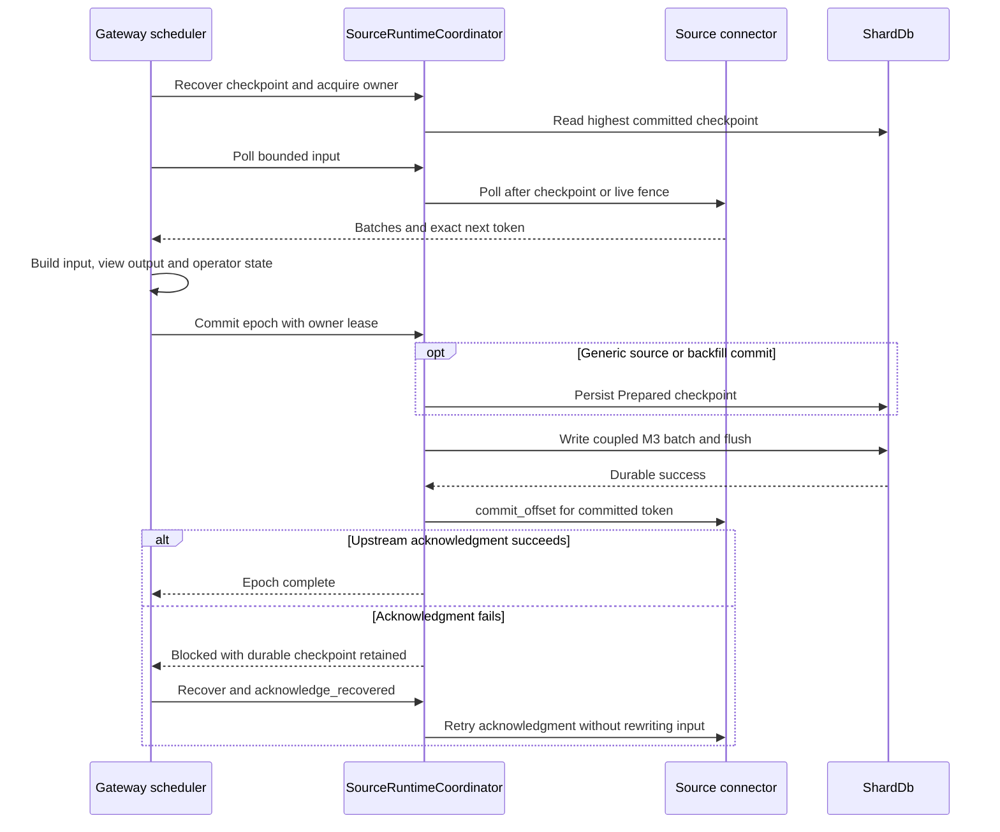

# Kafka and PostgreSQL CDC ingestion

Kafka source and PostgreSQL CDC source are **Core** capabilities. The shared guarantee is checkpoint-coupled processing: upstream progress is acknowledged only after the corresponding RockStream input and checkpoint are durably committed. This is not a blanket exactly-once guarantee for arbitrary external side effects or Kafka sink delivery; the Kafka sink is a separate **Experimental** boundary. See [Kafka view delivery](kafka-view-delivery.md).

Use the [canonical source DDL and connector settings](../../docs/connectors.md#canonical-source-ddl-contract) and the separate [Kafka settings](../../docs/connectors.md#kafka-source), rather than treating implementation constants as deployment defaults. The retained external boundaries are PostgreSQL CDC, Kafka source, and Kafka sink. Removed connector surfaces fail closed; follow the [removed-connector migration guide](../../docs/connector-migration.md), not an object-store or webhook ingestion recipe. Object storage here is internal durable state.

## Shared runtime: scheduling is not acknowledgment authority

`SourceConnector` supplies schema discovery, fence capture, snapshot batches with exact resume tokens, bounded delta polling, offset commit, and pause/resume. Tokens are opaque to the shared layer: a Kafka token is not a PostgreSQL LSN. An extension that does not implement atomic snapshot/delta fence capture fails closed when asked to backfill, rather than receiving a synthesized fence.

The gateway schedules work, converts source batches into DML and view deltas, and builds the storage batch. `SourceRuntimeCoordinator` owns the checkpoint and upstream acknowledgment boundary. Recovery reads the highest valid **Committed** checkpoint, ignoring Prepared entries, before a source owner can acquire a lease. Replacing an owner increments its runtime fence token; stale leases cannot commit or fence their successor. This is a runtime ownership fence, not a claim of a standalone distributed lease service.

*The source commit boundary is the durable coupled M3 write, not successful polling or an upstream acknowledgment.*

Generic commits first persist a Prepared checkpoint, then put the Committed checkpoint into the caller's M3 batch. Backfill commits also include the fence cursor and lifecycle. `commit_m3` checks the required state, output, source marker, and frontier components and requires both write and flush success. The replayable PostgreSQL transaction path deliberately omits a separate Prepared write: the unacknowledged logical slot is its replay log, and it permits only one unacknowledged M3 epoch.

A write/flush error must not be interpreted as proof that nothing persisted. Treat that window as **outcome unknown**: stop advancement, recover the committed checkpoint, and decide replay from durable state. If M3 succeeded but upstream acknowledgment failed, `RS-4016` retains the committed token; `acknowledge_recovered` retries only the acknowledgment. It does not reapply input. The coordinator records a blocked reason on commit failures; callers must stop scheduling and recover rather than assume every low-level poll entrypoint independently enforces the blocked state.

See [progress and checkpoints](../concepts/progress-and-checkpoints.md) and [storage and replay](../concepts/storage-and-replay.md) for the wider durability model.

### Snapshot-to-delta fencing and publication

A `SnapshotDeltaFence` keeps snapshot completion and live replay positions separate. In the gateway's generic source-backed backfill flow:

1. Recover the lifecycle, or capture and durably record an initial `Snapshotting` intent before consuming rows. Even an interrupted empty snapshot is resumable without advancing the source checkpoint.
2. Read bounded snapshot chunks and commit their exact resume cursor together with state and output.
3. Enter `CatchingUp`, polling from the captured **live** fence, not from the last snapshot key. Reject a live-delta batch exceeding the backfill byte bound.
4. Commit `Running` with a published frontier before marking the view published in the catalog.

Lifecycle and cursor validation reject mismatched epochs or publication state. The gateway owns these phase transitions; the runtime makes their durable records atomic with source progress. PostgreSQL's shared-slot attachment path additionally supports publishing a new attachment at the current checkpoint without advancing or acknowledging the upstream slot. See [views and schema](../workflows/views-and-schema.md).

## Kafka source contract

### Backfill and offset vectors

Kafka has **no separate table snapshot** in `KafkaSource`: `start_snapshot` returns an empty stream. Historical ingestion is replay of retained partition records through `poll_delta`, according to the configured starting-offset policy. Fence capture uses the last polled token, otherwise the last committed token, otherwise a zero vector for the currently assigned partitions; it does not capture broker high watermarks as a finite historical snapshot.

The JSON offset token maps partition IDs to **next offsets**. Accepting record offset `n` advances that partition to `n + 1`; a scalar maximum would lose independent partition progress. Polling refreshes assignments, seeks recovery positions, rejects records from revoked partitions, and suppresses replay below the supplied durable-next offset. `commit_offset` synchronously commits that vector to the consumer group; automatic commits are disabled. A broker commit failure retains a retryable epoch/token pair.

### Bounds, identity, and schema failures

Polling is bounded by caller credits, caller bytes, and connector epoch record/byte limits. Zero credits or bytes returns no batches and preserves the supplied token. A record that would overflow the byte budget is retained as a pending record; one record larger than an empty poll budget produces an explicit error instead of silently advancing its offset. Transport pause/resume operates on assigned rdkafka partitions. `last_poll_fill_level` measures the pending-record slot, not total broker backlog.

`KafkaSourceIdentityV1::validate_incarnation` checks stored cluster identity, optional topic UUID when both sides provide it, partition count, and stored offsets against broker earliest/latest bounds. Cluster replacement, topic recreation, and offsets outside retention bounds block with `RS-4015`; partition-count reduction uses `RS-4017` in this validator. Expansion is not rejected by that check. This validator is an identity-check contract, not evidence that every poll automatically fetches and validates all incarnation metadata.

Invalid tokens fail closed. Schema validation and poison-record helpers distinguish blocking from bounded DLQ handling; neither is permission to acknowledge an uncommitted poll. For operational errors, prefer the precise diagnostic and recovery action over assuming a code has only one meaning across all connector paths.

## PostgreSQL CDC contract

### Source identity and shared-slot routing

`SourceIdentityV1` identifies a source by canonical host, port, database, slot, publication, authentication principal, and credential reference. Its durable registration stores the complete identity preimage and a separate physical-slot binding. A hash collision with a different preimage or an attempt to bind the same physical slot to a different identity fails with `RS-4013`.

`SharedPgOutputCoordinator` is source-scoped: aliases and imported relations share one runtime, slot owner, transaction buffer, and relation-route catalog. Rows require an active transaction envelope and a known route, or an explicit unrouted-relation designation. Changes carry relation and schema versions. Transaction buffering is bounded and can spill; it is not an unbounded queue.

At PostgreSQL commit, the gateway assembles one M3 batch containing imported-table changes, affected view output and operator state, relation/schema updates, the shard frontier, and lifecycle cursors for active attached views. `commit_replayable_epoch` couples this to the transaction's commit LSN and only then acknowledges the slot. This makes cross-table routing within that envelope one durable visibility unit, not independent per-table offset commits.

### Snapshot and LSN stages

The native source-wide snapshot reads imported relations and metadata inside one repeatable-read, read-only transaction with a captured WAL LSN. That fence anchors later delta replay. Do not equate it with Kafka's empty snapshot interface, or infer a general concurrent-snapshot proof solely from the sequential fence test.

CDC distinguishes four progress stages:

| Stage | Meaning |
| --- | --- |
| `received_lsn` | Stream input received |
| `applied_lsn` | Input decoded/applied to buffering |
| `durable_lsn` | Corresponding committed durable progress |
| `published_frontier` | Published query-visible progress |

The acknowledgment invariant is **`confirmed_flush_lsn <= durable_lsn`**. The inspected native implementation peeks logical changes for reading and advances the slot through `pg_logical_slot_get_binary_changes` in `commit_offset`; it is not simply a conventional continuously streaming standby-status loop. The runtime's post-M3 call is what grants acknowledgment authority. In-memory quad-LSN bookkeeping must not be confused with the authoritative durable checkpoint.

### Relation changes and recovery

Route classification accepts unchanged schemas, lossless supported widening, and appended nullable or defaulted columns. Dropped columns, renames/reordering, key or replica-identity changes, and narrowing/incompatible types are breaking changes. The shared gateway path persists blocked relation metadata with the last safe LSN and a rebuild procedure, then reports `RS-1002` and blocks the pgoutput source. Do **not** assume unaffected relations can keep advancing this shared slot past a blocked transaction merely because generic connector documentation describes relation isolation.

CDC queues, transaction bytes, and WAL lag have explicit bounds. Whole queued transactions are not split merely to satisfy poll credits: a transaction too large for an empty poll budget returns `RS-4014`. Slot invalidation or publication loss enters `Blocked`; explicit resnapshot transitions are bounded by an attempt limit. Existing-checkpoint recovery does not silently recreate a missing slot and pretend continuity. Restore the required upstream state or perform the prescribed resnapshot/rebuild; retained WAL is part of the replay contract.

See [diagnostics and recovery](../operations/diagnostics-and-recovery.md) and [security boundaries](../operations/security-boundaries.md) before changing credentials, identity, or upstream retention.

## What the tests actually establish

Capability tiers come from [capabilities.toml](../../capabilities.toml), but test names are not broader fault-injection proofs:

- The [Kafka guarantee matrix](../../crates/rockstream-connectors/tests/kafka_source_guarantee_matrix_tests.rs) test named `kafka_source_mid_epoch_rebalance_recovers_exact_transcript` polls two assigned partitions, asserts the exact sorted transcript `(10, +1), (20, +1)`, commits, and checks two assigned partitions. Its body does **not** force a rebalance. The offset-recovery test recreates the consumer and checks that only the later record is emitted with next offset `2`.
- The [CDC matrix](../../crates/rockstream-connectors/tests/postgres_cdc_guarantee_matrix_tests.rs) fence test reads snapshot row `1`, then inserts and reads delta row `2`, commits it, and checks an empty subsequent poll. Several other cells exercise synthetic frames or explicit status transitions: the commit-boundary cell loops commits without restarting the source, and slot-loss recovery explicitly marks failure and completes resnapshot. These are useful narrow assertions, not exhaustive crash or upstream-fault campaigns.
- The [MinIO durability tests](../../crates/rockstream-connectors/tests/source_durability_minio_tests.rs) check Prepared exclusion, committed checkpoint recovery, and output/cursor/checkpoint/frontier coupling. The suite includes reopen and retained-source transcript checks; it can skip when Docker or MinIO is unavailable. A test present in the tree is not evidence it ran in a particular environment.

The safe scope of “exactly once” is therefore the retained source token plus the atomically committed RockStream effects, under the relevant identity, ownership, and replay-retention conditions—not all possible external delivery or failure scenarios.
