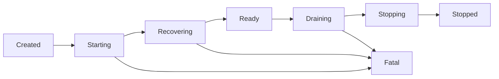

# Configuration and node lifecycle

Safe deployment changes require tracing **three separate things**: the resolved configuration, the values actually passed to live services, and the evidence that a running owner has applied them. A successful parse, a ready process, or an accepted catalog mutation does not establish all three.

Use the canonical [CLI reference](../../docs/reference/cli.md) and [configuration reference](../../docs/reference/configuration.md) for the option/key catalog. The [deployment profiles](../../docs/deployment-profiles.md), [lifecycle guide](../../docs/lifecycle.md), and [rolling-upgrade guide](../../docs/rolling-upgrades.md) describe operational recipes; the implementation boundaries below matter when interpreting their stronger guarantees. For initial use, see [Quickstart](../quickstart.md).

## Configuration resolution and its limits

`ConfigResolver` resolves both the legacy `RockstreamConfig` and newer `NodeConfig`, retaining a dotted-key origin map and diagnostics. The order, from lowest to highest priority, is:

1. Compiled defaults.
2. One configuration file: an explicitly supplied resolver path, otherwise `ROCKSTREAM_CONFIG`, otherwise `./rockstream.toml` when present.
3. Recognized environment overrides, primarily `ROCKSTREAM__<SECTION>__<KEY>`.
4. Supplied `CliConfigOverrides`.

An explicitly supplied missing file is an error. In the resolver, a missing path selected only through `ROCKSTREAM_CONFIG` is skipped; this differs from `config validate`, which rejects a selected missing file. Relative `NodeConfig.storage.url` file paths are resolved against the configuration file's parent. Canonical and legacy origins are synchronized for mapped keys. Environment handling is an explicit mapping, not automatic support for every arbitrary dotted key; there is also a compatibility override `ROCKSTREAM_WORKER_EXECUTION_THREADS`. See the [resolver](../../crates/rockstream-types/src/config_resolver.rs).

### Validate before interpreting effective output

`config validate` checks TOML syntax, unknown/deprecated keys and suggestions, semantic bounds, and optionally referenced file accessibility with `--check-files`. Its runner fails when the report is invalid; the current `_strict` argument is not used. This validates the selected file, not the entire environment/CLI-merged process configuration.

By contrast, resolution collects file and final semantic diagnostics but can still return `Ok(ResolvedConfig)`. The `start` dispatch currently extracts only `config` and `node_config`, discarding those diagnostics. **Do not treat successful startup resolution as equivalent to successful validation.** Invalid files can fail to load while leaving defaults in place. These differences are visible in the [validation runner and effective renderer](../../crates/rockstream-cli/src/lib.rs#L2543-L2641) and [resolution path](../../crates/rockstream-types/src/config_resolver.rs#L185-L268).

`config print-effective` exposes values and, in text mode with origins enabled, comments identifying default, file, environment, or CLI provenance. Its text renderer redacts the auth secret path and gateway key paths containing `secret` or `private`; this is selective path redaction, not a general secret-scrubbing guarantee. The JSON branch serializes `ResolvedConfig` directly rather than using those redacted copies. Treat effective output as potentially sensitive and review it before attaching it to tickets. See [rendering and redaction](../../crates/rockstream-types/src/config_resolver.rs#L102-L179).

### Where values become effective

The executable's [start dispatch](../../crates/rockstream-cli/src/main.rs#L282-L400) is a critical boundary:

- It calls `ConfigResolver::resolve(None, ...)`, so its file discovery uses the environment/current-directory path rather than an explicit resolver file argument.
- Clap's role, listen, and auth defaults are passed as `Some(...)` CLI overrides, even when the operator did not explicitly type them. `--storage` is required. Do not assume absent flags always leave file values authoritative.
- `StartOptions` receives several fields directly from parsed arguments: role, storage, control URL, auth, metrics/listen addresses, worker ID, control bind, and shared-storage directory. It does **not** consistently read those fields back from the resolved `NodeConfig`. A file/environment value appearing in effective output therefore does not prove that the corresponding live listener or registration uses it.
- Other values do reach live consumers: worker-role Tokio thread count comes from `config.worker.execution_threads`; the gateway receives the configured join strategy and webhook address; typed control management receives the `NodeConfig` snapshot; shutdown uses the explicit timeout or legacy cluster timeout.

When adding a key, follow it through defaults, validation, environment/CLI mapping, canonical/legacy conversion, and finally the owning service constructor. Do not stop at serialization or origin tracking. Authentication and TLS wiring also require the separate [Security boundaries](security-boundaries.md) review.

Runtime workload policy is another distinct surface. `workload_application_status` reports requested revision, actual gateway-local budget limit/usage, and a **NULL worker-effective revision**. Assigned views report `worker_ack_unavailable`; catalog revision must not be interpreted as acknowledged remote worker application. See the [application-status implementation](../../crates/rockstream-gateway/src/catalog_stubs.rs#L3129-L3170).

## What `run_start` actually runs

The [live entry point](../../crates/rockstream-cli/src/lib.rs#L588-L1180) validates role, platform, removed cold-tier settings, auth mode, and worker/frontier control-URL requirements. It pre-parses SQL, metrics, and typed-management addresses before creating the storage directory and audit log. Listener conflicts and storage initialization can still fail later.

| Role | Live composition and persistence | What keeps the process alive |
| --- | --- | --- |
| `all` | Starts an embedded control service on an ephemeral loopback address, connects a worker, requests shard 0 through the normal lease flow, and attempts to share that opened shard with the gateway. | A configured SQL listen address enables gateway serving. Without it, the background branch is short-lived unless daemon mode is set. |
| `control` | Starts topology/shard management and frontier aggregation, persistent shard/topology/migration stores, and optional Raft gating. | `--daemon` is needed for the normal long-running control process. |
| `worker` | Connects to control with locality/capability metadata; its client loop performs registration and handles assignments. Requires a control URL. | Workers automatically use the signal-waiting daemon branch. |
| `gateway` | Opens its own `gateway-shard` database. A control URL additionally enables the distributed data-plane client. | Serves only when `listen_addr` is present. |
| `frontier` | Requires a control URL, but this branch only constructs a local aggregator, emits an audit event, and logs fill level. It does not establish a remote subscription here. | Background branch: short-lived unless daemon mode is set. |

**Library defaults and executable defaults differ.** `StartOptions::default()` has no listener, making direct library calls suitable for no-op/test runs. The CLI supplies `Some(listen)` from its defaulted argument. Without live gateway serving, non-daemon background execution normally sleeps briefly and then tears down. `ROCKSTREAM_E2E_SLEEP_MS` can bound even otherwise long-lived branches for tests; it must not be mistaken for normal production lifetime.

Worker connection attempts are bounded and retried before startup fails. The returned worker task sends registration asynchronously with proposed identity, memory headroom, location, capabilities, and protocol/storage compatibility ranges; merely establishing the TCP connection is not the same as registration acceptance. In `all`, startup polls for registration and shard opening. If no shared shard is obtained, the gateway branch falls back to its independent shard-opening path rather than making shared ownership an unconditional invariant. See [worker setup](../../crates/rockstream-cli/src/lib.rs#L950-L1059) and [registration](../../crates/rockstream-runtime/src/client.rs#L1239-L1262). For ownership and exchange details, see [Cluster and exchange](../architecture/cluster-and-exchange.md).

### Storage and control-plane durability

The shard backend is selected by [build_runtime_object_store](../../crates/rockstream-storage/src/tiered_store.rs#L388-L434), used by the gateway and shared shard path. Local filesystem is the default. `ROCKSTREAM_OBJECT_STORE_ENDPOINT` switches this path to S3-compatible storage, requiring bucket, access key, and secret key, with an optional region and a bounded shard prefix. These single-underscore environment variables are a separate backend contract from the configuration resolver. A displayed `storage.url` alone is not proof of this backend selection.

Control persistence uses a local filesystem object-store wrapper rooted at `--control-shared-storage`, or its fallback under private storage. With Raft peers supplied, node ID and peer bind are required and the control service is attached to Raft. Without peers, it runs without that gating. **Raft term/vote storage remains private under each node's storage directory**, even when the control stores share a directory; sharing vote state would violate replica-local durability. Configure genuinely shared visibility for cross-process control-store continuity rather than assuming matching path strings provide it. See [control startup](../../crates/rockstream-cli/src/lib.rs#L808-L947).

## Readiness and shutdown: contract versus orchestration

The canonical component lifecycle includes recovery before readiness and a fatal escape on failure; the live CLI orchestration currently uses a less strict subset.

The [lifecycle type](../../crates/rockstream-types/src/lifecycle.rs#L11-L195) defines checked transitions, but also permits direct tracker state setting. Its readiness is HTTP 200 for `Ready` or legacy `Degraded`, otherwise 503. Liveness is not readiness: fatal is 500 and stopped is 503, while initialization and draining can remain live.

The HTTP management/metrics listener is started only when `StartOptions.metrics_addr` is present. It exposes lifecycle probes; typed control management is a different listener, enabled in `all` with a SQL listener and configured management address, or in daemon `control`. The live CLI marks ready after gateway startup succeeds, or after background service setup. This is not a universal assertion that every dependency, assigned shard, or remote policy has been independently checked.

Two orchestration implementations must not be conflated:

- **Live `run_start`:** waits for SIGTERM/Ctrl-C (or the test sleep), starts a shutdown watchdog, enters draining, aborts the gateway/worker tasks, shuts down control and Raft handles, enters stopping, stops metrics, and marks completion. Gateway startup failure marks fatal and cleans up previously started handles. Successful completion appends stop events and writes the support bundle. This path does not invoke the `Component::drain` sequence.
- **`NodeRuntime` component abstraction:** composes components by role, starts and recovers them in forward order, reverses already-started components on failure, drains in forward order and stops in reverse order. Current control/worker/gateway wrappers largely change lifecycle states and inject failures; they are not the live service startup implementation used by `main` → `run_start`. Extend and test this abstraction without assuming it already provides live socket, epoch-flush, or lease-release guarantees.

The [shutdown coordinator](../../crates/rockstream-cli/src/shutdown.rs) supports manual triggers as well as signals. Completion cancels watchdog enforcement and sets `Stopped`. If its deadline expires first, it logs `RS-3023`, sets `Fatal`, and normally exits with code 1; test suppression paths deliberately avoid process exit. The timeout is a bound, not evidence that dirty work was flushed. In particular, the richer gateway notices, worker flush/lease-release, and ordered drain narratives in the lifecycle guide should not be inferred from task abortion in this entry point.

## Deployment and upgrade change checklist

Treat [deployment templates](../../deploy/) as **examples to inspect**, not proof of production behavior. Check the actual role, listener flags, persistence paths, process lifetime, reachable probes, and security configuration against the code above. For example, the root [Dockerfile](../../Dockerfile) runs as UID/GID 10001, works under `/data`, defaults to `all` with SQL and metrics listeners, and health-checks `/ready` on port 9090. `EXPOSE` declarations do not bind services. Overrides that omit the metrics listener can invalidate that health check.

For upgrades, follow the [control → worker → gateway sequencing guide](../../docs/rolling-upgrades.md), while separately consulting [rolling-upgrade qualification](../../docs/testing/rolling-upgrade.md) for what has actually been qualified. That qualification replaces three worker processes using immutable old/candidate images, validates durable view/sink/source/lease state, and checks a fresh-local-directory reopen. It uses **abrupt replacement**, not the graceful-drain sequence; it does not qualify control/gateway upgrades, standalone CLI transport, multiple active shards, zero query downtime, or a general cross-version compatibility range. Its retry-forward guard rejects downgrade transitions in the runner, not arbitrary on-disk downgrade attempts in the product.

Before accepting a lifecycle/configuration change, review focused coverage rather than only unit construction:

- [Resolver tests](../../crates/rockstream-types/tests/config_resolver_tests.rs) cover precedence and origins; [validation tests](../../crates/rockstream-types/tests/config_validation_tests.rs) cover diagnostics.
- [Component lifecycle tests](../../crates/rockstream-cli/tests/component_lifecycle_tests.rs) exercise the abstraction; [binary lifecycle integration tests](../../crates/rockstream-cli/tests/binary_lifecycle_integration_tests.rs) target the executable boundary.
- [Product-truth lifecycle tests](../../crates/rockstream-cli/tests/product_truth_lifecycle_tests.rs) inspect live management status rather than inferring service membership from requested arguments.

See [Correctness and qualification](../testing/correctness-and-qualification.md) for evidence scope, and [Diagnostics and recovery](diagnostics-and-recovery.md) for failed startup, audit, and support-bundle investigation.

## Project lifecycle entry points

`project init` and `project new` dispatch to `run_init`/`scaffold_project`; `new` selects a named target directory when none is given. Scaffolding provides local, Kafka, and PostgreSQL CDC templates with configuration and project assets—it does not itself prove a node is serving.

`project apply` loads version-1 `project.toml`, applies schema SQL and CSV seed steps over a live pgwire endpoint, and tracks completed content checksums in `.rockstream/applied.json` to skip matching steps. This is local execution tracking, not cluster-wide migration consensus. `project verify` runs the declared verification queries against the endpoint and compares expected results. Keep this application-level verification distinct from lifecycle readiness. See the [project engine](../../crates/rockstream-cli/src/project.rs), [scaffolder](../../crates/rockstream-cli/src/init.rs), and [getting-started guide](../../docs/getting-started.md) for the workflow rather than copying its transcript into deployment procedures.
