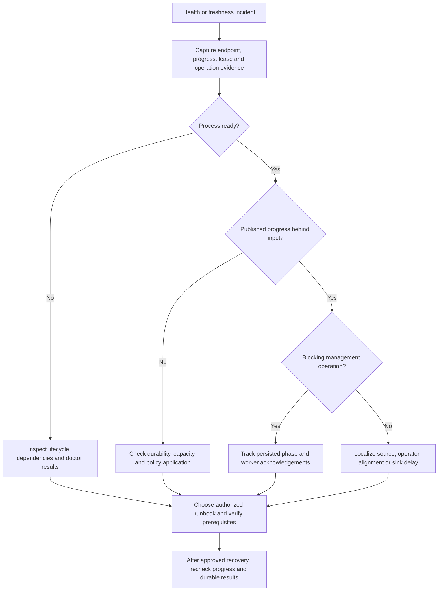
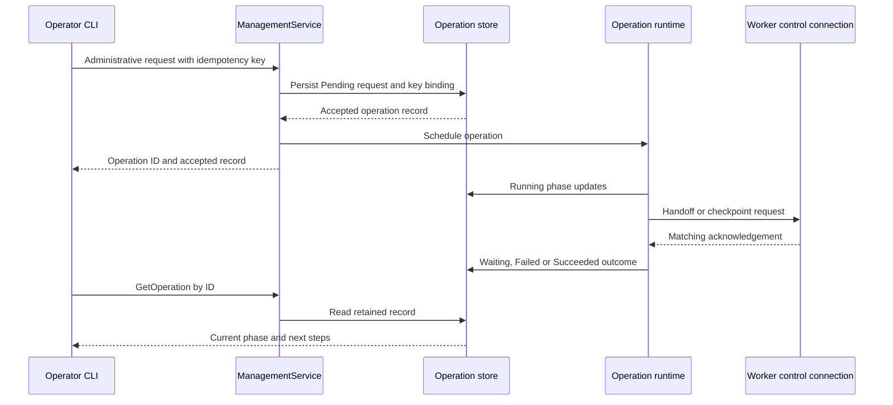

# Diagnosing stalls and recovering operations

Start with the affected workload and its published progress, not a process restart. A live process can be unready, a ready endpoint can serve stale results, and a successfully accepted administrative request can still be waiting for a worker. Likewise, an accepted workload policy revision is not proof that every worker enforces it.

Use the [operator guide](../../docs/operator.md), [SRE runbook](../../docs/sre-operations.md), [disaster-recovery runbook](../../docs/disaster-recovery.md), and [rolling-upgrade runbook](../../docs/rolling-upgrades.md) as canonical procedures. Exact syntax and catalogs belong in the generated [CLI](../../docs/reference/cli.md), [metrics](../../docs/reference/metrics.md), [errors](../../docs/reference/errors.md), [catalog](../../docs/reference/catalog.md), and [management API](../../docs/reference/management-api.md) references. The commands below are inspection examples, not instructions to execute remediation.

## Establish the observation and its owner

Record the endpoint, role, view, shard, operation ID, observation time, and source version before comparing reports. Management compound status is not a transactionally consistent snapshot across topology and leases. Its `observed_at` and `source_version` make provenance explicit.

There are three different observation paths:

- **Process HTTP:** `metrics_server` serves `/live` (also `/healthz`), `/ready` (also `/readyz`), and `/health` from the process `LifecycleTracker`. `/metrics` renders the shared metrics registry. A starting process can return 200 for liveness and 503 for readiness. A degraded process can return 200 for `/health`; inspect the body rather than only the HTTP status.
- **Control management:** `rockstream --management 127.0.0.1:9201 …` uses typed management RPCs for registered nodes, current shard leases, capabilities, and persisted operations. **Management `GetHealth` currently returns `unknown`**, because authoritative process-health telemetry is not attached. Do not substitute it for HTTP process health or application progress.
- **Gateway SQL:** `rockstream query` and `rockstream shell` use live TCP PGWire, not direct gateway handler calls. SQL view/frontier and resource observations are the application-facing route. Keep the gateway endpoint distinct from the HTTP and management addresses.

### Seven operator questions

The [operator guide](../../docs/operator.md#operational-observability--seven-operator-questions) groups health into liveness, readiness, availability, freshness, durability, capacity, and degradation. Answer all relevant dimensions rather than collapsing them into one green check.

| Question | First inspection | Authority and interpretation |
|---|---|---|
| Is the system healthy? | `rockstream health`, HTTP `/health`, `SELECT * FROM rockstream_catalog.nodes;` | Check which transport supplied the answer. Process lifecycle/dependencies and registered control topology are different observations. Liveness is not workload health. |
| Is my view current? | `rockstream view status <view>`, `SHOW VIEW STATUS`, `SELECT view_name, state, frontier FROM rockstream_catalog.views;` | Compare input and published frontiers and freshness lag against the view SLO. Serving queries does not establish freshness. |
| Why is it behind? | View status, `SHOW FRONTIERS`, `SHOW PIPELINE STALLS FOR <view>` | Follow degradation reason, dominant lag contributor, and operator/shard frontier evidence before choosing a remedy. |
| What consumes memory? | `rockstream status`, `rockstream_catalog.view_resource_usage`, `rockstream_catalog.workload_resource_usage` | Correlate view/workload accounting with worker/category `rockstream_memory_bytes` and spill or admission symptoms. |
| Who owns this shard? | `rockstream --management 127.0.0.1:9201 shard show 0`, `SELECT shard_id, worker_id, state FROM rockstream_catalog.shards;` | The control shard manager owns current fenced leases. Use the current owner and token, not an old worker log. |
| Is migration blocking progress? | `rockstream_catalog.operations`, management operation list/show, view `blocking_operation` | Read operation phase, update time, progress, error code, and next steps. An operation ID is acceptance, not completion. |
| What should I do next? | `rockstream doctor` and the stable RS error's next steps | Doctor is bounded diagnostic inspection, not automatic repair. Distinguish PASS, WARN, FAIL, and SKIP. |

For capacity-policy incidents, also use `SHOW WORKLOAD APPLICATION FOR <workload_name>`. It separates requested revision/cap from the gateway's actual local quota owner and live usage. NULL gateway observations mean no local owner was observed; an unlimited effective cap can also be NULL while live usage is present. With assigned views, `worker_effective_revision` remains NULL and `worker_application_state` is `worker_ack_unavailable`; do not infer cluster-wide enforcement from catalog acceptance. See [deployment and configuration](deployment-and-configuration.md).

## A small incident decision flow

*Decision flow separating observation, cause localization, and an explicitly authorized recovery plan.*

### Localize the stall before changing state

| Symptom | Evidence to collect | Safe interpretation and next investigation |
|---|---|---|
| Source blocking or `waiting_on_source` | Source watermarks/resume positions, `SHOW FRONTIERS`, slowest-input flags | Inspect connector, broker, credentials, and network. A source frontier that does not advance can hold back downstream progress; restarting a healthy compute worker does not fix the input. See [source ingestion](../integrations/source-ingestion.md). |
| Backpressure, admission rejection, or spilling | Workload/view memory, exchange `rockstream_exchange_backpressure`, storage-pressure lag, sink health | Distinguish upstream starvation from downstream saturation. The exchange gauge is a ratio from 0 to 1. Investigate receiver capacity, compute, storage and sink commit delay before raising budgets or scaling. |
| `checkpoint_alignment_stalled` | `rockstream checkpoint show <id>`, lagging shard/operator, CPU/network evidence | Identify the barrier holder. Checkpoint alignment and sink commit are durability/progress boundaries, not just query availability. See [progress and checkpoints](../concepts/progress-and-checkpoints.md). |
| Stale lease errors, especially `RS-1702` | Current management shard owner/token, worker connection/lifecycle, migration phase | Fencing tokens increase to prevent stale writers committing after reassignment. Treat rejection as a safety boundary; reconcile the current owner rather than weakening fencing or manually reviving the old writer. |
| Migration or drain not advancing | Persisted operation, worker control connections, donor/recipient ACKs, shared-store identity | A waiting operation can be recoverable. Restore its prerequisite and follow the same operation rather than issuing competing ownership changes. |
| Sink blocked or recovering | Sink transaction state, committed checkpoint, source offset and published frontier | Inspect downstream commit health or recovery catch-up. Confirm durable effects, not merely successful ingestion or process startup. |

The stall report is a **localization aid over recorded telemetry**, not an independent proof of durable commit. For each view it flags minimum source epochs as `is_slowest_input`; it flags minimum operator epochs as `is_holding_back_commit` only when the minimum is below the maximum. Ties can flag multiple operators. Equal frontiers do not prove a pipeline is advancing. The report's `lag_behind_max_ms` is epoch difference multiplied by 1000, not an independently measured wall-clock latency. The registry is process-local and bounded, so absence of a row is not evidence of health.

View degradation also reports a deterministic dominant contributor. The SRE runbook describes maximum-contribution selection and tie ordering; use the detailed components to avoid mistaking a dominant label for the only problem.

### Keep diagnostics bounded and retain evidence

Doctor defaults to a five-second per-check timeout and clamps the configured per-check timeout to 30 seconds. Despite the `MAX_DOCTOR_TIMEOUT` name, that clamp alone does **not** establish a 30-second whole-command deadline: checks are awaited in sequence. Avoid assuming the older guide's fixed check count is an execution guarantee; inspect the actual report, including skipped checks.

Preserve RS codes, correlation IDs, safe context, retry hints and next steps with logs and support artifacts. Shared runtime diagnostics redact context, cap it at 32 entries/8 KiB, and retain only 256 recent occurrences in the process-local journal. Eviction/rejection counters explain missing detail. Capture evidence promptly; a support bundle is not an unlimited incident history or a backup. See the [SRE support-bundle section](../../docs/sre-operations.md#support-bundle-parsing) for the distinction between startup JSON and on-demand artifacts.

## Follow management requests to durable outcomes

The control `ManagementService` dispatches drain, migration, and backup work through attached runtimes. `ManagementOperationStore` persists the accepted request under `control/management-operations` before execution; operation records carry status, timestamps, phase, progress, error and next steps.

*Acceptance precedes asynchronous execution; worker acknowledgement and persisted outcome must be observed separately.*

- **Retries and conflicts:** an exact retry with the same idempotency key returns the same record. A changed request under that key returns `ALREADY_EXISTS`; an expired key returns `FAILED_PRECONDITION`. Keys are bound for 24 hours. State transitions use create-only records keyed by the previous record hash to prevent concurrent store instances advancing the same state. A conflict is not permission to repeat the physical action under a new key.
- **Pending, running, waiting:** `Pending` means durably accepted. `Running` means execution/phase activity, including awaiting worker ACKs. `Waiting` records an unmet prerequisite or recoverable interruption, not success. Read `next_steps` and re-query. `Succeeded`, `Failed`, and `Cancelled` are immutable terminal states; terminal records are retained for seven days.
- **Restart reconciliation:** startup converts previously running records to waiting, retaining phase/progress. Pending/waiting requests are rescheduled, and a one-second scan revisits nonterminal records. This is reconciliation with persisted intent, not an assumption that a pre-restart action completed.
- **Cancellation:** allowed for pending requests and specific pre-lease-transfer phases. After lease transfer starts it is rejected without changing the record. Cancellation during donor handoff requires ACK handling and donor reopening under the unchanged lease; it is not a general rollback command.

For migration, the executor validates healthy active workers, different donor/target workers sharing a shard store, and unchanged fenced ownership. It waits for donor flush/close before transferring the lease, persists ownership, then waits for recipient open before reporting success. Recipient-open failure triggers rollback handling. The current executor rejects registered active workload deployments before handoff; do not treat this administrative RPC as arbitrary live-workload migration.

For drain, current management execution likewise rejects active workload deployments. A disconnected worker can leave the operation waiting; a sent drain can remain running in `waiting_for_worker_flush_ack`. Completion requires matching recipient-open acknowledgements for moved shards, not merely sending `BeginDrain` or releasing the donor lease. See [cluster and exchange](../architecture/cluster-and-exchange.md).

**Authority check:** the management endpoint currently has neither TLS nor server-side request authorization. Keep it on a trusted interface/network. CLI identity-role flags do not authenticate a remote management caller. Check capabilities and the exact endpoint before any mutation; an unattached executor is unavailable. The CLI currently maps management RPC errors to `RS-0003`, so use the management reference and operation record rather than assuming that code preserves all gRPC distinctions. See [security boundaries](security-boundaries.md).

## Backup, verify, and restore without confusing formats

There are two backup surfaces. With explicit `--management`, `admin backup create` dispatches `CreateBackup`: an asynchronous **committed checkpoint generation**. Without that flag, the legacy path writes a local manifest consumed by `admin backup inspect` and `admin backup verify`. Those legacy commands are not verification of a management checkpoint generation.

Management backup requires an attached authoritative shard store and an idle cluster with no active workload deployments/source writes. Multi-worker backup requires the same configured shared object store for every shard owner. It requests durable shard checkpoints, exports checkpoint-pinned data and control state, excludes audit/management logs and live worker topology, and succeeds only after terminal-marker validation. Workers rebuild topology on registration. Missing workers or temporary storage problems can leave it waiting; integrity failures are failures, not usable recovery points.

Use the [DR runbook](../../docs/disaster-recovery.md) for `checkpoint export` and `checkpoint restore` syntax and approved execution. Its safety boundaries are:

1. Export a committed recovery point into a separate bucket, account, or region. **Never copy the mutable live object-store prefix as a backup.** Retain checkpoint ID, object/byte totals and `SUCCESS` outcome.
2. Validate the generation: terminal commit marker, generation/checkpoint consistency, shard checkpoint epochs, object lengths/SHA-256 values, inventory digest and total bytes must agree. Validation does not require the original control plane.
3. Restore only into fresh, offline target storage. Restore validates first, stages and verifies objects, and publishes the bootstrap active-generation pointer after reconstruction. A different existing active generation is rejected; a matching pointer permits an idempotent result.
4. On `RS-5035`, keep the target offline, repair access or replace the incomplete/inconsistent export, and retry into fresh storage. Do not start serving from a partial restore.
5. After starting against restored storage, compare complete sorted view rows and verify checkpoint epoch, catalog, topology/leases, connector offsets and resume positions. A published bootstrap pointer is not application validation. Measure RPO/RTO in a drill rather than adopting historical local measurements as guarantees.

See [storage and replay](../concepts/storage-and-replay.md) for the relation between durable checkpoints, replay and source resume state.

## Upgrade recovery and verification scope

The rolling-upgrade runbook prescribes control nodes one by one while retaining quorum, then workers with graceful drain, then gateways with connection draining. Use its readiness, flush, sink-commit and lease-handover sequence as the intended procedure, but **do not equate that procedure with qualification of every deployment or management RPC**.

The [rolling-upgrade qualification](../../docs/testing/rolling-upgrade.md) proves a narrower three-worker abrupt-replacement scenario using exact immutable image/source identities, complete view and committed sink effects, source checkpoints and fenced leases. Its injected failed candidate exits before registration or state access; survivors finish the acknowledged phase and the same candidate is retried forward. Downgrade is unsupported by that qualification. It does not qualify graceful drain, control/gateway upgrades, multiple active shards, zero query downtime, or a general cross-version compatibility range.

During a failed upgrade, preserve candidate identity, logs, readiness/registration evidence, durable checkpoint and current lease evidence before deciding the next step. Do not downgrade an on-disk state format on the strength of a startup failure alone. Resume only after the approved recovery plan verifies durable input acceptance, complete output/sink effects, and continuing writes—not just that the replacement process starts.

Focused regression coverage includes the [PGWire stall diagnostic tests](../../crates/rockstream-gateway/tests/pipeline_stall_diagnostics_tests.rs): slow-source localization, wedged-operator commit-holder flags, missing-view errors with next steps, and Prometheus frontier families. The [qualification guide](../testing/correctness-and-qualification.md) explains why those diagnostic checks complement, but do not replace, end-to-end correctness and recovery evidence.
