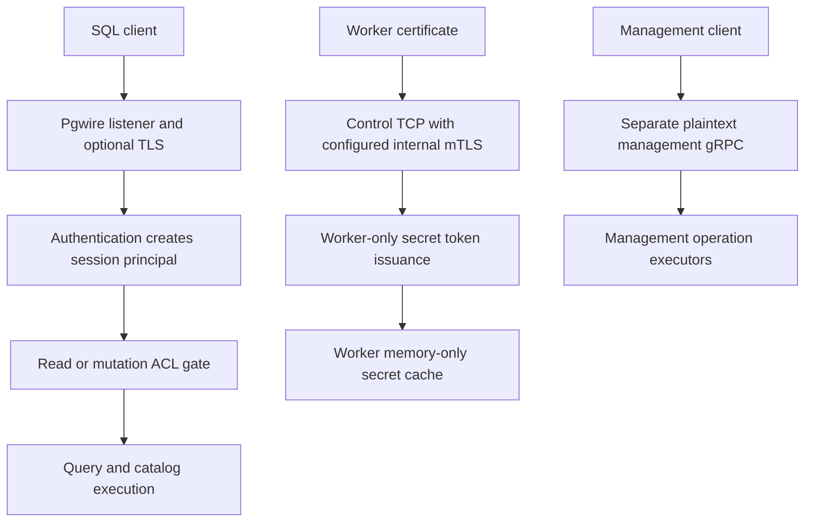

# Authentication, authorization, and trust boundaries

RockStream has **separate client-session, internal-node, and administrative trust boundaries**. Enabling one does not secure the others. In particular, gateway mTLS is not internal-worker mTLS, and the management gRPC service does not inherit the worker listener's TLS or SQL ACL checks.

The [security guide](../../docs/security.md) describes configuration and rotation procedures; the [threat model](../../docs/threat-model.md) associates boundaries with regression proofs. Treat their broad guarantees as design/assessment context, not proof that every current entrypoint enforces the same policy. The [readiness report](../../docs/security-report.md) records a closed internal assessment, whereas the threat model says an independent commissioned report is not yet available. Neither replaces inspecting the listener and caller in use.

*The SQL, worker, and management paths cross different enforcement boundaries; the diagram does not imply management authentication.*

## Listener-by-listener protection

| Surface | Implemented transport and identity boundary | Authorization implication |
|---|---|---|
| Gateway PostgreSQL port | `GatewayServer::with_tls` builds its own acceptor. A supplied CA requires client certificates; without a CA it uses server TLS without client authentication. mTLS mode's CA validation returns `RS-2403` on misconfiguration. | mTLS startup gets the CN from a CA-validated certificate side channel, not a `cn` startup parameter. Missing verified CN fails with `RS-2404`. Other authentication modes are independent of this TLS builder. |
| Control worker/CLI TCP protocol | `accept_and_handle` negotiates TLS only when an acceptor is supplied. Successful TLS extracts `NodeIdentity`; without an acceptor, the same protocol runs on plaintext with no peer identity. | With an identity present, registration requires the Worker role and a certificate identity matching the worker ID or registration address. Secret-token requests always require a verified Worker identity, even if plaintext registration is otherwise possible. |
| Worker shuffle gRPC | `ExchangeService::start` installs TLS only for an enabled `internal_tls` configuration. `client_ca_root` is installed when a CA path is present. | This establishes CA peer authentication when configured, not a SQL principal or ACL grant. The service startup does not extract a `NodeIdentity` or bind the request's worker identity to a certificate. Do not extrapolate control registration checks to shuffle. |
| Management gRPC | `ManagementService::start` accepts raw TCP into a tonic server, with no TLS configuration or authentication interceptor. | Handlers check protocol version, admission, and operation arguments, but do not resolve a principal or consult `AclStore`. For example, `DrainWorker` can schedule its executor after an idempotent operation-store acceptance. Protect this listener externally. |
| Raft peer RPC | The Raft listener passes accepted `TcpStream`s directly to `handle_peer_connection`. | This is another plaintext peer boundary, not covered by the control worker acceptor. Restrict peer-network reachability. |

These are implementation observations, not assertions of a formal severity rating. The management client likewise defaults an unqualified address to `http://` and constructs its gRPC client without identity credentials. Merely using an HTTPS-looking string is not a credential configuration. The runtime `DataPlaneClient` is even more explicit: it strips HTTP/HTTPS prefixes and opens a raw `TcpStream` to the control protocol. It cannot be assumed to work through an mTLS-only control listener.

See [control TLS](../../crates/rockstream-control/src/tls.rs), [control connection handling](../../crates/rockstream-control/src/service.rs), [shuffle startup](../../crates/rockstream-runtime/src/exchange/service.rs), [management server](../../crates/rockstream-control/src/management.rs), and [Raft peer listener](../../crates/rockstream-control/src/raft.rs). Connector ingress has its own boundary; see [source ingestion](../integrations/source-ingestion.md), rather than assuming pgwire authentication protects it.

### Internal certificate lifecycle

`InternalTlsConfig` and `NodeIdentity` are distinct from gateway authentication types. The canonical internal CN is `role:node_id` with an optional cluster suffix; parsing also accepts compatibility forms, and an otherwise unrecognized bare CN falls back to the CLI role. Certificate parsing therefore does not itself grant administrative privileges or establish cluster isolation.

The control TLS builder requires certificate/key paths and requires a CA when `client_auth_required` is true. Its `TlsCertificateReloader` rebuilds and swaps the acceptor, and supports extra trusted CA roots for overlap. Existing streams retain their negotiated transport. Keep old and new CA trust during rollout, reload, then retire old trust only after peers have migrated. This is the control acceptor mechanism, not a universal reload mechanism for every server listed above.

## Gateway credentials → principal → permission

The [authentication implementation](../../crates/rockstream-gateway/src/auth.rs) supports `Off`, `Oidc`, `Mtls`, `Scram`, and `Md5`:

- **Off** produces `Principal::System`, which bypasses gateway ACL gates. It is a privileged mode, not anonymous least privilege.
- **SCRAM/MD5** authenticate against `RoleCatalog` and produce `ScramUser`. The catalog stores salted SCRAM password material and optional MD5 hashes in memory; it is not the ACL store. Password updates replace both representations. An authenticated username still needs ACL grants.
- **mTLS** produces `CertCn` from the verified client certificate CN.
- **OIDC-labelled mode** accepts a bearer startup parameter and uses `JwtVerifier`. The current verifier supports HS256, locally supplied/default or cached keys, a required `sub`, and an optional `exp`. It does not implement issuer/audience validation or remote discovery in this verification path. CLI gateway startup supplies a built-in default signing key; do not treat that as production identity-provider integration. The startup handler also has a verifier-absent fallback that uses the token as the JWT identity: custom construction must not leave an OIDC handler without a verifier.

There are **two different configuration failure behaviors**: `AuthMode::from_str` is infallible and maps unrecognized strings to `Off`; CLI `run_start` normalizes and validates its allowlist, rejecting unknown modes with `RS-0002`. Direct library callers must not rely on parsing to reject typos. Also, constructing an mTLS-auth server is not the same as invoking `with_tls`; verify the actual startup wiring, not just the auth enum.

### Reads, mutations, and subscriptions

The current [ACL implementation](../../crates/rockstream-control/src/acl.rs) uses an in-memory map. Effective role lookup checks an object-specific grant first, then a namespace grant, and compares the role against the required minimum. Although the file describes catalog persistence and cache bounds, the shown `grant`, `revoke`, and lookup path operates directly on that map. Do not assume durable ACL recovery from those comments.

`AclStore::check` also bypasses checks for the **identity string `system`**, independently of the gateway's enum-level System check. Reserve that identity across credential provisioning. The default/missing-session and connectionless dispatch paths can use `Principal::System`; these are trusted internal APIs, not safe substitutes for an authenticated network session.

| Operation | Gate and refusal behavior |
|---|---|
| Relation reads | `select_access_error_response` requires Viewer on the relation in the session namespace. For catalog views in another namespace, a non-System caller additionally needs Admin in the session namespace. Denials use SQLSTATE `42501`, with `RS-2401` for insufficient role or `RS-2402` for namespace refusal. |
| SQL state changes | `authorize_mutation` uses the shared `pgwire_mutation_policy`, session identity, namespace, and mutation resource before execution. Creation of ordinary sources/tables/views typically requires PipelineOwner; secret DDL and administrative changes require Admin. Denial returns `42501` / `RS-2401` and attempts an audit entry. Extend the policy together with statement dispatch. |
| `SUBSCRIBE` snapshot or replay | Reuses the SELECT access gate **before retention metadata lookup, snapshot reads, or stream-slot admission**. This proves admission-time authorization, not continuous revocation checks on an already admitted stream. |

The [mutation authorization matrix](../../crates/rockstream-gateway/tests/gateway_mutation_authorization_tests.rs) checks policy coverage, exact denials, unchanged catalog state, and audit round trips. The [subscription authorization tests](../../crates/rockstream-gateway/tests/v072_subscription_authorization_tests.rs) prove unauthorized snapshot/replay and cross-namespace attempts make zero reader calls and consume zero stream slots, and that a Viewer grant allows admission.

### CLI authorization is not server authentication

[CLI transports](../../crates/rockstream-cli/src/transport.rs) use the shared `CLI_MUTATION_POLICY` to reject insufficient local roles and record denial events. `ClientIdentity` carries user, token, certificate path, namespace, and role, but is caller-constructed and defaults to Admin. Those fields are **metadata, not verification of a bearer token or certificate**. Local role checks and their exhaustive tests must not be interpreted as server-side authorization for a direct management RPC. Internal TLS can authenticate a CLI certificate on the control TCP path; that is a different boundary from the management gRPC path.

## Secret ownership and lifecycle

`SecretStore` owns encrypted catalog entries and the active `KekProvider`; workers do not own the catalog KEK. [Envelope encryption](../../crates/rockstream-control/src/kek.rs) generates a local DEK, encrypts the payload using AES-256-GCM, and wraps the DEK through the provider. Stored envelopes include ciphertext, nonce, wrapped DEK, provider label, and metadata under `catalog/secrets/`. `SHOW SECRETS` exposes metadata rather than decrypted payloads. Current gateway secret DDL uses namespace ID `0` and the store audit actor `pgwire`, not the authenticated user's actor string.

Default services construct `EnvKekProvider::from_env_or_default`: it hashes `RS_SECRET_KEK` into key bytes, but **falls back to a deterministic derivation when the variable is absent**. Encryption alone therefore does not imply externally controlled key custody. Provision the KEK deliberately, or inject an appropriately configured provider/store. Merely supplying a KMS ARN does not switch default services to KMS.

`AwsKmsKekProvider` wraps/unwraps locally generated DEKs with signed KMS Encrypt/Decrypt requests. It requires the control identity's KMS permissions; failures have no local-encryption fallback. The [security guide](../../docs/security.md) documents credential discovery, HTTPS endpoint restrictions, migration from old placeholder envelopes, and an explicitly ignored real-AWS authorization test. Local protocol fixtures are not evidence that AWS IAM policy has been qualified in a deployment.

### Token issuance and refresh

The live control `ResolveSecretToken` handler requires a verified Worker certificate and issues a 300-second token for namespace `0`, binding it to the certificate's node ID. It does not perform a per-secret assignment/ACL check in that branch: possession of a trusted Worker certificate is the observed admission boundary.

`WorkerSecretManager` checks identity, expiry, nonce shape, and authenticated decryption before installing plaintext in a bounded memory-only cache. Reads remove expired entries. **The token encryption key is deterministically derived from the worker identity string, not from its private key.** Do not treat the token envelope as an independent cryptographic recipient-secret boundary; authenticated transport and trusted worker access remain essential.

`ALTER SECRET` increments the payload version and sends a rotation notification. The runtime client responds by requesting another token and installs issued tokens in the memory cache. The notification is a refresh trigger, not proof that every connector has atomically switched credentials. See [worker resolution](../../crates/rockstream-runtime/src/secrets.rs), [runtime control messages](../../crates/rockstream-runtime/src/client.rs), and [source ingestion](../integrations/source-ingestion.md) for connector consumption.

### KEK rotation and recovery

`SecretStore::rotate_kek` serializes rotation against reads/mutations, stages all rewrapped envelopes, and publishes one SlateDB batch (or replaces the in-memory catalog). Staging failure leaves stored envelopes unchanged. Once submitted, the commit runs in a spawned task so caller cancellation does not separate publication from the provider switch. Success waits for durability before retaining only the new provider.

Keep **both KEKs** available until rotation succeeds and restart configuration uses the replacement. After interrupted/failed storage publication, reopen with `RetainedKekProvider::new(replacement, previous)` and retry rotation; it writes with the first provider and tries both for decryption without persisting key material. Use one shared store per catalog: its rotation lock does not coordinate independent store instances. Rotation stages memory proportional to catalog size. The [rotation failure suite](../../crates/rockstream-control/tests/secrets_rotation_failure_tests.rs) exercises failed wrapping, serialization against concurrent access, cancellation/WAL failures, reopening, and retained-key recovery.

## Audit, redaction, and failure semantics

`FileAuditLog` appends structured JSONL with a process-local write lock. Its `open` creates parent directories, while the actual file is opened during append; append propagates I/O errors and does not fsync. Important callers deliberately discard those errors:

- gateway mutation-denial logging;
- `SecretStore::record_audit` and rotation completion;
- control mTLS refusal/authenticated-CLI events;
- CLI file audit output.

Thus denial enforcement does not depend on successful logging, and a successful secret mutation is **not rolled back because audit append failed**. Audit presence is optional in these components. Monitor and protect audit storage independently; this is not a fail-closed, transactional, tamper-evident audit service.

Secret store events contain names/actions rather than payloads. [Literal-redaction tests](../../crates/rockstream-control/tests/secrets_redaction_tests.rs) verify a secret literal is absent from audit and listing metadata; rotation-failure tests also inspect serialized encrypted catalog artifacts. Diagnostic `redact_secrets` masks recognized assignments, bearer values, URL credentials, and private-key-looking input, and management config summaries use redaction. `FileAuditLog::append` itself is not a general sanitizer: do not pass raw SQL, arbitrary credentials, or decrypted payloads into audit fields and assume they will be scrubbed.

## Safe change and verification checklist

1. **Adding SQL:** update [mutation policy](../../crates/rockstream-types/src/mutation_policy.rs), preserve the connection's principal through simple/extended dispatch, and test denial before side effects. Never route untrusted input through a connectionless System helper.
2. **Adding internal RPCs:** test TLS configuration, verified identity extraction, role/ID binding, and operation permission separately. A certificate-chain test does not prove authorization.
3. **Adding management operations:** add server-side identity/authorization deliberately; copying another current handler copies its unauthenticated boundary too.
4. **Changing secrets:** test ciphertext-at-rest, metadata-only listing, worker expiry/wrong-identity refusal, rotation failure/reopen, and log non-disclosure. Keep key recovery configuration outside the catalog.
5. **Operating:** restrict management and Raft networks; verify each deployed listener and real startup wiring. Use [deployment and configuration](deployment-and-configuration.md), [diagnostics and recovery](diagnostics-and-recovery.md), [cluster and exchange](../architecture/cluster-and-exchange.md), and [PostgreSQL requests](../workflows/postgres-requests.md) for adjacent runbooks.

Useful focused suites include `control_worker_mtls_tests`, `internal_mtls_tests`, `shuffle_mtls_tests`, `worker_secret_resolution_tests`, `secrets_rotation_failure_tests`, `gateway_mutation_authorization_tests`, and `v072_subscription_authorization_tests`. They cover specific configured paths, not all listeners collectively. This page is based on source and test inspection, not a fresh execution of those suites.
