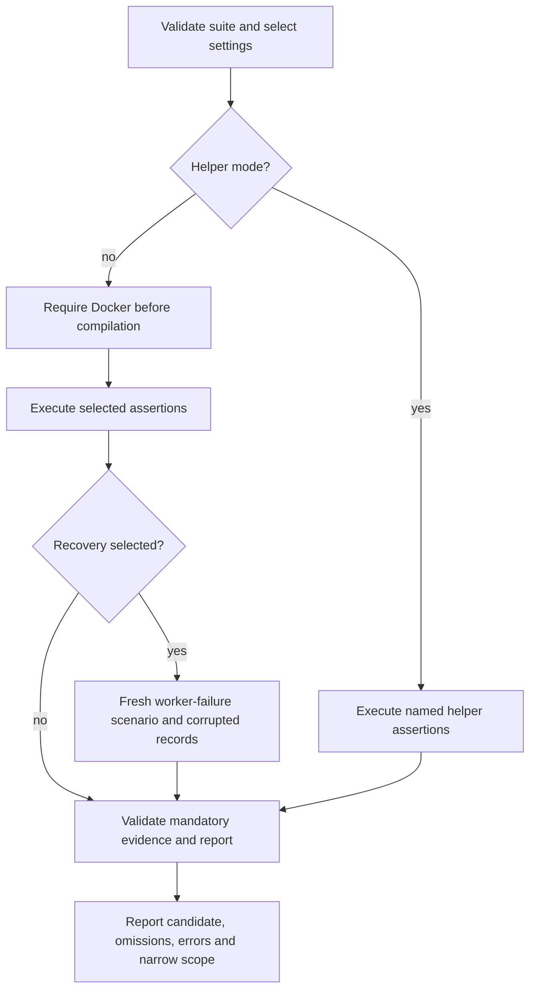

# Correctness protection and release evidence

A useful proof states **which invariant was checked, against which implementation and backend, for which candidate**. A passing harness, a test name containing “recovery,” or a release sign-off is not general release readiness. Start with the [canonical command taxonomy](../../docs/test-commands.md) and the behavior-specific [capability proof entries](../../capabilities.toml), then inspect the referenced test body, prerequisites, and production path.

**Research status:** the checks below are suggestions, **not executed for this page**. No builds, tests, benchmarks, fuzz engines, or formal verification were run.

## Choose protection by invariant and change type

| Change / invariant | Focused protection | Boundary to preserve |
| --- | --- | --- |
| SQL lowering, expression types, result encoding, protocol behavior | Exact gateway transcripts and applicable PostgreSQL differential/conformance cases | A local gateway socket is not a distributed gateway-to-worker transport proof. Check exact rows and errors, not only successful parsing. |
| Incremental operator semantics | Incremental-versus-batch oracle plus deterministic insert/update/retract regressions | The trivial no-op oracle checks its harness; operator oracles must actually invoke the operator. |
| Arithmetic, ordering, codecs, state transitions | Property tests and boundary regressions, plus verified-kernel contracts where applicable | A finite generated sample is not a theorem; a theorem about a kernel is not an integration test. |
| Checkpoint, arranged state, replay, persisted format | Local-filesystem and object-store durability pairs | Reopening a flushed database in one test process is not an abrupt OS-process crash. |
| Lease, frontier, scheduling, retry or failure handling | Seeded deterministic faults with explicit recovery assertions | Simulated authority changes and supplied timings do not measure live failover. |
| Backend recovery and process isolation | Live service/process scenario with independently read view and sink results | Docker availability, distinct supplied PID values, or an observer report alone do not prove application recovery. |
| Untrusted SQL / decoder inputs | Fuzz targets plus permanent regression inputs | Parser robustness does not establish relational equivalence. |
| Coordination protocol or verified kernel | FizzBee models, Verus contracts, ordinary runtime tests, and call-site review | Model assumptions and wrapper behavior still need integration protection. |

### Exact SQL and protocol output

The representative core semantics fixture starts `GatewayServer::with_shard_db` on an ephemeral local socket, uses a local-filesystem `ShardDb`, `CatalogStubs`, and a `NoopViewReader`, and connects using `tokio_postgres`. Its aggregate matrix checks exact result rows after insert, update, and delete. This is meaningful gateway/compiled-execution coverage, but not an external multi-worker deployment. Several behavior-named aggregate tests delegate to the same `aggregate_cell` scenario: their names alone do not add checkpoint or resource-bound proof. See the [fixture and assertions](../../crates/rockstream-gateway/tests/core_operator_semantics_e2e_tests.rs).

Use the capability entry to find the intended proof, not as a substitute for reading it. For user-facing changes, retain exact values, multiplicities, ordering where promised, and actionable errors. See [PostgreSQL requests](../workflows/postgres-requests.md) and the [incremental SQL engine](../architecture/incremental-sql-engine.md) for the corresponding execution boundaries.

### Incremental-versus-batch and property/regression checks

The [no-op harness](../../crates/rockstream-oracle/src/harness.rs) accumulates Z-set weights, keeps positive-weight rows, and asks DataFusion to select those same rows. Duplicate positive weight appears once in this particular harness. Its scope is accumulation/Arrow/DataFusion plumbing, **not arbitrary bag semantics or production operator correctness**.

The [aggregate oracle](../../crates/rockstream-oracle/src/aggregate_oracle.rs) is stronger and different: it sends epochs through production `AggregateOp::process_delta`, accumulates output, and compares against a batch calculation over accumulated weighted inputs. It also validates the batch reference with DataFusion SQL. That reference shares `avg_from_sum_count` with the system's law layer, so do not describe every arithmetic step as wholly independent. Keep deterministic edge cases alongside generated histories; translate discovered failures into small repeatable regressions rather than relying only on another large random run.

### Local/object-store durability pairs

The integer-join capability explicitly pairs [LFS durability](../../crates/rockstream-gateway/tests/live_exec_join_durability_lfs_tests.rs) with [MinIO durability](../../crates/rockstream-gateway/tests/core_operator_durability_minio_tests.rs). Both flush a left-side commit, abort the gateway task, reopen the same shard backend, then add the matching right row and check the join result. The catalog is reused in memory. These protect persisted arranged state across gateway reconstruction; despite restart wording, the bodies do **not** kill the test's OS process or prove catalog recovery from scratch.

The MinIO case can print `SKIP` and return successfully when Docker is unavailable locally. Treat that as **no MinIO proof**, not a pass. The accounting gate rejects successful tests that print skip markers; Docker-owned CI suites require Docker. For persistence changes, select both sides of the pair and inspect flush, reopen, and post-reopen mutations. See [storage and replay](../concepts/storage-and-replay.md).

### Deterministic faults versus live observations

The simulation `Runtime` abstracts clock, sleep, spawning, network and object-store handles and exposes its reproducible seed. Use deterministic tests to reproduce failure ordering and assert loss/duplication/progress invariants. Consult the [failure matrix](../../docs/failure-matrix.md) cell by cell: many cells explicitly lack real-backend evidence. Its broad introductory wording must not be read as live proof for every category.

The qualification recovery helpers are especially easy to overread. Their [test bodies](../../crates/rockstream-sim/tests/qualification_recovery_tests.rs) inject an in-memory worker/leader change and **supply** values such as 1500 ms detection and 4200 ms reassignment to `RecoveryObserver`. They test bookkeeping, threshold rejection and supplied query comparisons, not measured crashes, CDC resumption, Kafka atomicity, or backend durability.

The [external harness](../../crates/rockstream-test-support/src/external_harness.rs) checks declared worker count, unique supplied PIDs and `WorkerId`s, and offers an engine-independent multiset calculation. Its isolation auditor does not itself launch processes or inspect OS liveness, and its implementation does not enforce the optional cgroup field. Actual observations must come from a live runner.

## What release qualification actually establishes

The shell entrypoint delegates to [`release-qualification.py`](../../scripts/release-qualification.py). `--suite` accepts `all`, `e2e`, `recovery`, and `mutations`; invalid selections fail before prerequisites or compilation.


*Qualification branches by evidence mode; executing helper assertions does not satisfy missing live observations.*

### Candidate identity and fail-closed execution

The runner binds Git `HEAD`, SHA-256 of `git diff HEAD --binary`, hashes of untracked non-ignored files, compiler version, and `Cargo.lock` digest. Settings record suite, fast-mode environment, relevant compiler/build environment, one test thread, and debug profile. The live recovery path rechecks identity after execution and fails if the candidate changed.

Reports record exact scenario IDs/statuses, Cargo commands and exits, derived totals, omissions, and validation errors. The parser requires a complete consistent libtest transcript, rejects duplicate/malformed records, and does not credit ignored or failed mandatory cases. Missing services prevent compilation/execution rather than silently selecting helpers. A fresh recovery artifact directory prevents an old result from satisfying the live run. `--check-prerequisites` only reports availability; it neither runs scenarios nor qualifies anything.

`--fast` / `--quick`, or nonempty `ROCKSTREAM_QUALIFY_FAST` / `ROCKSTREAM_QUALIFY_MOCK_ENV`, select **helper-only** evidence: `evidence_kind: helper`, `release_qualified: false`. A passing helper report remains useful for runner regressions but carries no application recovery claim. Non-fast `all` and `e2e` still fail for missing mandatory `live::e2e`; more helper coverage cannot fill that omission.

### The narrow worker-failure result

The versioned [scenario specification](../../docs/testing/worker-failure-kafka-minio-v1.json) and [execution guide](../../docs/testing/worker-failure-recovery.md) define `worker-failure-kafka-minio-v1`. Changes to history, expected output, fault boundary or deadlines require a new scenario version.

The [live test](../../crates/rockstream-sim/tests/real_cluster_chaos_soak_tests.rs) provisions Kafka and MinIO, runs the production control service, and launches two worker fixture subprocesses. The fixtures schedule production worker lease, Kafka source, compiled view, checkpoint-coupled M3 commit, MinIO-backed storage and transactional exporter APIs. The parent kills worker 1 at a durable pending transaction after an update retraction. Control observes the dropped connection; worker 2 receives the higher lease token and resumes from durable state. This is a real process kill against real backends, **not** standalone CLI gateway-to-worker transport coverage.

The parent reads the view through a separate `ShardReader` and production `HotOnlyViewReader`, and consumes Kafka with `read_committed`. The [Rust validator](../../crates/rockstream-sim/src/qualification/worker_failure.rs) checks full weighted output, relation, sink envelopes and reconstructed relation, source offsets, distinct process/worker ownership, durable sink cursor, application state, and frontier 5 with exact query row `1\tc`. Event order and fault-relative deadlines are checked: detection 5 seconds, ownership 30 seconds, correct query 60 seconds. Runtime fill observations are not proof of storage-brownout buffer exhaustion.

The integrated qualification record includes six corrupted complete records: missing detection event, constant substituted durations, stale query frontier, changed query value, duplicate sink output, and helper-only ownership transition retaining the old PID. The runner compares complete records and their specific expected failure reasons against the same executed Rust validation path—not merely passing negative-control test names.

A successful recovery report can set `release_qualified: true` **only for** `qualification_scope: [worker-failure-kafka-minio-v1]`. It is one sample, not p99 recovery. `unsupported_claims` excludes general Kafka recovery, PostgreSQL CDC, distributed-control HA, PGWire transport, and recovery p99. The [real-cluster chaos workflow](../../.github/workflows/real-cluster-chaos.yml) executes integrated recovery and uploads reports and worker logs; its name does not broaden the result. See [Kafka view delivery](../integrations/kafka-view-delivery.md), [source ingestion](../integrations/source-ingestion.md), and [diagnostics and recovery](../operations/diagnostics-and-recovery.md) before transferring this evidence to an operational claim.

## Manifest integrity is not scenario provenance

There are distinct evidence formats. The checked-in [general evidence manifest](../../docs/evidence-manifest.json) names a particular candidate and workflow environment; it is not evidence for an arbitrary current checkout. Its [typed validator](../../crates/rockstream-types/src/evidence_manifest.rs) checks identity fields, artifact digest syntax, failed/mandatory-skipped results, and regenerates summary statistics from supplied raw samples. It rejects a single positive raw sample identical to the configured target. `verify_files_on_disk` separately recomputes artifact digests. JSON deserialization alone does neither validation step.

Those integrity checks cannot establish that supplied metrics came from production observation. Do not confuse them with the qualification runner's exact scenario IDs, executed records and negative controls. A sign-off or internally consistent manifest must still be traced to the candidate, workload specification, executed assertions and actual service observations.

[CI accounting](../../docs/ci-test-accounting.md) likewise establishes selection and terminal case outcomes, not faithfulness of assertions. Known ignored limitations do not count as passes; compilation or test listing is not execution. Separately scheduled soak, fuzz, formal and release reports cannot be inferred from an ordinary green PR result. Record the relevant candidate-bound job conclusions and artifacts explicitly.

## Fuzzing, formal models, and verified kernels

<!-- openwiki: broken internal link [../../fuzz/fuzz_targets] file "../../fuzz/fuzz_targets" does not exist. Fix the href or restore the target, then delete this comment. -->
The [SQL fuzz target](../../fuzz/fuzz_targets/fuzz_sql_parser.rs) accepts UTF-8 bytes and calls DDL parsing and plan conversion, ignoring ordinary returned errors. This protects robustness of those entrypoints, not exact SQL answers. Other [fuzz targets](../../fuzz/fuzz_targets) cover decoder surfaces. Keep engine execution distinct from libtest inventory and carry actionable failures into regressions.

[FizzBee specifications](../../formal/README.md) cover epoch commit, frontier aggregation, sink 2PC, self-fencing, migration and control HA. The [Makefile](../../Makefile) separates `verify-rust`, `verify-proof-contracts`, and `verify-protocol`; `verify` combines them. These are model/kernel gates, not evidence of live backend behavior.

The [verified crate](../../crates/rockstream-verified/src/lib.rs) has ordinary boundary tests as well as Verus specifications. Production `AggregateOp` [calls the verified transition kernel](../../crates/rockstream-ops/src/aggregate.rs); the proof is not a separate runtime algorithm. Review the caller's conversion/error handling as well as the theorem. [Verus qualification](../../formal/verus/README.md) uses pinned tools and a clean matrix with revision, digests, exact commands, logs, exits and timing; missing tools/backends/tests remain blocked rather than passing.

## Suggested focused checks — unexecuted

Use RTK as required by [contributor instructions](../../AGENTS.md). Select the narrowest relevant checks first; this is not a replacement for required CI or release gates.

```sh
# Exact gateway behavior and incremental operator oracle
rtk cargo test -p rockstream-gateway --test core_operator_semantics_e2e_tests core_aggregate_exact_int_sum -- --exact
rtk cargo test -p rockstream-oracle aggregate_oracle

# Paired persisted join state; MinIO requires Docker and must not skip
rtk cargo test -p rockstream-gateway --test live_exec_join_durability_lfs_tests compiled_join_state_persists_across_restart_lfs -- --exact
rtk cargo test -p rockstream-gateway --test core_operator_durability_minio_tests compiled_join_state_persists_across_restart_minio -- --exact

# Runner protection, helper-only evidence, then narrow live recovery evidence
rtk proxy bash scripts/check-qualification-mutations.test.sh
rtk proxy bash scripts/run-release-qualification.sh --fast --output target/qualification-helpers.json
rtk proxy bash scripts/run-release-qualification.sh --suite recovery --output target/real-cluster-chaos/qualification.json

# Proof changes: contract checks, theorem/model gates, clean Verus qualification
rtk proxy make verify-proof-contracts
rtk proxy make verify
rtk proxy make qualify-verus
```

For a new simulation target, update the explicit ownership/features/services in the [CI test matrix](../../scripts/ci-test-matrix.json). For a new release claim, add real observations and rejection controls—not just a helper assertion or a capability label. Preserve reproducible seeds, exact inputs, candidate identity and limitations with the evidence.
