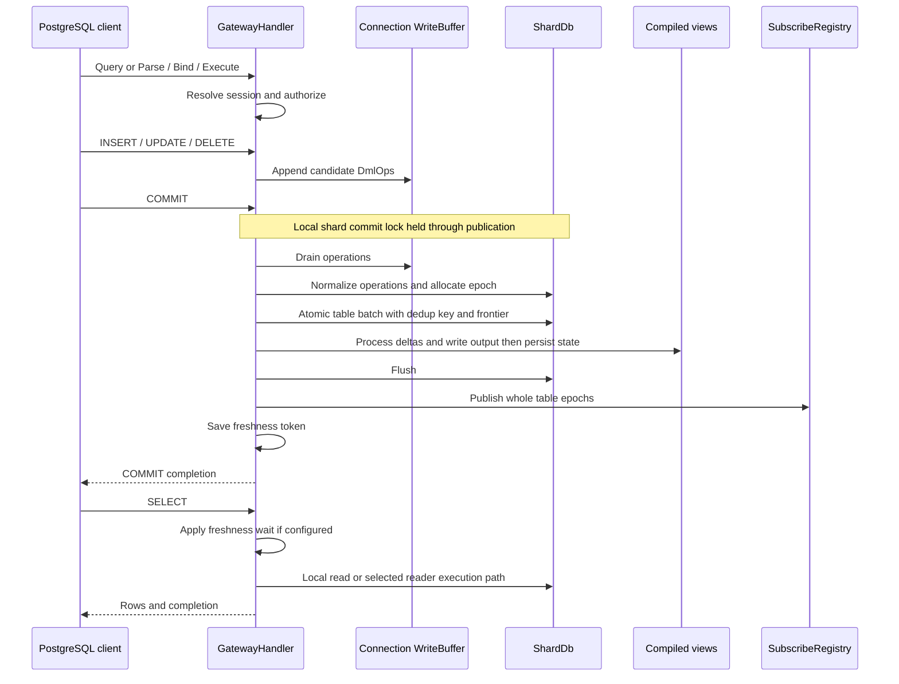

# PostgreSQL requests, transactions, and committed reads

The gateway is both a PostgreSQL protocol endpoint and a serving-layer coordinator. `GatewayHandler` shares catalog and reader dependencies across connections, but routes transaction buffers, session settings, prepared statements, and portals by connection ID. A successful DML response outside `BEGIN` includes an implicit commit; inside an explicit block it normally means only that mutations have been buffered.

Use the [wire conformance reference](../../docs/pgwire-conformance.md) for supported messages and linked proof tests, and the [SQL language reference](../../docs/language-features.md) and [SQL semantics](../../docs/sql-semantics.md) for the SQL contract. Protocol compatibility is not a claim that the gateway implements PostgreSQL's full concurrency or isolation model.

## Request and commit sequence

*The local shard-backed commit path; autocommit calls the same commit handler without a separate client COMMIT. Distributed view refresh replaces the local compiled-view step.*

Sources: [dispatch](../../crates/rockstream-gateway/src/server.rs#L6891-L7168), [commit](../../crates/rockstream-gateway/src/server.rs#L10030-L10328), [compiled refresh](../../crates/rockstream-gateway/src/server.rs#L2893-L2975).

## From connection to statement execution

Startup saves client parameters and establishes authentication state. Session state carries the principal, namespace, transaction status, freshness tokens, local settings, and backend cancellation identity. Authentication-off startup explicitly uses the system principal; it is not an unprivileged default deployment. See [security boundaries](../operations/security-boundaries.md) for deployment implications.

**Simple query:** `SimpleQueryHandler::do_query` obtains a stable connection ID, rejects requests during draining, handles empty input, and uses the PostgreSQL SQL parser to split parseable multi-statement input. Each statement passes through `do_query_single`, which handles special wire operations such as COPY and otherwise calls `dispatch_async_with_conn`. This is sequential dispatch, not evidence of an implicit atomic transaction around every semicolon-separated batch.

**Extended query:** Parse prepares SQL and resolves parameter types; Bind validates parameter values and constructs a portal. Execute dispatches through the extended handler using portal parameters and result formats. Its custom `on_execute` collects query rows into `PortalState`, then advances an offset across executions. A positive `max_rows` can yield `PortalSuspended`; completion removes the cached state. Thus portal suspension limits delivery, **not necessarily producer memory or execution work**. Close and DEALLOCATE release cached protocol objects. The extended protocol tests cover pipeline execution, caching, and suspension.

Malformed supported binary Bind values fail with `22P03`; bad counts or format codes fail with `08P01`. The conformance contract discards subsequent messages until Sync, preserving the connection and reporting idle or failed transaction status as appropriate. These protocol-validation failures occur before execution.

Sources: [simple handler](../../crates/rockstream-gateway/src/server.rs#L12658-L12748), [extended handlers](../../crates/rockstream-gateway/src/server.rs#L12760-L13304), [Bind error contract](../../docs/pgwire-conformance.md#L67-L76).

### Authorization is an execution boundary

`dispatch_async_with_conn` checks mutation policy before dispatch. For a non-system principal, `authorize_mutation` checks the required role against the session namespace and resource and audits denials. The shared read-access helper checks Viewer access and, for catalog views in another namespace, requires namespace-admin access unless the principal is System. Query-time DataFusion checks every referenced relation. SUBSCRIBE checks access **before** exposing retention information, scanning rows, or reserving a stream slot; COPY OUT similarly checks before reading or emitting COPY frames.

These are specific inspected guards, not a blanket assertion that every optimization branch has identical checks. Preserve authorization when introducing a new fast path. Sources: [mutation guard](../../crates/rockstream-gateway/src/server.rs#L2231-L2278), [read guard](../../crates/rockstream-gateway/src/server.rs#L7514-L7648), [COPY boundary](../../crates/rockstream-gateway/src/server.rs#L5142-L5153), [SUBSCRIBE boundary](../../crates/rockstream-gateway/src/server.rs#L5530-L5569).

## DML and explicit transactions

AST-driven DML dispatch chooses INSERT, UPDATE, or DELETE handlers. Representative operations are staged as follows:

- **INSERT** constructs stored values and deterministic row keys, checks duplicate primary keys, and accumulates candidates before appending them to the connection buffer.
- **UPDATE** evaluates candidate row images, retains old and new keys and values in one `DmlOp::Update`, and checks key changes. A later-row expression error can reject the statement before its candidates are appended. The division-by-zero regression verifies unchanged table and materialized-view rows.
- **DELETE** captures matching row pre-images and buffers deletes. Those images also support RETURNING and negative subscription changes.

All three handlers call `handle_commit` on success outside an explicit block, including when RETURNING is absent. Within `BEGIN`, operations stay buffered until COMMIT. The buffer has a 64 MiB approximate operation-byte limit; individual `push` calls reject excess with shard-backpressure errors. Candidate construction is not proof of atomic buffer reservation: candidates are appended one operation at a time, so do not generalize the expression-error test to every resource-limit failure.

`BEGIN` marks the session in-transaction. The supported isolation is Read Committed; Serializable and Repeatable Read are explicitly rejected (`RS-2003` and `RS-2004`), and two-phase transaction commands are unsupported. This does not establish a transaction-wide MVCC snapshot or universal visibility of buffered writes to SELECT. Freshness tokens describe **committed** writes.

`ROLLBACK` clears buffered DML and pending transactional notifications without shard writes. Successful explicit COMMIT/ROLLBACK ends the session transaction, clearing cursors and SET LOCAL overrides. Savepoints record buffer positions; ROLLBACK TO truncates operations and can reactivate a failed block. The failed-block guard rejects commands other than rollback forms with `25P02`, including SUBSCRIBE. Error-to-failed-state handling exists in the inspected DML/read dispatch and protocol paths; it should not be assumed identical for every early response branch.

Sources: [INSERT staging and autocommit](../../crates/rockstream-gateway/src/server.rs#L11047-L11135), [UPDATE staging](../../crates/rockstream-gateway/src/server.rs#L11683-L11769), [DELETE staging](../../crates/rockstream-gateway/src/server.rs#L11879-L11945), [transaction dispatch](../../crates/rockstream-gateway/src/server.rs#L5749-L5911), [buffer and savepoints](../../crates/rockstream-gateway/src/write_buffer.rs#L91-L205), [session lifecycle](../../crates/rockstream-gateway/src/session.rs#L214-L246).

## What COMMIT publishes—and in what order

The storage-backed local commit path has several distinct boundaries:

1. Clear savepoints and handle empty buffers. An explicit client idempotency key is looked up before applying mutations; a known key produces a no-op commit. Without a supplied envelope, the handler generates a fresh key **per commit**. This is not a stable retry identity across independently retried client requests.
2. Drain the buffer, acquire `shard_commit_lock`, normalize committed operations, and allocate an epoch. Build one table batch containing the DML, idempotency record, and frontier key. `ShardDb::write_batch` translates that into one SlateDB write and awaits durability. Its in-memory `last_epoch` is updated while processing the frontier entry, before the underlying write finishes.
3. Refresh transitively dependent compiled views. Locally, delta processing writes sink output before persisting pipeline state. With a distributed data plane, the handler submits source deltas instead. Local refresh errors are logged as warnings; distributed submission errors propagate. The table batch and all dependent-view work are **not one combined atomic write batch**.
4. Flush storage, then publish complete per-table epochs into the subscription registry while still holding the commit lock. An UPDATE contributes a negative old row and positive new row at the same table epoch. Concurrent local commits therefore cannot interleave replay publication out of order.
5. Release the lock, record the session freshness token, deliver buffered notifications, and return completion. The token uses the last operation's table and the commit epoch.

A flush failure prevents subscription publication and acknowledgement on this path, but an error after the table write is not proof that no state persisted. Replay overflow after persistence is only warned about and requires resnapshot; it does not roll back the durable transaction. The no-storage construction is different: `handle_commit` discards buffered writes and returns COMMIT best-effort. Do not use that mode to infer durability.

The commit lock protects local commits and local subscription snapshot construction; ordinary SELECT does not acquire it here. An allocated epoch or a freshness wait is therefore not, by itself, proof that all dependent-view state has crossed a single atomic publication boundary. For broader progress and recovery context, see [progress and checkpoints](../concepts/progress-and-checkpoints.md) and [storage and replay](../concepts/storage-and-replay.md).

Sources: [complete commit handler](../../crates/rockstream-gateway/src/server.rs#L10030-L10339), [storage batch ordering](../../crates/rockstream-storage/src/shard_db.rs#L760-L807), [view output/state ordering](../../crates/rockstream-gateway/src/server.rs#L2920-L2975).

## SELECT is several execution paths

| Path | Responsibility and visibility |
|---|---|
| Local compiled-view read | With `ShardDb`, `read_view_response` reads compiled sink state using the catalog operator ID, or scans legacy `view_output/<name>/` storage for uncompiled relations. It reads directly from the writer DB rather than waiting for a separate reader's manifest polling. Ordering and limits may be applied after materialization. |
| Remote/read-only shard read | Without local storage, the serving handler uses the injected `ViewReader`. `HotOnlyViewReader` resolves the view directory to compiled sink output and materializes weighted rows; absent a directory entry it falls back to legacy prefixes. Its frontier is an opening-time label, not a transaction manager. Distributed-data-plane views instead read and merge a workload snapshot. |
| Query-time DataFusion | Queries selected by `analyze_select_query` as requiring query-time execution, with local storage configured, authorize all relations, select a shard topology, register streaming relation tables, execute SQL, and collect result batches. Literal SELECTs have a separate DataFusion path. Catalog queries and index lookup shortcuts are additional branches. |

Topology selection prefers a refresh provider, then an explicitly supplied topology, then a single known local shard. The refresh provider reopens every configured reader and requires equal persisted frontier values; missing topology or mismatched frontiers fails rather than silently returning a local partial answer. This is equality validation over those readers, not arbitrary historical snapshot reconstruction. `MultiShardReader` is a separate scatter/union helper carrying a caller-supplied frontier label; its legacy prefix scatter does not itself reopen or pin history by epoch. Do not conflate it with query-time DataFusion's topology validation.

Before the relation-read branch, an explicit AFTER fence or one-shot `rockstream.wait_for` takes precedence over automatic session read-your-writes. Automatic waiting is enabled by default with a 5,000 ms timeout. `wait_for_epoch` polls local `last_epoch` every 10 ms; without storage it does not wait. **Timeout logs a warning and proceeds at the current frontier**, rather than failing the SELECT. This is a bounded freshness aid, not a strict remote catch-up guarantee.

Sources: [read dispatch and freshness](../../crates/rockstream-gateway/src/server.rs#L6987-L7200), [serving reads](../../crates/rockstream-gateway/src/server.rs#L7635-L7810), [reader materialization](../../crates/rockstream-gateway/src/view_reader.rs#L123-L191), [topology refresh](../../crates/rockstream-gateway/src/server.rs#L1989-L2035), [topology selection](../../crates/rockstream-gateway/src/server.rs#L7545-L7579), [query-time execution](../../crates/rockstream-gateway/src/server.rs#L16278-L16321), [scatter helper](../../crates/rockstream-gateway/src/multi_shard_reader.rs#L235-L287).

See [incremental SQL execution](../architecture/incremental-sql-engine.md), [cluster and exchange](../architecture/cluster-and-exchange.md), and [views and schema](views-and-schema.md) for the execution and view-lifecycle owners.

## SUBSCRIBE: snapshot, live tail, and bounded replay

`SUBSCRIBE <relation> AS OF NOW WITH SNAPSHOT` reserves a drop-owned stream slot, then, when local storage exists, holds the same commit lock while capturing the epoch and reading the snapshot through `ViewReader`. It probes one row beyond the snapshot limit and rejects an oversized snapshot before forming the stream. The lock is released after snapshot construction, not held for the subscription's lifetime. The handle starts at the captured epoch; snapshot rows precede deltas strictly after it. Returned rows append `mz_timestamp` and `mz_diff`; live polling sleeps 100 ms when there is no change.

The local lock couples the scan and epoch only with respect to this gateway's local commits. Distributed reader tokens require separate owner-side fencing; the handler does not manufacture that guarantee from the local mutex.

`AS OF EPOCH n` is inclusive retained replay: the handle starts just before `n`, after validating that the registry can serve that position. Restarted or unobserved history fails closed. **Durable publication means changes are exposed only after the commit's storage flush; the replay registry itself is bounded in-memory state, not a durable history service.** Production DML publishes changes grouped by touched table; do not assume this establishes a derived-view change feed for every compiled view.

The log admits only whole monotone epochs, evicts whole oldest epochs, and maintains a replay floor. A too-large epoch clears retained replay and advances that floor instead of keeping a partial UPDATE or epoch. New requests before retention receive a retention error; an active subscriber that loses its next position fails as too slow. Recovery is a new snapshot, not silently skipping data.

Sources: [snapshot-to-live handler](../../crates/rockstream-gateway/src/server.rs#L5564-L5733), [subscriber polling and replay](../../crates/rockstream-gateway/src/subscribe_handler.rs#L374-L470), [whole-epoch log](../../crates/rockstream-gateway/src/change_log.rs#L94-L160).

## Resource, cancellation, and failure boundaries

Bounds belong to individual paths, not to a universal query admission controller:

- Write buffers: 64 MiB per connection, with at most 128 savepoints.
- Subscriptions: 16 active streams, 10,000 snapshot rows, default 10,000 retained log entries, 16 MiB retained payload per relation, and 8 MiB per epoch. Permits release on drop. Payload accounting is not total allocator accounting.
- Query-time scatter: cumulative row/byte budgets plus in-flight metrics; the older `MultiShardReader` checks merged size after scans, so that check alone is not a producer-memory bound.
- Extended portals cache complete query results before suspension. COPY OUT has pre-frame output checks and a producer-read deadline; the source explicitly distinguishes these guards from complete producer admission.
- View/backfill admission is separate: `AdmissionController` admits capacity, pauses lower-priority views, or rejects; `BackfillAdmissionController` has its own reservation lane and does not pause running views. This is not a per-SELECT scheduler.

CancelRequest arrives on a separate socket, matches backend PID plus secret, and signals the connection token. Inspected relation-read and query-time DataFusion branches race their futures against cancellation and return `57014` / `RS-2050`; the selected future is dropped. There is no corresponding cancellation race around `handle_commit`, so cancellation must not be described as undoing durable writes or uniformly interrupting every phase. Connection teardown removes sessions, buffers, COPY state, prepared-statement/portal caches, and cached result rows, including abnormal disconnect paths.

Sources: [subscription bounds](../../crates/rockstream-gateway/src/subscribe_handler.rs#L29-L128), [log bounds](../../crates/rockstream-gateway/src/change_log.rs#L19-L24), [scatter accounting](../../crates/rockstream-gateway/src/server.rs#L16324-L16381), [admission](../../crates/rockstream-gateway/src/admission.rs#L1-L15), [backfill lane](../../crates/rockstream-gateway/src/admission.rs#L121-L159), [cancel socket](../../crates/rockstream-gateway/src/server.rs#L13958-L13980), [read cancellation](../../crates/rockstream-gateway/src/server.rs#L7112-L7168), [teardown](../../crates/rockstream-gateway/src/server.rs#L14301-L14312).

## Focused regression evidence

- [DML atomicity and view tests](../../crates/rockstream-gateway/tests/dml_atomicity_and_view_tests.rs): multi-row expression failure leaves table/view state unchanged, primary-key updates retract and insert, rollback discards DML, and explicit commit publishes one epoch.
- [Extended query tests](../../crates/rockstream-gateway/tests/gateway_extended_query_tests.rs): pipeline messages, prepared statements, empty/multi-statement input, and portal suspension.
- [Durable subscription publication tests](../../crates/rockstream-gateway/tests/v072_durable_subscription_publication_tests.rs): acknowledged commits expose exact whole epochs, concurrent commits publish in order, and a paused local snapshot blocks competing commit until its fence releases. The suite explicitly leaves process-destruction durability to release qualification.

These are focused behavioral checks, not a proof of every crash window or PostgreSQL-equivalent isolation. See [correctness and qualification](../testing/correctness-and-qualification.md) for the wider evidence boundary.
