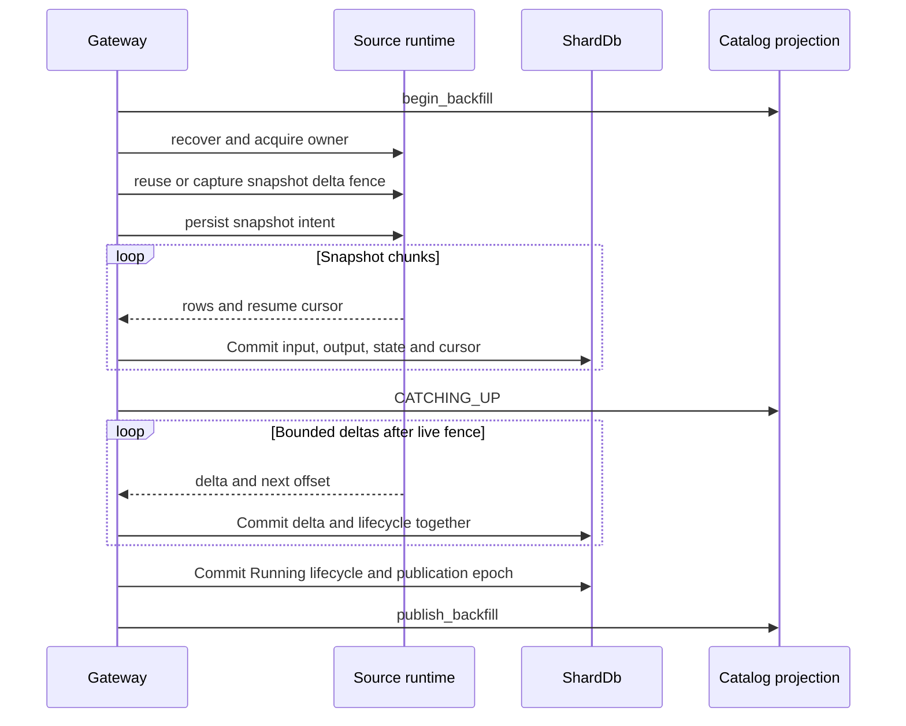

# View lifecycle, backfill, and schema changes

A view has several distinct kinds of state: its catalog definition and dependencies, its process-local compiled pipeline, its persisted operator arrangements and output, and (for source-backed materialized views) its durable ingestion cursor and publication lifecycle. Keeping these separate explains why a catalog entry alone does not guarantee live maintenance, and why successful compilation does not guarantee that backfill is readable yet.

## SQL definitions versus executable views

**Do not interpret ordinary `CREATE VIEW` as an inline-only object in the current gateway.** Dispatch sends `CREATE VIEW`, `CREATE MATERIALIZED VIEW`, and their `OR REPLACE` forms to the same `handle_create_view`. With a local `ShardDb`, both forms must compile into an executable operator pipeline and both receive initial population from already-committed data. Materialized creation additionally starts tracked backfill and the source-binding path. The gateway catalog's `CatalogView` stores SQL, columns, namespace, and optional sink `op_id`; registration does not persist a separate materialized/plain discriminator.

“Inline expansion” is a **compilation mechanism**, not an alternative lifecycle for ordinary gateway views. `inline_view_dependencies` recursively substitutes catalog view SQL into `FROM`/`JOIN` subqueries, preserving aliases, with a depth budget of 16. Compilation then requires the resulting dependencies to resolve to base tables. The original, unexpanded dependency names remain in the catalog for cycle detection and update reachability. There is no legacy DataFusion materializer fallback when local compilation fails.

Execution ownership depends on deployment:

| Gateway setup | Creation behavior |
|---|---|
| Local `ShardDb` | Compile the query under a `ViewSink`, cache it in `compiled_views`, record the sink ID, then populate it. Unsupported local shapes fail with `RS-1019` before catalog registration. |
| Standalone gateway without local shard storage | Register the definition without local compilation; serve output through `ViewReader`, rather than maintaining a local pipeline. |
| Distributed data plane | Inline dependencies, require base-table inputs and supported aggregate or aggregate-over-equi-join routing, then deploy a plan with a stable distributed sink ID. |

Sources: [dispatch and creation](../../crates/rockstream-gateway/src/server.rs#L5426-L5434), [creation implementation](../../crates/rockstream-gateway/src/server.rs#L7857-L8248), [dependency expansion](../../crates/rockstream-gateway/src/server.rs#L18467-L18531), [catalog registration](../../crates/rockstream-gateway/src/catalog_stubs.rs#L905-L963).

## Creation and initial population

Creation first checks duplicate handling (`IF NOT EXISTS` is a no-op), rejects dependency cycles with `RS-1011`, and checks any requested workload exists. It infers initial column names and compiles before registering the local executable view. Catalog registration records the SQL, original dependencies, columns, and sink `op_id` and emits durable catalog mutations when a durable store is configured.

The compiled sink writes signed Z-set output under `ViewOutput`, keyed by operator ID, epoch, and row index. A separate **view directory** maps the human view name to `(op_id, num_cols, pk)`, so a read-only shard reader can resolve published output without sharing the writer's in-memory catalog. That directory is not the compiled pipeline itself.

For existing SQL-table data, `populate_compiled_view_from_scratch` feeds a bounded full scan as the initial delta; join views scan both inputs. It writes output and persists stateful arrangements. This is the initial-population scan, not the normal per-commit update strategy. Subsequent commits feed signed row deltas, including delete/insert pairs for updates, through the pipeline.

Durability boundaries deserve care: `CatalogStubs::persist_mutations` does not propagate catalog commit errors and may spawn persistence on a current-thread runtime. Failure to write a view directory entry is logged as a warning, and published/multi-shard reads may consequently return no rows. These paths should not be described as an atomic DDL transaction spanning catalog, directory, and backfill.

Sources: [sink encoding](../../crates/rockstream-ops/src/sink.rs#L1-L17), [view directory](../../crates/rockstream-ops/src/sink.rs#L548-L634), [initial population and deltas](../../crates/rockstream-gateway/src/server.rs#L2881-L3062), [catalog persistence](../../crates/rockstream-gateway/src/catalog_stubs.rs#L857-L887).

## Source backfill: snapshot, catch-up, publication

For a materialized view directly depending on bound sources, creation uses the source runtime instead of independently rescanning and double-writing imported table data. The generic `backfill_bound_source` path recovers runtime state, acquires an owner lease, captures or reuses a `SnapshotDeltaFence`, and persists snapshot intent before consuming chunks. Recovery resumes snapshotting from the last key or skips directly to catch-up when that is the durable phase.

The generic bound-source path advances durable cursor and execution state together before projecting the view as published.

Accepted backfill batches use the source runtime's M3 commit boundary: imported table input, view output, operator state, checkpoint, cursor, lifecycle, and frontier belong to the same write. Catch-up polls are bounded by `BACKFILL_BATCH_MAX_ROWS` and `BACKFILL_LIVE_DELTA_MAX_BYTES`; excess buffered delta bytes return `RS-4020`. A final empty commit records `BackfillPhase::Running` and its publication epoch before `publish_backfill` exposes the view.

The catalog projection begins as `BackfillingFromEpoch(0)` with `SNAPSHOTTING` progress, changes to `CATCHING_UP`, and becomes `Running` only on publication. Creation failures after registration can leave a defined but unpublished view and return `RS-4022`; they are not equivalent to pre-registration compile rejection. Read paths reject unpublished backfill rather than silently treating partial output as complete. Inspect `SHOW BACKFILL STATUS FOR MATERIALIZED VIEW ...` and `SHOW VIEW STATUS FOR NAMESPACE ...` alongside source status.

Sources: [generic fenced backfill](../../crates/rockstream-gateway/src/server.rs#L3064-L3257), [creation failure/publication handling](../../crates/rockstream-gateway/src/server.rs#L8184-L8246), [catalog lifecycle projection](../../crates/rockstream-gateway/src/catalog_stubs.rs#L3028-L3097), [unpublished read response](../../crates/rockstream-gateway/src/server.rs#L15158-L15167).

### PostgreSQL CDC uses a shared source owner

`pgoutput` is source-scoped, not one replication-slot consumer per view. `SourceIdentityV1` incorporates canonical host, port, database, slot, publication, authentication principal, and credential reference; its hash supplies the connector ID. Durable physical-slot binding rejects another identity claiming the same host/port/database/slot with `RS-4013`. Aliases and dependent views sharing a coordinator must share one shard.

For a new coordinator, the gateway captures a source-wide snapshot of registered relations and commits its rows and relation routes as a synthetic envelope at the snapshot LSN. For an additional view on an existing coordinator, `backfill_attached_pgoutput_view` locks the coordinator and shard commit path, initializes from **local imported table state**, and commits the view attachment at the coordinator's committed offset. It does not create an independent upstream snapshot/slot reader for that view.

Do not confuse this with the separate shared-arrangement attachment primitive: `AttachedView::attach` reads a trace snapshot pinned at a frontier, registers a consumer frontier, and drains only buffered deltas above the pin. Its bounded buffer returns `RS-4020` on overflow. That zero-source-rescan primitive is an extension mechanism, not evidence that every SQL view installation uses a shared trace. Likewise, `ViewRefOp` can tail an upstream sink's epoch deltas, but current gateway view-on-view compilation uses SQL expansion.

Sources: [source identity and binding](../../crates/rockstream-gateway/src/pgoutput_coordinator.rs#L20-L154), [worker ownership](../../crates/rockstream-gateway/src/server.rs#L3955-L4039), [snapshot and local attachment](../../crates/rockstream-gateway/src/server.rs#L3495-L3751), [shared trace attachment](../../crates/rockstream-ops/src/view_attach.rs), [epoch tailing](../../crates/rockstream-ops/src/view_ref.rs#L1-L106).

## Dependencies and schema propagation

Dependency reachability starts from changed relations and expands through catalog edges. `reachable_compiled_views` topologically orders reachable executable views. In the pgoutput envelope path, imported-table deltas feed affected published/activating views, each output delta becomes available to downstream views, and output plus arrangements are appended to the same batch. Plan-level DAG utilities also detect cycles and produce source-before-dependent order; they are distinct from the gateway's catalog-name graph.

### Compatible is specific to the boundary

Use the canonical [schema-evolution cookbook](../../docs/schema-evolution.md) for migration guidance: compatible changes stay in place; breaking changes require a new view or source migration, rather than destructive reinterpretation of existing data. There is **not one universal classifier**:

| Boundary | Actual compatibility rule |
|---|---|
| SQL `SchemaCatalog` view entry | Existing columns must retain name, order, and exact type string, and the new list cannot be shorter. An accepted replacement increments `schema_version`; a rejected replacement returns `RS-1002` before writing the replacement. The implementation does not enforce the stricter nullable-addition language in its comments. |
| PostgreSQL `RelationRoute` | Preserve relation/imported-table identity, replica identity, and the existing column-name/key prefix. Allow lossless types (`int4` to `int8`, or supported text modifier widening) and append columns that are nullable **or defaulted**. Drop, rename/reorder, key identity change, and narrowing are breaking. |
| Generic `rockstream_types::schema_evolution` descriptors | Classifies nullable additions and type-tag widening, checks nullability and merge-law identity/version, and models clone/backfill/flip replacement. These types do not imply automatic gateway DDL migration. |

Gateway `CREATE OR REPLACE VIEW` uses its creation path; it does not call `SchemaCatalog::register_view`. Do not assume the latter's versioning checks protect every gateway replacement, or that changing an upstream SQL definition automatically recompiles all already-cached downstream plans.

Sources: [gateway ordering](../../crates/rockstream-gateway/src/server.rs#L2821-L2879), [envelope propagation](../../crates/rockstream-gateway/src/server.rs#L4550-L4651), [plan DAG utilities](../../crates/rockstream-plan/src/dag.rs#L79-L150), [SQL classifier and registration](../../crates/rockstream-sql/src/catalog.rs#L149-L167), [versioned replacement](../../crates/rockstream-sql/src/catalog.rs#L233-L327), [route classifier](../../crates/rockstream-gateway/src/pgoutput_coordinator.rs#L218-L257), [lossless types](../../crates/rockstream-gateway/src/pgoutput_coordinator.rs#L758-L764), [generic evolution model](../../crates/rockstream-types/src/schema_evolution.rs).

### Relation routing and fail-closed CDC changes

The worker matches a PostgreSQL Relation message's namespace/name to configured source aliases. It stages a durable route from relation ID to imported table and columns; unrelated relations are staged as unrouted. Unsupported column metadata or an incompatible route triggers blocking instead of reinterpreting rows under a changed schema.

Route changes travel with the transaction envelope. Row changes carry a schema version, which must match the staged or durable route. The commit combines imported rows, affected view output/state, route updates/history, frontier, per-view lifecycles, and source offset through `commit_replayable_epoch`. The in-memory imported-table column projection is updated after that commit.

A breaking change persists `BlockedRelationState` with `RS-1002`, transaction ID, offending relation metadata, and `last_safe_lsn`, flushes it, then blocks the coordinator. The worker marks aliases blocked, restores compiled pipeline state from storage, closes pgoutput, and releases its owner lease. On restart or resume, durable blocked state prevents reopening normal ingestion. Thus the safe committed output/checkpoint is preserved, but a breaking relation can stop progress for the **shared source**, not merely one downstream view. The blocked record includes a suggested rebuild procedure; a simple resume is not a schema migration.

Sources: [relation staging and blocking](../../crates/rockstream-gateway/src/server.rs#L4332-L4494), [transaction commit](../../crates/rockstream-gateway/src/server.rs#L4497-L4756), [worker failure handling](../../crates/rockstream-gateway/src/server.rs#L4196-L4210), [blocked-state recovery](../../crates/rockstream-gateway/src/server.rs#L4009-L4025).

## Restart, pause/resume, and drop ownership

**Restart rebuilds execution, not only metadata.** `recover_compiled_views` recompiles catalog entries with a durable `op_id` into the process-local `compiled_views` map. It reuses the sink ID and deterministic view-scoped stage IDs so restored arrangements address the old keys. Source-backed views reload durable lifecycle records, publish/start workers if already running, or continue backfill otherwise.

The current recovery loop logs arrangement-restore failures and still inserts the compiled pipeline; failed recompilation is logged and leaves the view without live incremental refresh. This is weaker than a universal fail-closed readiness guarantee. Compiled-plan identity records separately preserve SQL, AST hash, logical-plan hash, compiler version, state-layout version, output schema, and dependency IDs. Identity tests verify persistence and compatibility/dependency rejection, but their readiness test drives a `LifecycleTracker` directly—it does not prove `recover_compiled_views` turns all restore warnings into fatal readiness failures.

Operational controls have different owners:

- **View state:** `ViewState` represents running, paused, backfilling, and over-budget states. CLI view pause/resume delegates to `CatalogApi`; the remote transport currently returns `RS-0004` for these mutations. Do not equate the existence of the enum or local CLI tests with a functioning remote per-view pause protocol.
- **Source pause/resume:** gateway `ALTER SOURCE ... PAUSE` changes source status; pgoutput workers stop/close ownership when no active aliases remain. Resume sets status to `OK` and can spawn a pgoutput worker for a dependent view. Shared ownership means pausing one alias is not inherently pausing every alias on the slot.
- **View drop:** gateway drop removes catalog registration and the local compiled-cache entry. This handler does not itself delete sink output/directory keys or issue an upstream slot drop; do not use it as a storage reclamation guarantee.
- **Source drop:** PostgreSQL CDC sources with dependent views are rejected with `RS-4013`. After removing the last registered alias, the gateway attempts durable coordinator cleanup and registry removal. Running PostgreSQL identity options are rejected as immutable; pause/drain/rebind is required rather than a live identity switch.

Sources: [compiled-cache recovery](../../crates/rockstream-gateway/src/server.rs#L2580-L2733), [identity tests](../../crates/rockstream-gateway/tests/compiled_plan_identity_tests.rs), [view states](../../crates/rockstream-types/src/view_lifecycle.rs#L31-L45), [CLI delegation](../../crates/rockstream-cli/src/lib.rs#L1496-L1517), [remote mutation boundary](../../crates/rockstream-cli/src/transport.rs#L1423-L1439), [source controls](../../crates/rockstream-gateway/src/server.rs#L9295-L9391), [worker closure](../../crates/rockstream-gateway/src/server.rs#L4081-L4103), [view drop](../../crates/rockstream-gateway/src/server.rs#L8253-L8321).

## Focused verification and related reading

- [PostgreSQL schema evolution tests](../../crates/rockstream-gateway/tests/postgres_cdc_schema_evolution_tests.rs) exercise route history for nullable/defaulted additions and integer/text widening, plus breaking-change classification. Distinguish these route-level tests from end-to-end upstream DDL execution.
- [Compiled plan identity tests](../../crates/rockstream-gateway/tests/compiled_plan_identity_tests.rs) cover durable identity round trips, version mismatch, missing dependencies, and the readiness state model.
- [Schema cookbook](../../docs/schema-evolution.md) links the SQL/LFS catalog acceptance and rejection tests.

For context, see [incremental SQL execution](../architecture/incremental-sql-engine.md), [storage and replay](../concepts/storage-and-replay.md), [source ingestion](../integrations/source-ingestion.md), [PostgreSQL request handling](postgres-requests.md), and [diagnostics and recovery](../operations/diagnostics-and-recovery.md).
